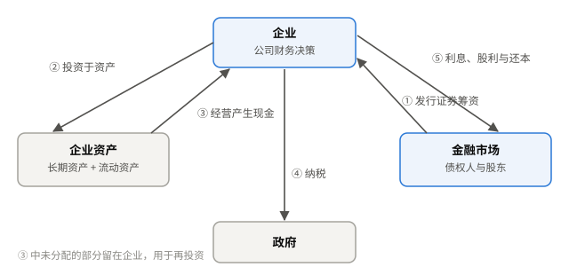

# 第 1 讲 公司金融导论

Introduction to Corporate Finance

## 1.1 公司金融的三大决策 Corporate Finance Decisions { data-toc-label="1.1 公司金融的三大决策" }

| 决策 | 回答的问题 | 对应资产负债表 |
| --- | --- | --- |
| 资本预算 Capital Budgeting | 投资哪些长期项目？ | 资产端的长期资产 |
| 资本结构 Capital Structure | 用多少债务、多少权益融资？ | 长期负债与股东权益 |
| 营运资本管理 Working Capital Management | 如何管理现金、应收、存货和短期负债？ | 流动资产与流动负债 |

净营运资本
:   流动资产 − 流动负债（net working capital）。

{ .cf-fig }

**图 1 现金在企业与金融市场之间的流动。**企业向投资者发行证券筹资，投资于资产；资产产生的现金用于纳税、支付利息与股利、偿还本金，其余留在企业再投资。
{ .cf-caption }

判断投资是否值得，要同时考虑现金流的大小、时间和风险。

## 1.2 企业组织形式 Forms of Business Organization { data-toc-label="1.2 企业组织形式" }

| 形式 | 优势 | 劣势 |
| --- | --- | --- |
| 个人独资 Sole Proprietorship | 设立容易，所有者直接控制 | 无限责任；融资、存续和转让受限 |
| 合伙 Partnership | 汇集多人的资金与能力 | 普通合伙人承担无限责任；转让受合伙协议约束 |
| 公司 Corporation | 独立法人，股东有限责任；易转让、易融资、可持续经营 | 所有权与经营权分离，产生代理问题；可能双重征税 |

普通合伙人 GP
:   承担无限连带责任，通常负责经营管理（general partner）。

有限合伙人 LP
:   以认缴出资额为限承担责任，不执行合伙事务（limited partner）。

!!! warning "易错"

    合伙人并非都承担有限责任；公司股东的有限责任也有例外，例如股东滥用法人独立地位时。

## 1.3 财务管理目标 Goal of Financial Management { data-toc-label="1.3 财务管理目标" }

目标
:   最大化现有股东权益的每股当前价值。

| 替代指标 | 为什么不够 |
| --- | --- |
| 当期利润最大 | 忽略未来价值、现金流的时间与风险 |
| 成本最低、规模最大 | 削减必要投入或盲目扩张都可能损害价值 |
| 当期股价最高 | 市场价格可能短期偏离内在价值 |

市场价格
:   股票当前的实际成交价格。

内在价值
:   依据基本面对公司价值的估计（intrinsic value）。两者可能偏离。

## 1.4 代理问题 Agency Problem { data-toc-label="1.4 代理问题" }

代理关系
:   委托人授权代理人代其行事（principal–agent relationship）。公司中，股东是委托人，经理是代理人。

代理问题
:   双方利益不一致：经理可能追求个人待遇、职位安全或企业规模，而非股东财富。

代理成本
:   监督经理的成本，以及利益不一致造成的价值损失（agency costs）。

| 缓解机制 | 作用 | 前提 |
| --- | --- | --- |
| 薪酬与股权激励 | 把经理收益与股价挂钩 | 考核目标设计合理 |
| 公司控制权市场 | 业绩差的公司可能被收购，管理层被替换 | 外部约束，不能替代内部治理 |
| 机构投资者与积极股东 | 监督、沟通、推动变革 | 持股规模和监督能力足够 |
| 独立董事 | 监督与专业咨询，保护中小股东 | 实质独立，并有能力和时间履职 |

!!! example "例 · 限制性股票"

    公司授予经理股票，但设锁定期，按业绩条件分批解锁。经理只有在公司业绩达标、股价上涨时才能获益，从而与股东利益一致。

## 1.5 公司治理 Corporate Governance { data-toc-label="1.5 公司治理" }

### 独立董事

定义
:   除董事外不在公司任其他职务，且与公司及其主要股东不存在可能妨碍独立判断的关系的董事。

职责
:   参与决策、监督制衡、专业咨询，尤其关注中小股东利益。

| 规定 | 兼任上限 | 义务表述 |
| --- | --- | --- |
| 2001 年《关于在上市公司建立独立董事制度的指导意见》 | 原则上 5 家上市公司 | 诚信与勤勉 |
| 2023 年《上市公司独立董事管理办法》 | 原则上 3 家境内上市公司 | 忠实与勤勉 |

### 监事会与审计委员会

监事会
:   检查公司财务，监督董事与高管，可要求纠正损害公司利益的行为。

审计委员会
:   2023 年修订的《公司法》允许股份有限公司按章程在董事会设审计委员会，行使监事会职权，不设监事会。成员不少于 3 名，过半数不得在公司担任董事以外的职务。

!!! warning "易错"

    审计委员会替代监事会是"可以"而非"必须"，要依法、依章程确定。

### 独立董事有没有用

- 独董比例与公司业绩相关，不能直接说明因果：业绩差的公司可能主动增加独董，经理也可能影响独董人选。
- 用独董意外去世这类外生事件做研究：去世后公司股价下跌，说明独董平均而言有价值，但不代表每位独董都有效。

## 1.6 控股股东与掏空 Tunneling { data-toc-label="1.6 控股股东与掏空" }

掏空
:   控股股东利用控制权，把公司资源转移给自己（tunneling），损害中小股东利益。

常见手段：

- 直接占用公司资金
- 让上市公司为大股东担保，违约时由公司代偿
- 低价从公司买入资产，或高价向公司卖出资产
- 长期拖欠关联交易款项

识别指标
:   其他应收款 ÷ 总资产（ORECTA）。比例越高，后续业绩越差、越可能被退市。

!!! warning "易错"

    ORECTA 高是风险信号，不是掏空的证据，仍需核查关联方明细和资金流向。

## 1.7 自测 Quick Quiz { data-toc-label="1.7 自测" }

!!! question "1. 公司金融的三大决策分别对应资产负债表的哪一部分？"

    ??? success "参考答案"

        资本预算对应长期资产；资本结构对应长期负债与股东权益；营运资本管理对应流动资产与流动负债。

!!! question "2. 为什么不以利润最大化作为财务管理目标？"

    ??? success "参考答案"

        利润是会计数字，不考虑现金流的时间与风险，也可能以牺牲未来价值为代价。股东关心的是股票的当前价值。

!!! question "3. 经理为保住职位拒绝有利的收购，控股股东占用上市公司资金，分别属于哪类冲突？"

    ??? success "参考答案"

        前者是经理与股东之间的代理冲突；后者是控股股东与中小股东之间的冲突。

!!! question "4. 增加独立董事人数一定能改善公司业绩吗？"

    ??? success "参考答案"

        不一定。要看独董是否实质独立、是否有能力和时间履职；而且相关不等于因果。
