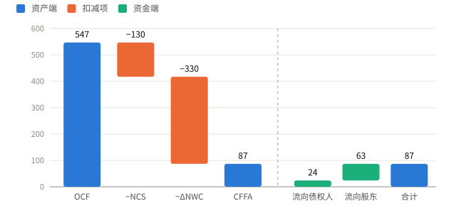

# 第 2 讲 财务报表与现金流量

Financial Statements and Cash Flow

## 2.1 资产负债表 Balance Sheet { data-toc-label="2.1 资产负债表" }

$$
\text{资产} = \text{负债} + \text{所有者权益}
$$

含义
:   某一**时点**的资产、负债与权益。权益是资产扣除负债后的剩余索取权。

| 分析角度 | 要点 |
| --- | --- |
| 流动性 Liquidity | 资产能否快速、不明显折价地变现。流动性高利于偿债，但持有现金有机会成本 |
| 债务与权益 Debt vs. Equity | 债权人优先受偿，股东承担剩余风险；负债越多，财务杠杆越高 |
| 账面价值与市场价值 Book vs. Market Value | 账面价值按会计规则计量；决策应看市场价值 |

## 2.2 利润表 Income Statement { data-toc-label="2.2 利润表" }

含义
:   一段**期间**的收入、费用与利润。收入和费用的确认时点不一定是现金收付时点。

$$
\text{收入} - \text{销售成本} - \text{折旧} = EBIT
\qquad
EBIT - \text{利息} - \text{税} = \text{净利润}
$$

!!! example "例 A（单位：百万美元）"

    | 项目 | 计算 | 结果 |
    | --- | --- | ---: |
    | 息税前利润 EBIT | 1,509 − 750 − 65 | 694 |
    | 应税所得 | 694 − 70 | 624 |
    | 净利润 | 624 − 212 | 412 |
    | 留存收益增加 | 412 − 103（股利） | 309 |

!!! warning "易错"

    折旧是非现金费用，算现金流时要加回；但购置资产时的支出仍要作为资本支出扣除。

## 2.3 平均税率与边际税率 Average vs. Marginal Tax Rate { data-toc-label="2.3 平均税率与边际税率" }

平均税率
:   应纳税额 ÷ 应税所得，反映整体税负。

边际税率
:   多赚 1 元需多交的税，评价新项目时用边际税率。

!!! example "例"

    按美国旧版公司所得税累进税表，应税所得 11,000,000 应纳税 3,750,000，平均税率 34.09%，边际税率 35%。再多赚 1,000,000 仍在同一税档，新增税额 350,000。

!!! warning "易错"

    新增所得若跨越税档，要分段计算，不能用一个边际税率乘全部增量。

## 2.4 净营运资本 Net Working Capital { data-toc-label="2.4 净营运资本" }

$$
NWC = \text{流动资产} - \text{流动负债}
\qquad
\Delta NWC = NWC_{\text{期末}} - NWC_{\text{期初}}
$$

ΔNWC > 0 表示占用了更多资金，计算现金流时扣除；ΔNWC < 0 表示释放资金，计算时加回。

## 2.5 资产现金流 Cash Flow from Assets { data-toc-label="2.5 资产现金流" }

$$
CFFA = OCF - NCS - \Delta NWC = CF_{\text{债权人}} + CF_{\text{股东}}
$$

| 组成 | 公式 |
| --- | --- |
| 经营现金流 OCF Operating Cash Flow | EBIT + 折旧 − 税 |
| 净资本支出 NCS Net Capital Spending | 期末净固定资产 − 期初净固定资产 + 折旧 |
| 净营运资本变动 ΔNWC | 期末 NWC − 期初 NWC |
| 流向债权人 | 利息 − 净新增借款 |
| 流向股东 | 股利 − 净新增股权融资 |

CFFA 为负，说明企业需要从外部筹资。

!!! example "例 A 续（单位：百万美元）"

    流动资产期初 1,112、期末 1,403；流动负债期初 428、期末 389；净固定资产期初 1,644、期末 1,709；长期负债期初 408、期末 454；普通股期初 600、期末 640。

    | 资产端 | 计算 | 结果 |
    | --- | --- | ---: |
    | OCF | 694 + 65 − 212 | 547 |
    | NCS | 1,709 − 1,644 + 65 | 130 |
    | ΔNWC | (1,403 − 389) − (1,112 − 428) | 330 |
    | CFFA | 547 − 130 − 330 | 87 |

    | 资金端 | 计算 | 结果 |
    | --- | --- | ---: |
    | 流向债权人 | 70 − (454 − 408) | 24 |
    | 流向股东 | 103 − (640 − 600) | 63 |
    | 合计 | 24 + 63 | 87 |

    两端相等。

{ .cf-fig }

**图 1 资产现金流的分解。**OCF 547 扣除净资本支出 130 和营运资本增加 330，剩下 CFFA 87，正好分配给债权人 24 和股东 63。
{ .cf-caption }

!!! warning "易错"

    - OCF 不扣利息，利息属于流向债权人的现金。
    - 净新增股权融资不含留存收益。
    - 本例把应付票据计入 NWC，借款只看长期负债。若把短期借款算作借款，就要同时从 NWC 中剔除。

## 2.6 现金流量表 Statement of Cash Flows { data-toc-label="2.6 现金流量表" }

$$
\Delta\text{现金} = CFO + CFI + CFF
$$

会计上的现金流量表把现金变动分为经营、投资、筹资三类。按美国会计准则，支付的利息计入经营活动。

!!! example "例 A 续"

    应收账款增加 233，存货增加 2，应付账款增加 34，应付票据减少 73。

    | 类别 | 计算 | 结果 |
    | --- | --- | ---: |
    | 经营活动 CFO | 412 + 65 − 233 − 2 + 34 | 276 |
    | 投资活动 CFI | −(1,709 − 1,644 + 65) | −130 |
    | 筹资活动 CFF | 46 − 73 − 103 + 40 | −90 |
    | 现金增加 | 276 − 130 − 90 | 56 |

| 指标 | 例 A | 含义 |
| --- | ---: | --- |
| 净利润 | 412 | 会计利润 |
| OCF | 547 | 经营产生的现金，未扣利息 |
| CFO | 276 | 会计口径，已扣利息并调整应收、存货、应付 |
| CFFA | 87 | 可分配给债权人和股东的现金 |
| 现金增加 | 56 | 资产负债表上现金余额的变化 |

利润不等于现金，CFFA 也不等于现金余额的增加。

## 2.7 公式速查 Formulas { data-toc-label="2.7 公式速查" }

| 指标 | 公式 |
| --- | --- |
| 会计恒等式 | 资产 = 负债 + 所有者权益 |
| NWC | 流动资产 − 流动负债 |
| OCF | EBIT + 折旧 − 税 |
| NCS | 期末净固定资产 − 期初净固定资产 + 折旧 |
| CFFA | OCF − NCS − ΔNWC |
| 流向债权人 | 利息 − 净新增借款 |
| 流向股东 | 股利 − 净新增股权融资 |

## 2.8 自测 Quick Quiz { data-toc-label="2.8 自测" }

!!! question "1. 例 A 中净利润 412，现金只增加了 56，差额来自哪里？"

    ??? success "参考答案"

        加回折旧 65；应收和存货增加占用 235，应付增加提供 34；资本支出 130；偿还应付票据 73、支付股利 103，新增长期借款 46 和股本 40 部分抵消。

!!! question "2. NWC 增加时，计算 CFFA 要加回还是扣除？"

    ??? success "参考答案"

        扣除。NWC 增加意味着资金被占用。

!!! question "3. 新项目带来的增量所得应按哪种税率计税？"

    ??? success "参考答案"

        边际税率；跨税档时分段计算。

!!! question "4. 某公司 OCF 300，NCS 120，ΔNWC 30，利息 40，净新增借款 10，求 CFFA 和流向股东的现金。"

    ??? success "参考答案"

        CFFA = 300 − 120 − 30 = 150；流向债权人 = 40 − 10 = 30；流向股东 = 150 − 30 = 120。
