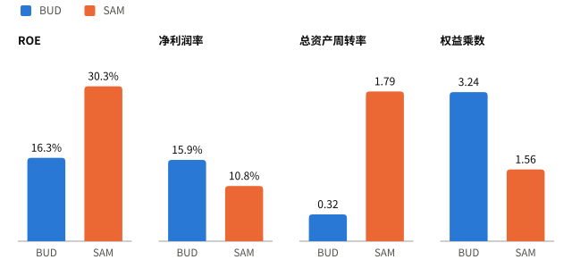
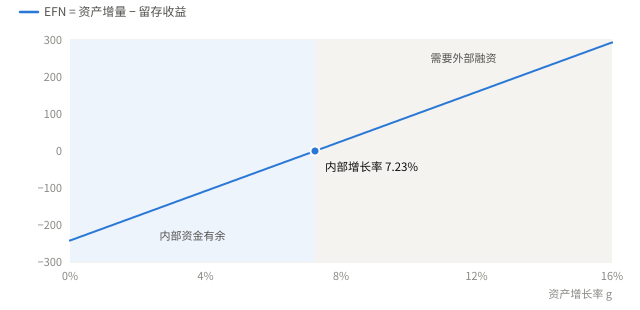

# 第 3 讲 财务报表分析与财务模型

Financial Statements Analysis and Long-Term Planning

## 3.1 共同比报表 Common-Size Statements { data-toc-label="3.1 共同比报表" }

共同比资产负债表
:   各项目 ÷ 总资产。

共同比利润表
:   各项目 ÷ 销售收入，看每 1 元销售额的去向。

作用
:   消除规模差异，便于比较不同年份、不同规模的公司。

!!! example "例"

    存货 218,000，总资产 647,700，所有者权益 421,800，销售收入 587,200。存货的共同比百分比 = 218,000 ÷ 647,700 = 33.66%。权益和销售收入是干扰项。

## 3.2 财务比率 Ratio Analysis { data-toc-label="3.2 财务比率" }

本节统一用 Prufrock 公司的数据（单位：百万美元）。

!!! example "例 A · Prufrock 公司"

    | 资产负债表 | 金额 | 利润表 | 金额 |
    | --- | ---: | --- | ---: |
    | 现金 | 98 | 销售收入 | 2,311 |
    | 应收账款 | 188 | 销售成本 | 1,344 |
    | 存货 | 422 | 折旧 | 276 |
    | 流动资产 | 708 | EBIT | 691 |
    | 固定资产净值 | 2,880 | 利息 | 141 |
    | 总资产 | 3,588 | 税 | 187 |
    | 流动负债 | 540 | 净利润 | 363 |
    | 长期负债 | 457 | 股利 | 121 |
    | 所有者权益 | 2,591 | 留存收益增加 | 242 |

    另：股价 88 美元，流通股 33 百万股。

### 短期偿债能力 Liquidity Ratios { data-toc-label="短期偿债能力" }

| 比率 | 公式 | 例 A |
| --- | --- | ---: |
| 流动比率 Current Ratio | 流动资产 ÷ 流动负债 | 1.31 |
| 速动比率 Quick Ratio | (流动资产 − 存货) ÷ 流动负债 | 0.53 |
| 现金比率 Cash Ratio | 现金 ÷ 流动负债 | 0.18 |

三个比率的分子依次剔除变现较慢的资产，标准越来越严格。

!!! warning "易错"

    用现金偿还 $x$ 的流动负债后，流动比率变为 $(CA - x)/(CL - x)$：原比率大于 1 时上升，小于 1 时下降。

### 长期偿债能力 Leverage Ratios { data-toc-label="长期偿债能力" }

| 比率 | 公式 | 例 A |
| --- | --- | ---: |
| 资产负债率 Total Debt Ratio | (总资产 − 权益) ÷ 总资产 | 0.28 |
| 负债权益比 Debt-Equity Ratio | 总负债 ÷ 权益 | 0.38 |
| 权益乘数 Equity Multiplier | 总资产 ÷ 权益 = 1 + D/E | 1.38 |
| 利息保障倍数 Times Interest Earned | EBIT ÷ 利息 | 4.90 |
| 现金保障倍数 Cash Coverage | (EBIT + 折旧) ÷ 利息 | 6.86 |

EBIT 不是可用于付息的现金，所以现金保障倍数加回折旧。

### 资产管理能力 Turnover Ratios { data-toc-label="资产管理能力" }

| 比率 | 公式 | 例 A |
| --- | --- | ---: |
| 存货周转率 Inventory Turnover | 销售成本 ÷ 存货 | 3.18 次 |
| 存货周转天数 | 365 ÷ 存货周转率 | 115 天 |
| 应收账款周转率 Receivables Turnover | 销售收入 ÷ 应收账款 | 12.29 次 |
| 应收账款周转天数 | 365 ÷ 应收账款周转率 | 30 天 |
| 总资产周转率 Total Asset Turnover | 销售收入 ÷ 总资产 | 0.64 次 |
| 资本密集度 Capital Intensity | 总资产 ÷ 销售收入 | 1.55 |

!!! warning "易错"

    存货周转率的分子是**销售成本**，应收账款周转率的分子是**销售收入**。

### 盈利能力 Profitability Ratios { data-toc-label="盈利能力" }

| 比率 | 公式 | 例 A |
| --- | --- | ---: |
| 净利润率 Profit Margin | 净利润 ÷ 销售收入 | 15.71% |
| EBITDA 利润率 | (EBIT + 折旧) ÷ 销售收入 | 41.84% |
| 资产收益率 ROA | 净利润 ÷ 总资产 | 10.12% |
| 权益收益率 ROE | 净利润 ÷ 权益 | 14.01% |

### 市场价值 Market Value Ratios { data-toc-label="市场价值" }

| 比率 | 公式 | 例 A |
| --- | --- | ---: |
| 每股收益 EPS | 净利润 ÷ 流通股数 | 11.00 |
| 市盈率 P/E | 股价 ÷ EPS | 8.00 |
| 市销率 P/S | 股价 ÷ 每股销售收入 | 1.26 |
| 每股账面价值 | 权益 ÷ 流通股数 | 78.52 |
| 市净率 M/B | 股价 ÷ 每股账面价值 | 1.12 |

!!! warning "易错"

    亏损公司的市盈率没有意义；权益为负时市净率也失去通常含义。

### 比率要和什么比

- **趋势分析**：与本公司历史比较。
- **同业比较**：与同行业公司比较，按 SIC 或 NAICS 行业代码分组。

局限：缺乏理论指导选哪些比率；多元化公司难找可比对象；各国会计准则、会计政策和会计年度不同；一次性事件会扭曲比率。

## 3.3 杜邦恒等式 DuPont Identity { data-toc-label="3.3 杜邦恒等式" }

$$
ROE = \underbrace{\frac{\text{净利润}}{\text{销售收入}}}_{\text{净利润率}} \times \underbrace{\frac{\text{销售收入}}{\text{总资产}}}_{\text{总资产周转率}} \times \underbrace{\frac{\text{总资产}}{\text{权益}}}_{\text{权益乘数}}
$$

| 因子 | 衡量 |
| --- | --- |
| 净利润率 | 经营效率：成本控制 |
| 总资产周转率 | 资产使用效率 |
| 权益乘数 | 财务杠杆 |

!!! example "例 A"

    $ROE = 15.71\% \times 0.644 \times 1.385 = 14.01\%$，与直接计算的 363 ÷ 2,591 一致。

!!! example "例 B · BUD 与 SAM（2010 年）"

    | | ROE | 净利润率 | 总资产周转率 | 权益乘数 |
    | --- | ---: | ---: | ---: | ---: |
    | BUD | 16.3% | 15.9% | 0.32 | 3.24 |
    | SAM | 30.3% | 10.8% | 1.79 | 1.56 |

    BUD 靠高利润率和高杠杆，SAM 靠高周转。

{ .cf-fig }

**图 1 杜邦分解。**SAM 的 ROE 更高，主要来自约 5.6 倍于 BUD 的总资产周转率；BUD 的利润率和杠杆都更高。
{ .cf-caption }

同样的 ROE 可以来自完全不同的因子组合；杠杆推高的 ROE 伴随更高的财务风险。

## 3.4 财务计划与外部融资需求 Financial Planning & EFN { data-toc-label="3.4 财务计划与外部融资需求" }

财务计划的要素
:   销售预测、预计报表、资产需求、融资需求，以及让资产负债表配平的调节变量（plug variable）。

销售百分比法
:   假设部分项目与销售收入同比例变动，据此编制预计报表（percentage of sales approach）。

| 随销售变动 | 不随销售变动 |
| --- | --- |
| 成本、各项资产、应付账款（自发性负债） | 应付票据、长期负债、股本：取决于融资决策 |
| | 股利：取决于股利政策 |

股利支付率
:   股利 ÷ 净利润，记为 $d$。

留存比率
:   留存收益增加 ÷ 净利润，记为 $b = 1 - d$。

$$
EFN = \frac{\text{资产}}{\text{销售收入}}\Delta S - \frac{\text{自发性负债}}{\text{销售收入}}\Delta S - PM \times S_{\text{预计}} \times b
$$

三项依次为：新增资产需求、自发性负债提供的资金、留存收益提供的资金。

!!! example "例"

    资产/销售 = 3，自发性负债/销售 = 0.3，净利润率 13%，股利支付率 1/3；销售收入从 1,000 增至 1,250。

    $$
    EFN = 3 \times 250 - 0.3 \times 250 - 0.13 \times 1{,}250 \times \tfrac{2}{3} = 750 - 75 - 108.33 = 566.67
    $$

!!! warning "易错"

    存在闲置产能时，销售增长不一定需要新增固定资产，资产需求要重新估计。

## 3.5 内部增长率与可持续增长率 Internal & Sustainable Growth { data-toc-label="3.5 内部增长率与可持续增长率" }

$$
IGR = \frac{ROA \times b}{1 - ROA \times b}
\qquad
SGR = \frac{ROE \times b}{1 - ROE \times b}
$$

| | 内部增长率 IGR | 可持续增长率 SGR |
| --- | --- | --- |
| 融资来源 | 只用留存收益 | 留存收益 + 按比例新增负债 |
| 前提 | 不进行任何外部融资 | 不发新股，负债权益比不变 |
| 大小 | 较低 | 较高 |

推导：令资产增量等于留存收益，$A \times g = NI \times b \times (1+g)$，解出 $g$ 即 IGR；把 $A$ 换成权益 $E$，得 SGR。

!!! example "例 A"

    $b = 242/363 = 2/3$。

    - $IGR = \dfrac{10.12\% \times 2/3}{1 - 10.12\% \times 2/3} = 7.23\%$
    - $SGR = \dfrac{14.01\% \times 2/3}{1 - 14.01\% \times 2/3} = 10.30\%$

    不借新债时，Prufrock 每年最多增长 7.23%；保持负债权益比不变时最多增长 10.30%。

{ .cf-fig }

**图 2 EFN 与增长率。**不考虑自发性负债时，EFN 随增长率上升；增长率低于 7.23% 时留存收益有余，高于 7.23% 就需要外部融资。
{ .cf-caption }

增长的四个决定因素
:   净利润率、总资产周转率、财务杠杆、股利政策。前三个正是杜邦分解的三个因子。

!!! warning "易错"

    上面两个公式基于期末的 ROA、ROE。若题目给的是期初口径，公式变为 $g = ROA \times b$ 或 $g = ROE \times b$，不能混用。

## 3.6 公式速查 Formulas { data-toc-label="3.6 公式速查" }

| 指标 | 公式 |
| --- | --- |
| 周转天数 | 365 ÷ 周转率 |
| 权益乘数 | 总资产 ÷ 权益 = 1 + D/E |
| 杜邦恒等式 | ROE = 净利润率 × 总资产周转率 × 权益乘数 |
| EFN | (A/S)ΔS − (自发性负债/S)ΔS − PM × S预计 × b |
| 内部增长率 | ROA·b ÷ (1 − ROA·b) |
| 可持续增长率 | ROE·b ÷ (1 − ROE·b) |

## 3.7 自测 Quick Quiz { data-toc-label="3.7 自测" }

!!! question "1. 销售收入 418,700，销售成本 264,900，存货 61,900，求存货周转天数。"

    ??? success "参考答案"

        存货周转率 = 264,900 ÷ 61,900 = 4.28 次；周转天数 = 365 ÷ 4.28 = 85.29 天。分子用销售成本，不用销售收入。

!!! question "2. 应收账款 42,900，总资产 211,800，总资产周转率 1.45，净利润率 4.2%，平均收款期是多少天？"

    ??? success "参考答案"

        销售收入 = 211,800 × 1.45 = 307,110；应收账款周转率 = 307,110 ÷ 42,900 = 7.16 次；收款期 = 365 ÷ 7.16 = 50.99 天。净利润率是干扰项。

!!! question "3. 权益 861,300，销售收入 1.48 百万，净利润率 5.2%，求 ROE。"

    ??? success "参考答案"

        净利润 = 1,480,000 × 5.2% = 76,960；ROE = 76,960 ÷ 861,300 = 8.94%。

!!! question "4. 权益 89,000，权益乘数 1.5，总资产周转率 1.3，求销售收入。"

    ??? success "参考答案"

        总资产 = 89,000 × 1.5 = 133,500；销售收入 = 133,500 × 1.3 = 173,550。

!!! question "5. 内部增长率与可持续增长率的区别是什么？"

    ??? success "参考答案"

        内部增长率只用留存收益、不做任何外部融资，用 ROA 计算；可持续增长率允许按固定负债权益比新增借款但不发新股，用 ROE 计算，因此通常更高。
