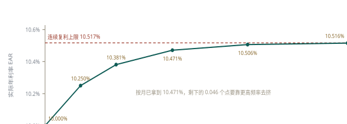
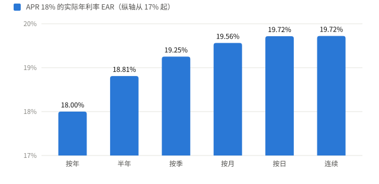
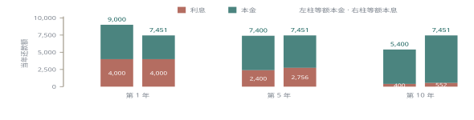

# 第 4 讲 折现现金流估值

Discounted Cash Flow Valuation

:material-file-pdf-box: [本讲 PDF 打印版](pdf/第04讲_折现现金流估值.pdf)

## 4.1 为什么折现：时间价值与单期 Time Value of Money { data-toc-label="4.1 为什么折现：时间价值与单期" }

课件用一个选择题开场：**A** 是现在拿 300，**B** 是今天、一年后、两年后各拿 100。三年下来总数一样，但 A 更好——拿到手的钱立刻能投出去，而等待本身有代价。这不是偏好问题，是三条能说清的理由。

理由
:   ① 人偏好现在的消费；② 物价会涨，未来的钱买到的东西更少；③ 未来的到账不确定。三条里任何一条成立，折现率就是正的。

终值 FV
:   今天一笔钱按某利率滚到未来某时点的金额。单期：\(FV=C_0\times(1+r)\)，\((1+r)\) 叫终值因子。

现值 PV
:   未来一笔钱折回今天的金额，是终值的逆运算：\(PV=C_1/(1+r)\)。折现与复利共用同一个因子，只是方向相反。

10,000 按 5% 存一年，得 **10,500** = 10,000 × 1.05。反过来，一年后能拿到 10,000、利率 5%，今天就值 **9,523.81** = 10,000 / 1.05。两者互为验证：9,523.81 × 1.05 正好回到 10,000。

$$
FV=C_0(1+r)\qquad PV=\frac{C_1}{1+r}\qquad \mathrm{NPV}=-\text{Cost}+PV
$$

把这两个式子拼起来就是投资决策的全部：花 9,500 买一个一年后付 10,000 的投资，\(\mathrm{NPV}=-9{,}500+10{,}000/1.05=23.81\)。正的，所以做。NPV 大于零的含义不是"赚了 23.81"，而是"扣掉资金的机会成本之后还多出 23.81"——它算的是超额收益，不是会计利润。

## 4.2 多期：复利、折现，以及反解 Compounding & Discounting { data-toc-label="4.2 多期：复利、折现，以及反解" }

一年以上的账，关键只在一点：利息要不要再生利息。1 元、9%、两年——单利是 \(1+1\times9\%\times2=1.18\)，复利是 \(1\times1.09^2=1.1881\)。差的 0.0081 有个名字：利滚利，等于 \(0.09\times0.09\)。拉到三年，复利 \(1.09^3=1.295029\)，单利 \(1+0.09\times3=1.27\)，缝变宽了。期限越长，这条缝越宽，这是复利全部的威力所在。

$$
FV_T=C_0(1+r)^T\qquad PV_0=\frac{C_T}{(1+r)^T}
$$

课件用股利把复利画成了时间轴：1.10 的股利按 40% 涨五年，逐年是 **1.54**、**2.16**、**3.02**、**4.23**、**5.92**。对照单利口径：1.10 + 5 × 0.44 = **3.30**。5.92 与 3.30 之间的 2.62，全部是"前几年的增长也在长"带来的，不是利率变高了。

反方向是折现。五年后的 20,000、折现率 15%，今天值 \(20{,}000/1.15^5=\) **9,943.53**——不到一半。折现率越高、期限越长，折得越狠，这两个方向决定了所有长期项目的估值。

| 已知三个求一个 | 怎么解 | 课件的例子 |
| --- | --- | --- |
| 求 \(FV\) 或 \(PV\) | 直接乘 / 除 \((1+r)^T\) | 1.10 → 5.92；20,000 → 9,943.53 |
| 求 \(T\) | 两边取对数：\(T=\ln(FV/PV)/\ln(1+r)\) | 5,000 涨到 10,000、10%，\(T=\ln2/\ln1.10=\) **7.27** 年 |
| 求 \(r\) | 开 \(T\) 次方：\(r=(FV/PV)^{1/T}-1\) | 5,000 涨到 50,000、12 年，\(r=10^{1/12}-1=\) **21.15%** |

7.27 年这个数正好解释「72 法则」：72 除以百分数给的是近似值，\(\ln2/\ln(1+r)\) 给的是准数。而 21.15% 这一问里最容易错的地方是用了对数而不是开方——求 \(T\) 取对数，求 \(r\) 开方，两个动作不能互换。

多笔现金流就是把上面的除法重复几遍。200、400、600、800 分别在 1—4 年末到账、折现率 12%，逐笔折得 178.57、318.88、427.07、508.41，合计 **1,432.93**。要价 1,500，\(\mathrm{NPV}=-67.07\)，不买。

!!! warning "易错"

    多笔现金流不能"把总额折现"。2,000 落在第 1—4 年，按第 4 年一次性折现得 1,271.04，与逐笔相加的 1,432.93 差 161.89——每笔的期限不同，必须各折各的。**唯一能合并的情形是金额与期限结构完全相同**，那才轮到下一节的年金公式。

## 4.3 一年到底赚多少：APR、EAR 与连续复利 APR & EAR { data-toc-label="4.3 一年到底赚多少：APR、EAR 与连续复利" }

「年利率 12%」这句话本身不完整。按年复利，一年就是 12%；按半年复利，每期 6%、一年滚两次，实际是 12.36%。所以有两个利率：报价用的和算账用的。

APR
:   **名义年利率**，不考虑复利的年利率，等于每期利率乘上每年期数。12% 按半年复利，每期就是 6%。它只是报价口径，同一个 APR 配不同频率，结果不同。

EAR
:   **实际年利率**，一年真正滚出来的增长率：\(EAR=(1+r/m)^m-1\)。比价只能比 EAR。

50 元、12%、按半年、3 年：\(50\times(1.06)^6=\) **70.93**。要问"这等于按年复利多少"，就是解 \(50\times(1+EAR)^3=70.93\)，得 **12.36%**。更快的算法是看一年：(1.06)² − 1 = 12.36%，与三年无关——EAR 是一年的概念，跟投资期长短没有关系。

18% 按月复利：每期 1.5%，\((1.015)^{12}=1.1956\)，EAR 是 **19.56%**，比名义高 1.56 个点。这就是信用卡与消费贷的常见算法。

{ .cf-fig }

**图 2 复利频率与 EAR。**名义 10%，半年 EAR 为 10.250%，按日为 10.516%，连续为 10.517%。名义 50% 时，按日比半年高 8.57 个百分点；按日与连续仍差约 0.056 个百分点，不能一概视为相同。
{ .cf-caption }

| 名义利率 | 半年 | 按季 | 按月 | 按日 | 连续 |
| --- | --- | --- | --- | --- | --- |
| 1% | 1.003% | 1.004% | 1.005% | 1.005% | 1.005% |
| 10% | 10.250% | 10.381% | 10.471% | 10.516% | 10.517% |
| 50% | 56.250% | 60.181% | 63.209% | 64.816% | 64.872% |

这张表回答一个很实际的问题：多高的频率才值得在意？利率越高，频率越要紧——名义 1% 时六种算法几乎同值，名义 50% 时按日比半年高 8.57 个点。名义 10% 时，按日与连续约差 0.002 个百分点。差距随名义利率变化：名义 50% 时约差 0.056 个百分点；是否可忽略取决于精度要求。

连续复利是把这个极限写成公式：\(FV=C_0e^{rT}\)，\(e\approx2.718\) 是 \((1+1/m)^m\) 在 \(m\to\infty\) 时的极限。所以连续复利不是另一种人为规定，而是"无限次复利"的数学结果，EAR 的上限就是 \(e^r-1\)：10% 时 10.517%，再加频率也涨不动。

!!! warning "易错"

    APR 之间不能直接比大小。同样写着 18%，按月是 19.56%，按季是 19.25%，按半年是 18.81%，按年是 18.00%——最高与最低差 1.56 个点，在几十万的贷款上是真金白银。**先换成 EAR 再比**，这一步没有例外。

## 4.4 永续年金：把无限求和变成除法 Perpetuity { data-toc-label="4.4 永续年金：把无限求和变成除法" }

{ .cf-fig }

**图 1 四个式子其实只有一个。**从左上出发改一样东西就到下一个格子：分母加 −g，得到增长永续；减掉 T 期之后那段永续，得到年金；两样都改，得到增长年金。年金的括号项 (1 − 1/(1+r)ᵀ) 就是「这部分已经被 T 期截断了」，T → ∞ 时它趋于 1，退回 C/r。
{ .cf-caption }

每期付 C、永远付下去，折现率 r，现值是 \(C/r\)。英国统一公债每年付 15 英镑、利率 10%，值 \(15/0.10=\) **150**。150 不是"15 乘 10 年"，是无限项 \(C/(1+r)^t\) 加起来的极限——项数无穷但每项衰减得够快，和才收敛。

$$
PV_{\text{永续}}=\frac{C}{r}\qquad PV_{\text{增长永续}}=\frac{C}{r-g}
$$

增长永续只是分母多减一个 g。下一年股利 1.30、增长 5%、折现率 10%：\(1.30/(0.10-0.05)=\) **26.00**。注意分子是**下一期**的现金流，不是当期——若把已经是下一期的 1.30 再乘一次 (1+g)，答案变成 27.30，凭空多算 5%。

课件 p31 那一页的推导区是**一个空白框**，只剩「A Geometric Sequence」这个标签，等比数列的求和过程整块缺失。结论可以由 p32 的例子反推：150 × 10% 正好回到 15，说明 \(C/r\) 是对的。推导本身是 \(\sum C/(1+r)^t = C/r\)，条件 \(|1/(1+r)|<1\)，即 \(r>0\)。

!!! warning "易错"

    \(r-g\) 看着无害，但 \(g\to r\) 时分母趋零、估值爆炸。永续增长假设不能随便套在高增长公司上——它隐含"增长率永远低于折现率"，而现实里高增长总会掉下来。**\(g\ge r\) 时没有有限解**，不是"算出来很大"，是式子失效。

## 4.5 年金：永续的两段相减 Annuity { data-toc-label="4.5 年金：永续的两段相减" }

年金就是"有到期日的永续"。把无限长的 \(C/r\) 减去从第 \(T+1\) 期才开始的那一段，剩下正好是前 \(T\) 期：

$$
PV_{\text{年金}}=\frac{C}{r}\left[1-\frac{1}{(1+r)^T}\right]\qquad PV_{\text{增长年金}}=\frac{C}{r-g}\left[1-\left(\frac{1+g}{1+r}\right)^T\right]
$$

括号里那一项 \((1-1/(1+r)^T)\) 有名字，叫年金因子。车贷：每月能还 400、年利率 7%（月利率 0.5833%）、36 期，\(400\times32.3865=\) **12,954.59**。分母的 0.005833 与指数的 36 必须是同一个时间单位，这是这一类题最常见的错源。

!!! warning "易错"

    年金公式给出的是「第一期付款前一期」的价值，不是 t=0 的价值。课件那道题——四年、每年 100、第一期在第 2 年、折现率 9%——公式先算 \(100\times3.23972=\) **323.97**，这个数落在 t=1；再折一期才到 t=0：\(323.97/1.09=\) **297.22**。漏掉这一步答案会大 9%，而这正是延迟年金题的标准陷阱。

增长年金两个例子都用同一套算法。退休金：每年 20,000、涨 3%、40 年、折现率 10%，\(20{,}000/0.07\times[1-(1.03/1.10)^{40}]=\) **265,121.57**。租金：8,500、涨 7%、5 年、12%，\(8{,}500/0.05\times[1-(1.07/1.12)^5]=\) **34,706.26**——逐年折现（7,589.29 + 7,250.48 + 6,926.80 + 6,617.56 + 6,322.14）加起来是 34,706.27，比公式多的 1 分来自每一项先四舍五入再相加，公式本身没有中间舍入。这条对照值得自己按一遍。

四个式子怎么挑：看两件事——**有没有到期日**、**涨不涨**。统一公债与优先股股利是永续；股利折现模型的终值项是增长永续；车贷、房贷、债券息票是年金；涨薪后的退休金与租金是增长年金。四个公式的对照在末节速查里有。

## 4.6 贷款与摊还：三种还法，一张表 Loan Amortization { data-toc-label="4.6 贷款与摊还：三种还法，一张表" }

贷款按"本金什么时候还"分三种。**纯贴现**：今天拿钱、到期一次还本息，一年期国库券承诺还 10,000、市场利率 7%，售价 \(10{,}000/1.07=\) **9,345.79**。**只付息**：每期付息、到期还本，10,000、7%、5 年是前四年各 **700**、第五年 **10,700**。**摊还**：每期还一部分本金加当期利息，下面两种摊法都属于这一类。

等额本金——50,000、10 年、8%，每年还本金 5,000 加当年利息。第 1 年利息 4,000、还款 9,000、余额 45,000；第 10 年利息 400、还款 5,400、余额归零。总利息 \(8\%\times(50{,}000+45{,}000+\cdots+5{,}000)=\) **22,000**。

| 年 | 期初余额 | 利息 | 本金 | 还款 | 期末余额 |
| --- | --- | --- | --- | --- | --- |
| 1 | 50,000 | 4,000 | 5,000 | 9,000 | 45,000 |
| 2 | 45,000 | 3,600 | 5,000 | 8,600 | 40,000 |
| 3 | 40,000 | 3,200 | 5,000 | 8,200 | 35,000 |
| 4 | 35,000 | 2,800 | 5,000 | 7,800 | 30,000 |
| 5 | 30,000 | 2,400 | 5,000 | 7,400 | 25,000 |
| 6 | 25,000 | 2,000 | 5,000 | 7,000 | 20,000 |
| 7 | 20,000 | 1,600 | 5,000 | 6,600 | 15,000 |
| 8 | 15,000 | 1,200 | 5,000 | 6,200 | 10,000 |
| 9 | 10,000 | 800 | 5,000 | 5,800 | 5,000 |
| 10 | 5,000 | 400 | 5,000 | 5,400 | 0 |

等额本息——每期还款额固定，用年金因子反解：\(PMT=PV/\) 年金因子。5,000、4 年、8%，年金因子 3.312127，**PMT = 1,509.60**。四期合计 6,038.40，其中利息 1,038.41；表末剩 0.01、本金合计 4,999.99 是逐期取到分的累计误差，不是错——真实贷款表的最后一行常常要轧差补一分。

| 年 | 期初余额 | 还款 | 利息 | 本金 | 期末余额 |
| --- | --- | --- | --- | --- | --- |
| 1 | 5,000.00 | 1,509.60 | 400.00 | 1,109.60 | 3,890.40 |
| 2 | 3,890.40 | 1,509.60 | 311.23 | 1,198.37 | 2,692.03 |
| 3 | 2,692.03 | 1,509.60 | 215.36 | 1,294.24 | 1,397.79 |
| 4 | 1,397.79 | 1,509.60 | 111.82 | 1,397.78 | 0.01 |
| 合计 |   | 6,038.40 | 1,038.41 | 4,999.99 |   |

统一用 50,000、10 年、8% 比较两种还法（上面的第二张表是另一笔 5,000、4 年贷款）：① 第 1 年两法的利息完全相同，都是 4,000，因为期初余额都是 50,000——差别从第 2 年才开始。② 利息永远等于"上期余额 × 8%"，所以余额降得多快、利息就降得多快：等额本金每年还 5,000 本金，利息每年减 400；等额本息第 1 年只还 3,451.47 本金，所以第 2 年利息只减 276.12（4,000 → 3,723.88）。③ 等额本金的还款额是等差数列（9,000 一路减到 5,400，公差 400），等额本息是常数 7,451.47——前者可预测，后者好记账。房贷几乎都用等额本息，不是因为便宜，而是月供固定好做预算；反过来，若打算几年内提前还款，等额本金更划算，因为前期还掉的本金更多、剩的余额更小。

{ .cf-fig }

**图 3 同样的总额，不同的切法。**等额本金每年还 5,000 本金、利息从 4,000 落到 400；等额本息每期 7,451.47，第十年利息只剩 552、本金要还 6,900。
{ .cf-caption }

同一笔 50,000/10 年/8% 按等额本息重算（课件 p45 是另一笔 5,000/4 年，不是同一笔），PMT **7,451.47**，总利息 **24,514.74**，比等额本金的 22,000 多 **2,514.74**。多付的这笔钱买的是「前期月供低」：第 1 年还款里 53.7% 是利息，等额本金只有 44.4%。

买房案例把整套东西反过来用。年薪 36,000、月收入 3,000，银行允许月供占 28% 即 840；30 年 360 期、月利率 0.5%，能借 \(840\times166.7916=\) **140,105**。closing costs 按贷款额的 4% 算是 **5,604**，首付只剩 20,000 − 5,604 = **14,396**，所以能出的总价是 \(140{,}105+14{,}396=\) **154,501**。

!!! warning "易错"

    等额本息"每期固定"容易让人以为总成本也固定，实际上它比等额本金贵——本金还得慢，余额高得久，利息就多。反过来，等额本金前期压力大：同样是第 1 年，一笔 50,000 的贷款要还 9,000 而不是 7,451.47。**选哪种看现金流形状，不看哪个"更省"**。

## 4.7 速查与自测 Quick Quiz { data-toc-label="4.7 速查与自测" }

| 单期 | 连续 |
| --- | --- |
| \(FV=C_0(1+r)\)；\(PV=C_1/(1+r)\)  **多期** \(FV=C_0(1+r)^T\)；\(PV=C_T/(1+r)^T\)  **反解** 求 T 取对数；求 r 开方  **多笔** 逐笔折现再相加，不能先加总  **APR** 每期利率 × 每年期数，不含复利  **EAR** \((1+r/m)^m-1\)，比价只认这个 | \(FV=C_0e^{rT}\)；上限 \(e^r-1\)  **永续** \(C/r\)；增长 \(C/(r-g)\)  **年金** \((C/r)[1-1/(1+r)^T]\)  **增长年金** \((C/(r-g))[1-((1+g)/(1+r))^T]\)  **时点** 年金公式给的是「第一期前一期」  **摊还** \(PMT=PV/\) 年金因子 |

!!! question "自测"

    ① 名义 12% 按季复利，EAR 是多少？② 每年 100、共 10 年、折现率 8%，现值多少？③ 一笔 20,000 的贷款、5 年、10%，等额本息的 PMT 是多少？④ 为什么 \(g\) 不能大于等于 \(r\)？⑤ 同样 18% 的 APR，按月和按年哪个更贵，贵多少？

    ??? success "参考答案"

        | 问题 | 答案与算法 |
        | --- | --- |
        | ① 12% 按季 | \((1+0.03)^4-1=\) **12.55%**，比名义高 0.55 个点 |
        | ② 100 × 10 年 | \(100\times(1-1.08^{-10})/0.08=100\times6.710081=\) **671.01** |
        | ③ PMT | \(20{,}000/((1-1.10^{-5})/0.10)=20{,}000/3.790787=\) **5,275.95** |
        | ④ \(g\ge r\) | 分母 \(r-g\) 变零或变负，级数不收敛，**没有有限解**。经济含义是"增长比折现还快"，长期不可能持续 |
        | ⑤ 18% 按月 vs 按年 | 按月 \((1.015)^{12}-1=\) **19.56%**，按年 18.00%，贵 **1.56 个点** |
