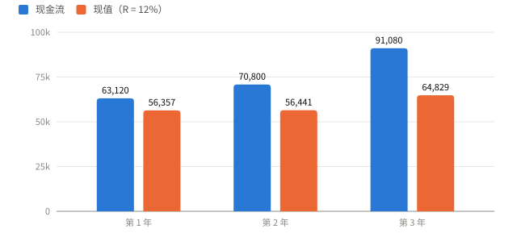
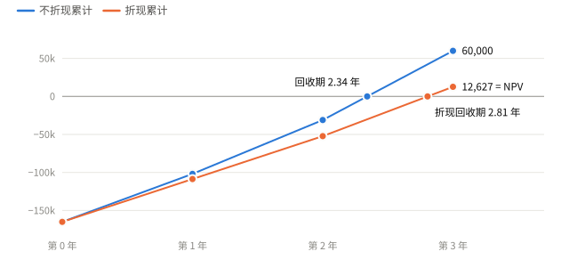
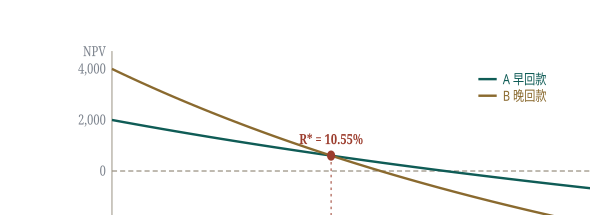
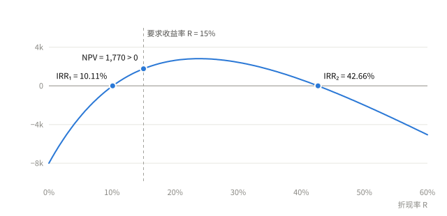
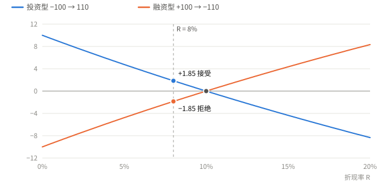
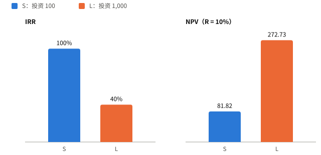
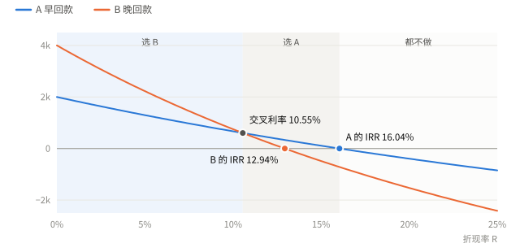
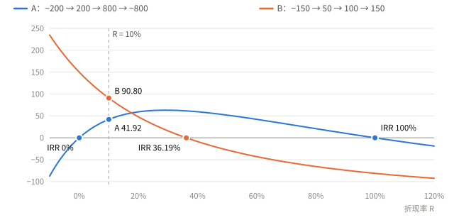

# 第 5 讲 净现值与投资评价方法

Net Present Value and Other Investment Rules

## 5.1 评价投资方法的五个标准 Good Decision Criteria { data-toc-label="5.1 评价投资方法的五个标准" }

1. 是否考虑**全部**现金流
2. 是否考虑**货币时间价值**
3. 是否按项目**风险**调整折现率
4. 能否给**互斥项目排序**
5. 结果是否**等于价值增量**

只有 NPV 五项全满足，见 5.7 的总表。

## 5.2 净现值 NPV Net Present Value { data-toc-label="5.2 净现值 NPV" }

$$
NPV = -I_0 + \sum_{t=1}^{n}\frac{CF_t}{(1+R)^t}
$$

记号
:   $I_0$ 为初始投资，$CF_t$ 为第 $t$ 年末现金流，$R$ 为要求收益率（required return）。

含义
:   未来现金流的现值减去初始投资，即项目为股东创造的价值。

性质
:   价值可加：$NPV(A+B)=NPV(A)+NPV(B)$。

判定
:   独立项目：NPV > 0 接受，NPV < 0 拒绝，NPV = 0 无差异。
:   互斥项目（mutually exclusive）：选 NPV 最大且为正者。

常规项目
:   初始投资之后各期现金流均为流入的项目，现金流只变号一次（conventional cash flows）。

!!! example "例 A"

    投资 165,000，三年现金流 63,120、70,800、91,080，$R = 12\%$。

    | 年份 | 现金流 | 算式 | 现值 |
    | :---: | ---: | :---: | ---: |
    | 1 | 63,120 | $63{,}120/1.12$ | 56,357.14 |
    | 2 | 70,800 | $70{,}800/1.12^2$ | 56,441.33 |
    | 3 | 91,080 | $91{,}080/1.12^3$ | 64,828.94 |
    | 合计 | | | 177,627.41 |

    $$
    NPV = 177{,}627.41 - 165{,}000 = 12{,}627.41 > 0
    $$

    接受。

{ .cf-fig }

**图 1 现金流与现值。**每笔现金流折现后都变小；三笔现值合计 177,627，减去投资 165,000 即 NPV 12,627。
{ .cf-caption }

!!! warning "易错"

    - 若记 $CF_0 = -I_0$，公式为 $CF_0 + \sum\ldots$，不要再减一次。
    - Excel：`=NPV(R, CF1:CFn) + CF0`，$CF_0$ 不放进函数。
    - 只用现金流，不用净利润。

!!! example "例 · 上大学值不值"

    - 第 1–4 年每年流出 43,000 = 学费 12,000 + 放弃的工资 31,000
    - 第 5–54 年每年流入 20,000 = 51,000 − 31,000

    金额为美国 2010 年前后的年均水平，单位美元；工作年限按 50 年计。放弃的工资是机会成本（opportunity cost），最易漏。

    假设 $R = 5\%$，NPV ≈ 147,908；IRR ≈ 9.9%。

## 5.3 回收期与折现回收期 Payback / Discounted Payback { data-toc-label="5.3 回收期与折现回收期" }

回收期
:   不折现的累计现金流回到 0 所需年数。

折现回收期
:   折现后的累计现金流回到 0 所需年数。

判定
:   短于设定门槛则接受。

$$
\text{回收期} = m + \frac{\text{第 } m \text{ 年末未收回金额}}{CF_{m+1}}
$$

$m$ 为累计现金流仍为负的最后一年。

!!! example "例 A 的回收期"

    | 年份 | 现金流 | 不折现累计 | 折现累计 |
    | :---: | ---: | ---: | ---: |
    | 0 | −165,000 | −165,000 | −165,000 |
    | 1 | 63,120 | −101,880 | −108,643 |
    | 2 | 70,800 | −31,080 | −52,202 |
    | 3 | 91,080 | +60,000 | +12,627 |

    - 回收期 $= 2 + 31{,}080/91{,}080 = 2.34$ 年
    - 折现回收期 $= 2 + 52{,}202/64{,}829 = 2.81$ 年

    折现累计的终值 12,627 即 NPV。

{ .cf-fig }

**图 2 累计现金流与回收期。**两条线与横轴的交点分别是回收期 2.34 年和折现回收期 2.81 年；折现线的终点就是 NPV。
{ .cf-caption }

| 缺陷 | 回收期 | 折现回收期 |
| --- | :---: | :---: |
| 忽略时间价值 | ✗ | ✓ |
| 忽略回本后的现金流，偏向短期项目 | ✗ | ✗ |
| 门槛主观 | ✗ | ✗ |

!!! example "例 · 截断"

    −62,000 → 16,500 → 23,800 → 27,100 → 23,300，回收期 $= 2 + 21{,}700/27{,}100 = 2.80$ 年，第 4 年的 23,300 不进入计算。

!!! warning "易错 · 结论不对称"

    回收期达标，不代表 NPV 为正。反过来，常规项目只要在寿命内按折现口径收回，NPV 必不小于 0。

优点：简单，反映流动性。只作辅助指标。

## 5.4 内部收益率 IRR Internal Rate of Return { data-toc-label="5.4 内部收益率 IRR" }

定义
:   使 NPV = 0 的折现率，即项目自身的收益率。

判定
:   常规投资型项目：IRR > R 接受。
:   其他情形见 5.5。

$$
0 = -I_0 + \sum_{t=1}^{n}\frac{CF_t}{(1+IRR)^t}
$$

!!! example "例 B · 试算插值"

    现金流 −200 → 50 → 100 → 150。

    $NPV(18\%) = 5.49$，$NPV(20\%) = -2.08$，根在两者之间：

    $$
    IRR \approx 18\% + \frac{5.49}{5.49 + 2.08} \times 2\% = 19.45\%
    $$

    精确值 19.44%。

### 与 NPV 的关系

| 折现率 | 0% | 10% | 18% | 19.44% | 20% |
| --- | ---: | ---: | ---: | ---: | ---: |
| NPV | 100.00 | 40.80 | 5.49 | 0 | −2.08 |

{ .cf-fig }

**图 3 NPV 曲线。**常规项目的 NPV 随折现率单调递减，只穿过横轴一次，交点即 IRR。
{ .cf-caption }

因此对常规项目：

$$
IRR > R \iff NPV > 0
$$

不满足这一条件时，两者可能冲突，见 5.5。

## 5.5 IRR 与 NPV 的冲突 Problems with IRR { data-toc-label="5.5 IRR 与 NPV 的冲突" }

| 情形 | 条件 | 处理 |
| --- | --- | --- |
| 多重 IRR | 现金流变号超过一次 | 用 NPV 或修正 IRR |
| 融资型项目 | 先流入后流出 | 用 NPV |
| 规模问题 | 互斥项目，投资额差异大 | 用 NPV |
| 时点问题 | 互斥项目，回款时间不同 | 求交叉利率，用 NPV |

冲突时一律以 NPV 为准。

### 多重 IRR Non-conventional Cash Flows { data-toc-label="多重 IRR" }

−200 → 200 → 800 → −800：

- $R = 0$：$-200 + 200 + 800 - 800 = 0$
- $R = 100\%$：$-200 + 100 + 200 - 100 = 0$

两个 IRR，规则无法判定。

!!! example "例"

    −90,000 → 132,000 → 100,000 → −150,000，$R = 15\%$。

    $$
    NPV = -90{,}000 + \frac{132{,}000}{1.15} + \frac{100{,}000}{1.15^2} - \frac{150{,}000}{1.15^3} = 1{,}769.54 > 0
    $$

    应接受。IRR 为 10.11% 和 42.66%，按 10.11% 会误判为拒绝。

{ .cf-fig }

**图 4 多重 IRR。**现金流两次变号，NPV 曲线先升后降、两次穿过横轴；在 R = 15% 处 NPV 为正。
{ .cf-caption }

修正 IRR
:   把后期负现金流按 $R$ 折回前一期合并，直到只变号一次，再求 IRR。

!!! example "例 · 修正 IRR"

    −100 → 230 → −132，$R = 14\%$，原 IRR 为 10% 和 20%。

    $$
    230 - \frac{132}{1.14} = 114.21 \;\Rightarrow\; -100 \to 114.21,\; IRR = 14.21\% > 14\%
    $$

    接受。

!!! warning "易错"

    这里用的是折现法：把后期现金流按要求收益率 $R$ 折回。另一种常见做法是再投资法，把正现金流按再投资率复利到期末，两种做法结果不同，答题时写明所用方法。

### 融资型项目 Investing vs. Financing { data-toc-label="融资型项目" }

| 现金流 | 性质 | IRR | NPV（R = 8%） | 决策 |
| --- | --- | ---: | ---: | --- |
| −100 → 110 | 投资 | 10% | +1.85 | 接受 |
| +100 → −110 | 借款 | 10% | −1.85 | 拒绝 |

IRR 相同，结论相反。融资型项目应 IRR < R 才接受。

{ .cf-fig }

**图 5 投资型与融资型。**两条线都在 R = 10% 处穿过横轴，但方向相反；R = 8% 时一个为正、一个为负。
{ .cf-caption }

### 规模问题 Scale Problem { data-toc-label="规模问题" }

| 项目 | 现金流 | IRR | NPV（R = 10%） |
| --- | --- | ---: | ---: |
| S | −100 → 200 | 100% | 81.82 |
| L | −1,000 → 1,400 | 40% | 272.73 |

互斥时 IRR 选 S，NPV 选 L。IRR 是比率，忽略规模。

{ .cf-fig }

**图 6 规模问题。**按 IRR，小项目 S 更高；按 NPV，大项目 L 多创造 190.91。
{ .cf-caption }

### 时点问题与交叉利率 Timing Problem & Crossover Rate { data-toc-label="时点问题与交叉利率" }

!!! example "例 C"

    - A：−10,000 → 10,000 → 1,000 → 1,000，IRR = 16.04%
    - B：−10,000 → 1,000 → 1,000 → 12,000，IRR = 12.94%

    | 折现率 | 0% | 5% | 10% | 10.55% | 15% | 20% |
    | --- | ---: | ---: | ---: | ---: | ---: | ---: |
    | NPV(A) | 2,000 | 1,295 | 669 | 605 | 109 | −394 |
    | NPV(B) | 4,000 | 2,225 | 751 | 605 | −484 | −1,528 |

B 的现金流靠后，折现率越高被打折越多，两条 NPV 曲线因此相交。

{ .cf-fig }

**图 7 交叉利率。**两条 NPV 曲线在 10.55% 处相交：左侧 B 更优，右侧 A 更优，超过 16.04% 两者都为负。
{ .cf-caption }

交叉利率
:   差额现金流的 IRR。

$$
A - B:\; 0 \to 9{,}000 \to 0 \to -11{,}000
\qquad
\frac{9{,}000}{1+R} = \frac{11{,}000}{(1+R)^3} \;\Rightarrow\; R^* = 10.55\%
$$

| R 的范围 | 选择 |
| --- | --- |
| R < 10.55% | B |
| 10.55% < R < 16.04% | A |
| R > 16.04% | 都不做 |

!!! warning "易错"

    IRR 始终选 A，在 R < 10.55% 时是错的。

## 5.6 盈利指数 PI Profitability Index { data-toc-label="5.6 盈利指数 PI" }

$$
PI = \frac{\text{未来现金流现值}}{\text{初始投资}}
$$

判定
:   PI > 1 接受，与 NPV > 0 等价。

局限
:   比率指标，不能给互斥项目排序。资本限额（capital rationing）下可按 PI 从高到低选；项目不可拆分时，应选预算内总 NPV 最大的组合。

!!! example "例"

    例 A 的 $PI = 177{,}627.41/165{,}000 = 1.0765$。

## 5.7 五种方法对比 Summary { data-toc-label="5.7 五种方法对比" }

| | NPV | 回收期 | 折现回收期 | IRR | PI |
| --- | :---: | :---: | :---: | :---: | :---: |
| 全部现金流 | ✓ | ✗ | ✗ | ✓ | ✓ |
| 时间价值 | ✓ | ✗ | ✓ | ✓ | ✓ |
| 风险调整 | ✓ | ✗ | ✓ | ✓ | ✓ |
| 互斥项目排序 | ✓ | ✗ | ✗ | ✗ | ✗ |
| 等于价值增量 | ✓ | ✗ | ✗ | ✗ | ✗ |
| 接受规则 | > 0 | < 门槛 | < 门槛 | > R | > 1 |
| 主要问题 | 依赖估计质量 | 截断、门槛主观 | 截断、门槛主观 | 多重根、借贷不分、排序错误 | 排序错误 |

!!! example "例 D · 综合"

    $R = 10\%$，互斥。

    - A：−200 → 200 → 800 → −800
    - B：−150 → 50 → 100 → 150

    | | NPV | IRR | PI | 回收期 |
    | --- | ---: | :---: | ---: | :---: |
    | A | 41.92 | 0% 与 100% | 1.2096 | 无意义 |
    | B | 90.80 | 36.19% | 1.6053 | 2 年 |

    选 B。A 的累计现金流第 1 年末归零、第 3 年再次归零，回收期失去意义；IRR 有两个。

{ .cf-fig }

**图 8 例 D 的 NPV 曲线。**A 的曲线呈驼峰，在 0% 和 100% 两次归零；B 单调下降。R = 10% 处 B 更高。
{ .cf-caption }

### 解题步骤

1. 先算 NPV：独立项目 > 0 接受，互斥项目取最大。
2. 算 IRR 前看现金流：只变号一次的投资型项目可用；否则以 NPV 为准。
3. 回收期、PI 只作辅助。

## 5.8 公式速查 Formulas { data-toc-label="5.8 公式速查" }

| 指标 | 公式 | 接受规则 |
| --- | --- | --- |
| NPV | $-I_0+\sum CF_t/(1+R)^t$ | > 0 |
| 回收期 | $m + \text{未收回}/CF_{m+1}$ | < 门槛 |
| 折现回收期 | 同上，按现值累计 | < 门槛 |
| IRR | NPV = 0 时的折现率 | > R |
| 交叉利率 | 差额现金流的 IRR | — |
| PI | 现值 ÷ 初始投资 | > 1 |
| 修正 IRR | 后期负现金流按 R 折回合并 | > R |

## 5.9 自测 Quick Quiz { data-toc-label="5.9 自测" }

!!! question "1. 投资 100,000，此后 5 年每年 25,000，R = 9%，回收期门槛 4 年。求回收期、折现回收期、NPV、IRR 并决策。"

    ??? success "参考答案"

        | 指标 | 结果 |
        | --- | --- |
        | 回收期 | 4 年 |
        | 折现回收期 | 寿命内无法收回，现值合计 97,241 |
        | NPV | 25,000 × 3.8897 − 100,000 = −2,758.72 |
        | IRR | ≈ 7.93% |
        | 决策 | 拒绝 |

!!! question "2. 为什么 NPV 是最佳准则？"

    ??? success "参考答案"

        使用现金流、覆盖全部寿命、按风险折现、可直接排序、结果即价值增量，五个标准全部满足。

!!! question "3. −90,000 → 132,000 → 100,000 → −150,000，R = 15%，NPV 与 IRR 是否冲突？"

    ??? success "参考答案"

        冲突。NPV = 1,769.54 > 0 应接受；IRR 为 10.11% 与 42.66%，无法判定。非常规现金流以 NPV 为准。

!!! question "4. 例 C 中，R = 8% 与 R = 12% 时各选哪个？"

    ??? success "参考答案"

        交叉利率 10.55%。R = 8% 选 B；R = 12% 选 A。

!!! question "5. 今天收到 100，一年后付出 110，市场利率 8%，是否接受？"

    ??? success "参考答案"

        IRR = 10%，但这是借款，成本高于 8%，拒绝。NPV = 100 − 110/1.08 = −1.85。
