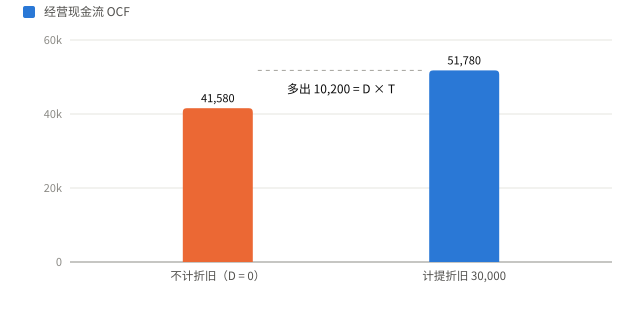
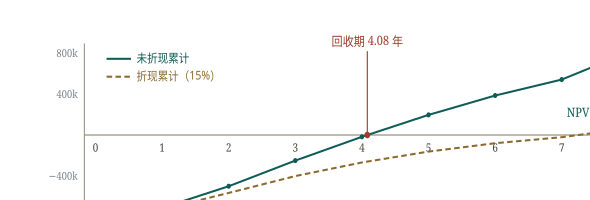
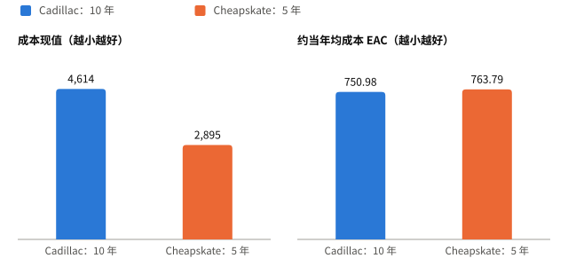

# 第 6 讲 投资决策

Making Capital Investment Decisions

## 6.1 增量现金流 Incremental Cash Flows { data-toc-label="6.1 增量现金流" }

$$
\text{增量现金流} = \text{接受项目时公司的现金流} - \text{不接受项目时公司的现金流}
$$

判断标准
:   只计因接受项目而改变的现金流。

独立原则
:   只看增量现金流，就能把项目从公司中单独拿出来评价（stand-alone principle）。

| 项目 | 是否计入 | 原因 |
| --- | :---: | --- |
| 沉没成本 Sunk Cost | 否 | 已经发生，不受决策影响 |
| 机会成本 Opportunity Cost | 是 | 资源用于本项目而放弃的最佳收益 |
| 副效应 Side Effects | 是 | 侵蚀效应扣减，协同效应加上 |
| 净营运资本 | 是 | 期初投入，期末收回 |
| 融资成本 Financing Costs | 否 | 已体现在折现率中 |
| 税 | 是 | 税是现金流出 |

!!! example "例 · 沉没成本"

    公司去年花 100,000 做市场测试，今年决定是否推出新产品。这 100,000 不论是否推出都收不回，不计入。

!!! example "例 · 机会成本"

    厂房 8 年前买价 689,000，6 年前改建 136,000，账面价值 494,000，现在市价 840,000。项目若使用这座厂房，应计入的成本是 **840,000**，即放弃出售的收入。买价和改建费是沉没成本；账面价值只在出售时用于计算税。

!!! example "例 · 侵蚀效应"

    新产品预计销售 7,800，但使老产品 T 恤销售从 14,000 降到 12,000、卫衣从 11,000 降到 8,000。项目的增量销售 = 7,800 − 2,000 − 3,000 = **2,800**。

!!! warning "易错"

    利息不计入项目现金流。折现率已经反映资金成本，再扣利息就重复计算了。

## 6.2 预计利润表与项目现金流 Pro Forma Cash Flows { data-toc-label="6.2 预计利润表与项目现金流" }

$$
OCF = EBIT + D - \text{税} = NI + D = (S - C)(1 - T) + D \times T
$$

$$
\text{项目现金流} = OCF - NCS - \Delta NWC
$$

$S$ 为销售收入，$C$ 为付现成本，$D$ 为折旧，$T$ 为税率。后两种写法要求没有利息费用。

!!! example "例 A · 鲨鱼诱饵项目"

    年销量 50,000 罐，单价 4，单位变动成本 2.50，固定成本 12,000/年；设备 90,000，3 年直线折旧至 0；期初营运资本 20,000，期末收回；税率 34%，要求收益率 20%。

    | 项目 | 0 | 1 | 2 | 3 |
    | --- | ---: | ---: | ---: | ---: |
    | 销售收入 | | 200,000 | 200,000 | 200,000 |
    | 变动成本 | | 125,000 | 125,000 | 125,000 |
    | 固定成本 | | 12,000 | 12,000 | 12,000 |
    | 折旧 | | 30,000 | 30,000 | 30,000 |
    | EBIT | | 33,000 | 33,000 | 33,000 |
    | 税 34% | | 11,220 | 11,220 | 11,220 |
    | 净利润 | | 21,780 | 21,780 | 21,780 |
    | OCF | | 51,780 | 51,780 | 51,780 |
    | 资本支出 | −90,000 | | | |
    | 营运资本 | −20,000 | | | 20,000 |
    | 项目现金流 | −110,000 | 51,780 | 51,780 | 71,780 |

    $NPV = 10{,}647.69 > 0$，接受；IRR = 25.76%。

!!! example "例 · 已知 OCF"

    扩建项目 OCF 每年 29,000，共 4 年；固定资产 39,000，期末无残值；营运资本 3,000 期初投入、期末收回；要求收益率 15%。

    现金流：−42,000、29,000、29,000、29,000、32,000，$NPV = 42{,}509.63$。

!!! warning "易错"

    营运资本"在项目期间一直占用"，意思是只在第 0 年投入、最后一年收回，中间各年 ΔNWC = 0。

## 6.3 净营运资本 Net Working Capital { data-toc-label="6.3 净营运资本" }

收入和成本按权责发生制确认，与现金收付不同步：

$$
\text{现金收入} = \text{销售收入} - \Delta\text{应收账款}
\qquad
\text{现金支出} = \text{成本} - \Delta\text{应付账款}
$$

$$
\Delta NWC = \Delta\text{存货} + \Delta\text{应收账款} - \Delta\text{应付账款}
$$

!!! example "例"

    新增存货 216,000，应付账款增加 181,000，应收账款增加 525,000 × 9% = 47,250。营运资本投入 = 216,000 + 47,250 − 181,000 = **82,250**，为现金流出。

## 6.4 折旧与税盾 Depreciation Tax Shield { data-toc-label="6.4 折旧与税盾" }

折旧本身不是现金流，但它减少应税所得，从而少交税。

$$
\text{折旧税盾} = D \times T
$$

{ .cf-fig }

**图 1 折旧税盾。**例 A 计提折旧 30,000 后，OCF 从 41,580 增至 51,780，增加的 10,200 正好等于 30,000 × 34%。
{ .cf-caption }

| 方法 | 年折旧额 | 折旧后账面价值 |
| --- | --- | --- |
| 直线法 | (初始成本 − 残值) ÷ 年数 | 降至残值 |
| MACRS | 初始成本 × 表中百分比 | 降至 0，不考虑实际残值 |

MACRS
:   美国税法规定的加速折旧制度（Modified Accelerated Cost Recovery System）。采用半年惯例，所以 3 年类资产分 4 年提完。

| 年 | 3 年类 | 5 年类 | 7 年类 |
| :---: | ---: | ---: | ---: |
| 1 | 33.33% | 20.00% | 14.29% |
| 2 | 44.45% | 32.00% | 24.49% |
| 3 | 14.81% | 19.20% | 17.49% |
| 4 | 7.41% | 11.52% | 12.49% |
| 5 | | 11.52% | 8.93% |
| 6 | | 5.76% | 8.92% |
| 7 | | | 8.93% |
| 8 | | | 4.46% |

!!! example "例"

    | 问题 | 答案 |
    | --- | --- |
    | 110,000 的 3 年类资产，各年折旧 | 36,663、48,895、16,291、8,151 |
    | 875,000 按 7 年直线折旧，第 4 年折旧 | 875,000 ÷ 7 = 125,000 |
    | 94,000 的 5 年类资产，第 3 年末累计折旧 | 94,000 × (20% + 32% + 19.2%) = 66,928 |

!!! note "中国的加速折旧"

    根据国税发〔2009〕81 号，技术进步快、产品更新换代快的固定资产，以及常年处于强震动、高腐蚀状态的固定资产，可以缩短折旧年限或采用加速折旧，方法为双倍余额递减法或年数总和法。

## 6.5 税后残值 After-Tax Salvage { data-toc-label="6.5 税后残值" }

$$
\text{税后残值} = SP - T \times (SP - BV)
$$

$SP$ 为售价，$BV$ 为按税法折旧后的账面价值。售价高于账面要交税；低于账面可以抵税，公式自动处理正负号。

!!! example "例 · 汽车残值"

    汽车 12,000，5 年类 MACRS，税率 34%。

    | 出售时点 | 售价 | 账面价值 | 税 | 税后残值 |
    | --- | ---: | ---: | ---: | ---: |
    | 第 5 年末 | 3,000 | 691.20 | 784.99 | 2,215.01 |
    | 第 2 年末 | 4,000 | 5,760.00 | −598.40 | 4,598.40 |

    第二行售价低于账面，亏损 1,760 可抵税 598.40，到手现金反而多于售价。

!!! example "例 · 四步法"

    设备 225,000，5 年类 MACRS，持有 4 年后以 87,000 出售，税率 35%。

    1. 累计折旧 = 225,000 × (20% + 32% + 19.2% + 11.52%) = 186,120
    2. 账面价值 = 225,000 − 186,120 = 38,880
    3. 税 = 35% × (87,000 − 38,880) = 16,842
    4. 税后残值 = 87,000 − 16,842 = **70,158**

## 6.6 综合案例 Majestic Mulch and Compost Company { data-toc-label="6.6 综合案例" }

!!! example "例 B · MMCC 公司 8 年项目"

    设备 800,000，7 年类 MACRS，第 8 年末残值 160,000；期初营运资本 20,000，此后为销售收入的 15%；单价前 3 年 120、此后 110；单位变动成本 60；固定成本 25,000/年；税率 34%；要求收益率 15%。

    | 年 | 1 | 2 | 3 | 4 | 5 | 6 | 7 | 8 |
    | --- | ---: | ---: | ---: | ---: | ---: | ---: | ---: | ---: |
    | 销量 | 3,000 | 5,000 | 6,000 | 6,500 | 6,000 | 5,000 | 4,000 | 3,000 |
    | 销售收入 | 360,000 | 600,000 | 720,000 | 715,000 | 660,000 | 550,000 | 440,000 | 330,000 |
    | 付现成本 | 205,000 | 325,000 | 385,000 | 415,000 | 385,000 | 325,000 | 265,000 | 205,000 |
    | 折旧 | 114,320 | 195,920 | 139,920 | 99,920 | 71,440 | 71,360 | 71,440 | 35,680 |
    | EBIT | 40,680 | 79,080 | 195,080 | 200,080 | 203,560 | 153,640 | 103,560 | 89,320 |
    | 税 | 13,831 | 26,887 | 66,327 | 68,027 | 69,210 | 52,238 | 35,210 | 30,369 |
    | OCF | 141,169 | 248,113 | 268,673 | 231,973 | 205,790 | 172,762 | 139,790 | 94,631 |
    | ΔNWC | −34,000 | −36,000 | −18,000 | 750 | 8,250 | 16,500 | 16,500 | 66,000 |
    | 现金流 | 107,169 | 212,113 | 250,673 | 232,723 | 214,040 | 189,262 | 156,290 | 266,231 |

    第 0 年现金流 = −800,000 − 20,000 = −820,000。第 8 年另含税后残值 160,000 × (1 − 34%) = 105,600，资产已提完折旧，账面价值为 0。

    $NPV = 65{,}485 > 0$，接受；IRR = 17.24%；回收期 = 4 + 17,323 ÷ 214,040 = 4.08 年。

{ .cf-fig }

**图 2 MMCC 的累计现金流。**不折现的累计现金流在第 5 年转正，回收期 4.08 年；按 15% 折现后到第 8 年末才转正，终值 65,485 即 NPV。
{ .cf-caption }

!!! warning "易错"

    - 第 4 年起单价降为 110，销售收入是 715,000 而不是 780,000。
    - 第 8 年的 ΔNWC 66,000 = 随销售下降释放的 16,500 + 期末全部收回的 49,500。

## 6.7 成本节约与设备更新 Cost Cutting & Replacement { data-toc-label="6.7 成本节约与设备更新" }

### 成本节约项目

没有新增收入，节省的成本相当于增加的税前利润：

$$
OCF = \text{节省额} \times (1 - T) + D \times T
$$

!!! example "例"

    系统 1,000,000，每年节省 300,000，共 5 年；3 年类 MACRS；第 5 年末残值 50,000；税率 40%；要求收益率 8%。

    | 年 | 0 | 1 | 2 | 3 | 4 | 5 |
    | --- | ---: | ---: | ---: | ---: | ---: | ---: |
    | 折旧 | | 333,300 | 444,500 | 148,100 | 74,100 | 0 |
    | OCF | | 313,320 | 357,800 | 239,240 | 209,640 | 180,000 |
    | 资本支出 | −1,000,000 | | | | | 30,000 |
    | 现金流 | −1,000,000 | 313,320 | 357,800 | 239,240 | 209,640 | 210,000 |

    $NPV = 83{,}797.50$，IRR = 11.45%，接受。

!!! warning "易错"

    节省的 300,000 是税前金额，税后只有 300,000 × (1 − 40%) = 180,000。

### 设备更新

按新旧设备的差额计算增量现金流。

!!! example "例"

    旧机原价 100,000，已用 5 年，每年折旧 9,000，账面 55,000，现可售 65,000，若继续用 5 年残值 10,000。新机 150,000，3 年类 MACRS，用 5 年无残值，每年节省 50,000。税率 40%，要求收益率 10%。

    - 第 0 年：出售旧机税后得 65,000 − 40% × (65,000 − 55,000) = 61,000；增量资本支出 = −150,000 + 61,000 = **−89,000**
    - 第 5 年：放弃旧机残值 10,000（账面也为 10,000，无税），记 −10,000

    | 年 | 1 | 2 | 3 | 4 | 5 |
    | --- | ---: | ---: | ---: | ---: | ---: |
    | 成本节省 | 50,000 | 50,000 | 50,000 | 50,000 | 50,000 |
    | 增量折旧 | 40,995 | 57,675 | 13,215 | 2,115 | −9,000 |
    | EBIT | 9,005 | −7,675 | 36,785 | 47,885 | 59,000 |
    | 税 | 3,602 | −3,070 | 14,714 | 19,154 | 23,600 |
    | OCF | 46,398 | 53,070 | 35,286 | 30,846 | 26,400 |
    | 现金流 | 46,398 | 53,070 | 35,286 | 30,846 | 16,400 |

    $NPV = 54{,}801.74 > 0$，应更换。

!!! warning "易错"

    - 出售旧机的税按今天的售价与账面价值计算，不是原价。
    - 继续使用旧机才能得到的残值，换新后就放弃了，要作为机会成本扣除。

## 6.8 寿命不同的方案 Equivalent Annual Cost { data-toc-label="6.8 寿命不同的方案" }

两台设备寿命不同、到期需要重置时，不能直接比较成本现值，要折算成每年的等额成本。

$$
EAC = \frac{\text{成本现值}}{\text{年金现值系数}(r, T)}
$$

!!! example "例"

    要求收益率 10%。

    | | Cadillac | Cheapskate |
    | --- | ---: | ---: |
    | 购置成本 | 4,000 | 1,000 |
    | 年运行成本 | 100，共 10 年 | 500，共 5 年 |
    | 成本现值 | 4,614.46 | 2,895.39 |
    | 年金现值系数 | 6.1446 | 3.7908 |
    | EAC | 750.98 | 763.79 |

    Cheapskate 的成本现值更低，但只能用 5 年。折算成每年成本后 Cadillac 更便宜，选 Cadillac。

{ .cf-fig }

**图 3 EAC 改变了结论。**按成本现值 Cheapskate 便宜；按每年等额成本，Cadillac 便宜 12.81。
{ .cf-caption }

!!! warning "易错"

    每个方案的年金现值系数要用它自己的寿命。寿命相同时直接比较 NPV 即可。

## 6.9 公式速查 Formulas { data-toc-label="6.9 公式速查" }

| 指标 | 公式 | 注意 |
| --- | --- | --- |
| 增量现金流 | 有项目 − 无项目 | 不计沉没成本和融资成本 |
| OCF | EBIT + D − 税 = (S − C)(1 − T) + DT | 后者要求无利息 |
| 项目现金流 | OCF − NCS − ΔNWC | NCS 中残值用税后金额 |
| 税后残值 | SP − T(SP − BV) | BV 按税法折旧计算 |
| EAC | 成本现值 ÷ 年金现值系数 | 只用于寿命不同的方案 |

## 6.10 自测 Quick Quiz { data-toc-label="6.10 自测" }

!!! question "1. 例 A 若要求收益率升至 25%，NPV 是多少？"

    ??? success "参考答案"

        NPV = 1,314.56，仍为正；IRR 25.76% 只略高于 25%。

!!! question "2. 例「四步法」的设备若持有到第 5 年末才以 87,000 出售，税后残值是多少？"

    ??? success "参考答案"

        账面价值 = 225,000 × (1 − 94.24%) = 12,960；税 = 35% × (87,000 − 12,960) = 25,914；税后残值 = 61,086。

!!! question "3. 例 B 若第 8 年末残值只有 40,000，NPV 变为多少？"

    ??? success "参考答案"

        税后残值从 105,600 降至 26,400，少 79,200，折现 8 年少 25,891；NPV = 39,594。

!!! question "4. 设备更新例中，若旧机今天只能卖 50,000，第 0 年增量资本支出是多少？"

    ??? success "参考答案"

        出售旧机税后 = 50,000 − 40% × (50,000 − 55,000) = 52,000；增量资本支出 = −150,000 + 52,000 = −98,000。
