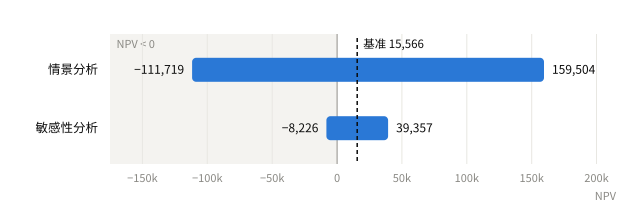
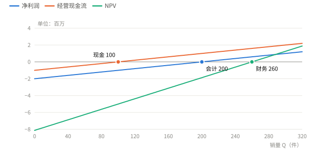
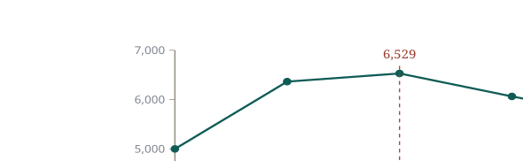
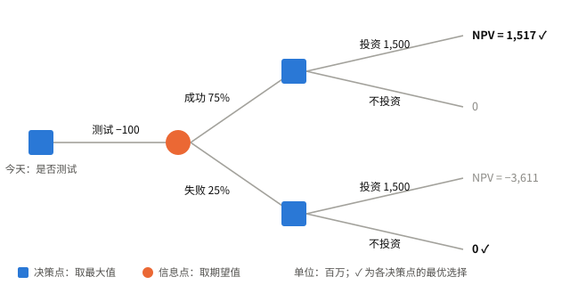

# 第 7 讲 风险分析与实物期权

Risk Analysis, Real Options, and Capital Budgeting

## 7.1 预测风险 Forecasting Risk { data-toc-label="7.1 预测风险" }

预测风险
:   因现金流估计错误而做出错误决策的可能性（forecasting risk）。NPV 对哪个估计越敏感，那个估计的风险就越大。

NPV 为正只是基于一组估计的结论，还要检验估计出错时结论是否改变。

| 工具 | 做法 | 回答的问题 |
| --- | --- | --- |
| 敏感性分析 | 一次只改变一个变量 | 哪个变量最需要估准？ |
| 情景分析 | 一组相关变量同时改变 | 最坏会坏到什么程度？ |
| 模拟分析 | 为每个变量设定概率分布，反复抽样 | NPV 的分布如何？亏损概率多大？ |
| 盈亏平衡分析 | 令 NI、OCF 或 NPV 为 0，反求销量 | 至少要卖多少？ |

## 7.2 情景分析与敏感性分析 Scenario & Sensitivity Analysis { data-toc-label="7.2 情景分析与敏感性分析" }

!!! example "例 A"

    初始投资 200,000，寿命 5 年，直线折旧至 0，每年折旧 40,000；税率 34%；要求收益率 12%。

    | 变量 | 悲观 | 基准 | 乐观 |
    | --- | ---: | ---: | ---: |
    | 销量 | 5,500 | 6,000 | 6,500 |
    | 单价 | 75 | 80 | 85 |
    | 单位变动成本 | 62 | 60 | 58 |
    | 固定成本 | 55,000 | 50,000 | 45,000 |

    $$
    OCF = (\text{销量} \times (\text{单价} - \text{单位变动成本}) - \text{固定成本} - 40{,}000)(1 - 34\%) + 40{,}000
    $$

    $$
    NPV = -200{,}000 + OCF \times 3.6048
    $$

    3.6048 是 12%、5 年的年金现值系数。

### 情景分析

四个变量同时取悲观或乐观值。

| 情景 | EBIT | OCF | NPV | IRR |
| --- | ---: | ---: | ---: | ---: |
| 悲观 | −23,500 | 24,490 | −111,719 | −14.4% |
| 基准 | 30,000 | 59,800 | 15,566 | 15.1% |
| 乐观 | 90,500 | 99,730 | 159,504 | 40.9% |

悲观情景 EBIT 为负，税也为负，表示亏损可以抵减公司其他利润的税。

### 敏感性分析

只改变销量，其余取基准值。

| 销量 | OCF | NPV | IRR |
| ---: | ---: | ---: | ---: |
| 5,500 | 53,200 | −8,226 | 10.3% |
| 6,000 | 59,800 | 15,566 | 15.1% |
| 6,500 | 66,400 | 39,357 | 19.7% |

令 NPV = 0 可求出临界销量约 5,673，比基准低 5.45%。

{ .cf-fig }

**图 1 两种分析的 NPV 区间。**四个变量同时变化时 NPV 从 −111,719 到 159,504；只变销量时从 −8,226 到 39,357。
{ .cf-caption }

!!! warning "易错"

    敏感性分析假设其他变量不变，但现实中销量下降时价格往往也在下降，所以它会低估最坏情况；情景分析考虑了变量间的联动。

## 7.3 模拟分析 Simulation Analysis { data-toc-label="7.3 模拟分析" }

模拟分析
:   为每个变量设定概率分布和相互关系，随机抽样数千次，得到 NPV 的分布（Monte Carlo simulation）。

用途
:   得到 NPV 的均值、中位数，以及 NPV < 0 的概率。

!!! example "例"

    模拟结果：NPV 均值与中位数都约 29 亿，但有 12% 的概率为负。均值为正支持接受；但如果公司无法承受 12% 的亏损概率，也可能拒绝。

!!! warning "易错"

    只给变量设上下限而不设概率分布，仍是情景分析。

## 7.4 平均成本与边际成本 Average vs. Marginal Cost { data-toc-label="7.4 平均成本与边际成本" }

$$
TC = FC + vQ
\qquad
AC = \frac{TC}{Q}
\qquad
MC = v
$$

$FC$ 为固定成本，$v$ 为单位变动成本，$Q$ 为产量。只要 $FC > 0$，平均成本就高于边际成本，产量越大两者越接近。

!!! example "例"

    月固定成本 3,000，单位变动成本 15。

    | 产量 | 总成本 | 平均成本 | 边际成本 |
    | ---: | ---: | ---: | ---: |
    | 1,000 | 18,000 | 18.00 | 15 |
    | 5,000 | 78,000 | 15.60 | 15 |

## 7.5 盈亏平衡分析 Break-Even Analysis { data-toc-label="7.5 盈亏平衡分析" }

| 类型 | 条件 | 盈亏平衡销量（不考虑税） |
| --- | --- | --- |
| 会计盈亏平衡 Accounting | 净利润 = 0 | $Q = \dfrac{FC + D}{P - v}$ |
| 现金盈亏平衡 Cash | OCF = 0 | $Q = \dfrac{FC}{P - v}$ |
| 财务盈亏平衡 Financial | NPV = 0 | $Q = \dfrac{FC + OCF^*}{P - v}$ |

$P$ 为单价，$D$ 为折旧，$OCF^*$ 为使 NPV = 0 的每年经营现金流：

$$
OCF^* = \frac{\text{初始投资}}{\text{年金现值系数}(r, T)}
$$

考虑税时，会计盈亏平衡的公式不变；一般情形下：

$$
Q = \frac{OCF + FC(1 - T) - D \times T}{(P - v)(1 - T)}
$$

!!! example "例 B"

    投资 5,000,000，5 年直线折旧至 0，每年折旧 1,000,000；单价 25,000，单位变动成本 15,000；固定成本 1,000,000/年；要求收益率 18%；不考虑税。

    - 会计：$Q = (1{,}000{,}000 + 1{,}000{,}000) / 10{,}000 = 200$ 件
    - 现金：$Q = 1{,}000{,}000 / 10{,}000 = 100$ 件
    - 财务：$OCF^* = 5{,}000{,}000 / 3.1272 = 1{,}598{,}889$，$Q = (1{,}000{,}000 + 1{,}598{,}889) / 10{,}000 = 259.89$，取 **260** 件

{ .cf-fig }

**图 2 三种盈亏平衡点。**经营现金流、净利润、NPV 分别在 100、200、260 件处由负转正。
{ .cf-caption }

现金 < 会计 < 财务：会计比现金多覆盖折旧，财务再多覆盖资本成本。

!!! warning "易错"

    - 会计盈亏平衡时 OCF = 折旧，NPV 一般为负，项目并不划算。
    - 财务盈亏平衡销量要向上取整：259 件时 NPV 仍为负。

## 7.6 实物期权 Real Options { data-toc-label="7.6 实物期权" }

实物期权
:   项目实施后，管理层根据新信息调整决策的权利（real options）。

期权只会增加项目价值，忽略期权的 NPV 是项目价值的下限。

| 类型 | 何时有价值 |
| --- | --- |
| 扩张期权 Option to Expand | 情况好于预期时追加投资 |
| 放弃期权 Option to Abandon | 情况差于预期时及早退出 |
| 延迟期权 Option to Delay | 等待条件改善再投资 |

!!! example "例 · 扩张期权"

    开一家冰酒店投资 12（百万），永续年现金流期望 2，折现率 20%：$NPV = -12 + 2/0.20 = -2$。

    年现金流有 50% 的概率为 3、50% 的概率为 1。若好的情况下可以在 10 个地点复制，差的情况下不复制：

    $$
    NPV = 0.5 \times 10 \times (-12 + 3/0.20) + 0.5 \times (-12 + 1/0.20) = 0.5 \times 30 + 0.5 \times (-7) = 11.5
    $$

!!! example "例 · 放弃期权"

    同一酒店，年现金流 50% 的概率为 6、50% 的概率为 −2，第 1 年末就能知道是哪种情况。

    - 不放弃：$0.5 \times (-12 + 6/0.20) + 0.5 \times (-12 - 2/0.20) = 0.5 \times 18 + 0.5 \times (-22) = -2$
    - 情况差时第 1 年末关店：差的情况 NPV = $-12 - 2/1.20 = -13.67$

    $$
    NPV = 0.5 \times 18 + 0.5 \times (-13.67) = 2.17
    $$

!!! example "例 · 延迟期权"

    项目收益现值 25,000，投资成本逐年下降，折现率 10%。

    | 启动年 t | 成本 | 启动时 NPV | 折现到今天 |
    | :---: | ---: | ---: | ---: |
    | 0 | 20,000 | 5,000 | 5,000 |
    | 1 | 18,000 | 7,000 | 6,364 |
    | 2 | 17,100 | 7,900 | **6,529** |
    | 3 | 16,929 | 8,071 | 6,064 |
    | 4 | 16,760 | 8,240 | 5,628 |

    第 2 年启动最优。

{ .cf-fig }

**图 3 延迟期权。**按启动时点计算的 NPV 逐年上升，但折回今天后在第 2 年最大。
{ .cf-caption }

!!! warning "易错"

    不同年份的 NPV 必须折现到同一时点再比较。

## 7.7 决策树 Decision Trees { data-toc-label="7.7 决策树" }

决策点
:   由公司选择，取各分支中的**最大值**，图中用方块表示。

信息点
:   由外部情况决定，取各分支的**期望值**，图中用圆点表示。

!!! example "例 · 太阳能发动机项目（单位：百万）"

    现在花 100 做一年的测试。测试成功的概率 75%，此时投资 1,500 的 NPV 为 1,517；失败时投资的 NPV 为 −3,611，应选择不投资。要求收益率 15%。

    $$
    \text{一年后期望值} = 0.75 \times 1{,}517 + 0.25 \times 0 = 1{,}137.75
    $$

    $$
    NPV = -100 + \frac{1{,}137.75}{1.15} = 889.35 > 0
    $$

    应进行测试。

{ .cf-fig }

**图 4 决策树。**两个决策点都选 NPV 较高的分支：成功时投资得 1,517，失败时不投资得 0；信息点按 75% 和 25% 取期望。
{ .cf-caption }

!!! warning "易错"

    失败分支取 0 而不是 −3,611，因为到那时可以选择不投资。若失败后仍投资，期望值只有 $0.75 \times 1{,}517 + 0.25 \times (-3{,}611) = 235$。

## 7.8 公式速查 Formulas { data-toc-label="7.8 公式速查" }

| 指标 | 公式 |
| --- | --- |
| 平均成本 | (FC + vQ) ÷ Q |
| 边际成本 | v |
| 会计盈亏平衡 | (FC + D) ÷ (P − v) |
| 现金盈亏平衡（不考虑税） | FC ÷ (P − v) |
| 财务盈亏平衡（不考虑税） | (FC + OCF\*) ÷ (P − v) |
| OCF\* | 初始投资 ÷ 年金现值系数 |

## 7.9 自测 Quick Quiz { data-toc-label="7.9 自测" }

!!! question "1. 例 A 中销量降为 5,700，其余取基准值，NPV 是多少？"

    ??? success "参考答案"

        EBIT = 5,700 × 20 − 50,000 − 40,000 = 24,000；OCF = 24,000 × 0.66 + 40,000 = 55,840；NPV = −200,000 + 55,840 × 3.6048 = 1,291，仍为正。

!!! question "2. 例 B 中若税率为 34%，现金盈亏平衡销量是多少？"

    ??? success "参考答案"

        令 OCF = (10,000Q − 2,000,000) × 0.66 + 1,000,000 = 0，得 Q = 48.48，取 49 件。折旧的税盾使现金盈亏平衡点低于不考虑税时的 100 件。

!!! question "3. 延迟期权例中，若收益现值每年增长 5%，最优启动年份是哪年？"

    ??? success "参考答案"

        折现到今天的 NPV 依次为 5,000、7,500、8,647、9,025、9,308，逐年上升，应在第 4 年启动。

!!! question "4. 为什么决策点取最大值、信息点取期望值？"

    ??? success "参考答案"

        决策点由公司自己选择，会选最好的分支；信息点由外部情况决定，只能按概率加权平均。
