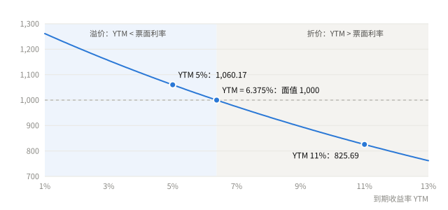
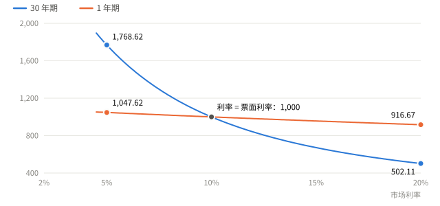
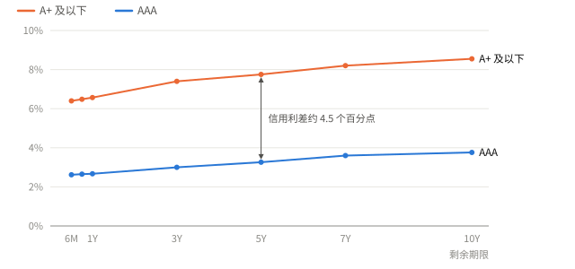
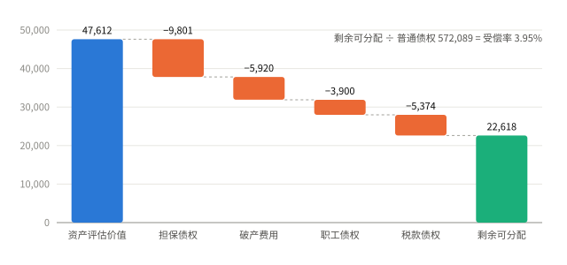

# 第 8 讲 利率与债券估值

Interest Rates and Bond Valuation

## 8.1 债券的基本要素 Bond Features { data-toc-label="8.1 债券的基本要素" }

债券是借款人与贷款人之间的法律合约，约定借款人按期支付利息、到期偿还本金。

面值 $F$
:   到期时偿还给持有人的金额（par value）。

票面利率
:   发行时确定的年利率，存续期内一般不变（coupon rate）。

利息 $C$
:   每年支付的利息，等于票面利率 × 面值（coupon）。

到期日
:   最后一次支付本金和剩余利息的日期（maturity date）。

到期收益率 YTM
:   市场对该债券要求的收益率，也是买入后持有至到期的内部收益率（yield to maturity）。

!!! warning "易错"

    票面利率在发行时固定，决定每期付多少利息；YTM 随市场变化，决定债券今天值多少钱。

## 8.2 债券定价 Bond Valuation { data-toc-label="8.2 债券定价" }

债券价值等于未来现金流的现值：利息是一笔年金，面值是到期时的一笔现金流。

$$
P = C \times \frac{1 - (1+r)^{-T}}{r} + \frac{F}{(1+r)^T}
$$

$r$ 为每期 YTM，$T$ 为剩余期数。半年付息时，每期利息为 $C/2$，每期利率为 $YTM/2$，期数为剩余年数 × 2。

!!! example "例 A · 美国国债"

    面值 1,000，票面利率 6 3/8%，每半年付息 31.875，剩余 5 年，共 10 期。

    - YTM 5%，每期 2.5%：$P = 31.875 \times \dfrac{1 - 1.025^{-10}}{0.025} + \dfrac{1{,}000}{1.025^{10}} = 278.97 + 781.20 = 1{,}060.17$
    - YTM 11%，每期 5.5%：$P = 31.875 \times \dfrac{1 - 1.055^{-10}}{0.055} + \dfrac{1{,}000}{1.055^{10}} = 240.26 + 585.43 = 825.69$

| YTM 与票面利率 | 价格与面值 | 名称 |
| --- | --- | --- |
| YTM < 票面利率 | 价格 > 面值 | 溢价债券 Premium Bond |
| YTM = 票面利率 | 价格 = 面值 | 平价债券 Par Bond |
| YTM > 票面利率 | 价格 < 面值 | 折价债券 Discount Bond |

债券价格与市场利率反向变动。

{ .cf-fig }

**图 1 债券价格与到期收益率**。例 A 的债券在 YTM 等于票面利率 6.375% 时按面值交易；YTM 越高价格越低，且下降速度逐渐变慢。
{ .cf-caption }

## 8.3 利率风险 Interest Rate Risk { data-toc-label="8.3 利率风险" }

价格风险
:   利率变动导致债券价格变动的风险（price risk）。

再投资风险
:   收到的现金流只能按未来未知的利率再投资的风险（reinvestment rate risk）。

| 债券特征 | 价格风险 | 再投资风险 |
| --- | --- | --- |
| 期限更长 | 更大 | — |
| 票面利率更低 | 更大 | 更小 |
| 票面利率更高 | 更小 | 更大 |

!!! example "例 B · 期限的影响"

    两只债券面值 1,000，票面利率 10%，每年付息，期限分别为 1 年和 30 年。

    | 市场利率 | 5% | 10% | 15% | 20% |
    | --- | ---: | ---: | ---: | ---: |
    | 1 年期 | 1,047.62 | 1,000.00 | 956.52 | 916.67 |
    | 30 年期 | 1,768.62 | 1,000.00 | 671.70 | 502.11 |

{ .cf-fig }

**图 2 期限与价格波动**。30 年期债券的曲线陡得多：利率从 10% 升到 20%，它的价格跌去一半，1 年期债券只跌 8%。
{ .cf-caption }

长期债券的大部分现金流远在未来，折现因子对利率更敏感。

!!! example "例 C · 票面利率的影响"

    两只 10 年期债券，面值 1,000，每年付息，市场利率从 8% 升到 10%。

    | 票面利率 | 利率 8% 时价格 | 利率 10% 时价格 | 价格变动 |
    | --- | ---: | ---: | ---: |
    | 4% | 731.60 | 631.33 | −13.71% |
    | 12% | 1,268.40 | 1,122.89 | −11.47% |

    低票面债券的现金流更集中在到期时的面值上，相当于期限更长，所以对利率更敏感。高票面债券提前收回的现金更多，利率下降时再投资损失也更大。

## 8.4 到期收益率 Yield to Maturity { data-toc-label="8.4 到期收益率" }

已知价格求 YTM，与已知年金现值求利率相同，只能试错，或用金融计算器、Excel 求解。

- 金融计算器：输入 N、PV、PMT、FV，求 I/Y。PV 与 PMT、FV 的符号相反。
- Excel：`=RATE(N, PMT, -PV, FV)`

!!! example "例 D · 每年付息"

    票面利率 10%，每年付息，剩余 15 年，面值 1,000，价格 928.09。

    价格低于面值，所以 YTM 高于 10%。N = 15，PV = −928.09，PMT = 100，FV = 1,000，得 YTM = 11%。

!!! example "例 E · 半年付息"

    票面利率 10%，半年付息，剩余 20 年，面值 1,000，价格 1,197.93。

    价格高于面值，所以 YTM 低于 10%。N = 40，PV = −1,197.93，PMT = 50，FV = 1,000，得每期利率 4%，YTM = 4% × 2 = 8%。

!!! warning "易错"

    半年付息时解出的是半年利率。YTM 按惯例报价为半年利率 × 2，是名义年利率；实际年收益率 EAR = $1.04^2 - 1 = 8.16\%$。

当期收益率
:   年利息 ÷ 当前价格（current yield）。

$$
YTM = \text{当期收益率} + \text{资本利得收益率}
$$

!!! example "例 D 续"

    - 当期收益率 = 100 ÷ 928.09 = 10.77%
    - 一年后若 YTM 仍为 11%，剩余 14 年，价格为 930.18
    - 资本利得收益率 = (930.18 − 928.09) ÷ 928.09 = 0.23%
    - 两者合计 11.00%，正好等于 YTM

    例 E 的当期收益率 = 100 ÷ 1,197.93 = 8.35%，高于 YTM 8%。溢价债券的价格会逐渐回落到面值，资本利得为负。

风险和期限相近的债券，YTM 大致相同，与票面利率无关。用一只债券的价格求出 YTM，就能给另一只同类债券定价。这一思路也适用于给其他资产估值。

!!! example "例"

    另一只债券与例 D 风险、期限相同，票面利率 8%，每年付息，剩余 15 年。按 YTM 11% 定价：

    $$
    P = 80 \times \frac{1 - 1.11^{-15}}{0.11} + \frac{1{,}000}{1.11^{15}} = 784.27
    $$

## 8.5 零息债券 Zero Coupon Bonds { data-toc-label="8.5 零息债券" }

零息债券
:   不支付利息，票面利率为 0，全部收益来自买价与面值之差。又称纯贴现债券、深度折价债券（zero coupon bond）。

美国国库券 T-bills 和本金剥离国债都是零息债券。

$$
P = \frac{F}{(1+r)^T}
\qquad
r = \left(\frac{F}{P}\right)^{1/T} - 1
$$

!!! example "例"

    - 面值 1,000，剩余 10 年，YTM 6%：$P = 1{,}000 / 1.06^{10} = 558.39$
    - 面值 1,000，剩余 10 年，价格 500：$r = 2^{1/10} - 1 = 7.18\%$

!!! warning "易错"

    只要利率为正，零息债券的价格一定低于面值，不可能溢价。

## 8.6 政府债券与公司债券 Government & Corporate Bonds { data-toc-label="8.6 政府债券与公司债券" }

| 类别 | 发行人 | 特点 |
| --- | --- | --- |
| 国库券 T-bills | 美国联邦政府 | 原始期限在 1 年以内，零息 |
| 中期国债 T-notes | 美国联邦政府 | 原始期限 1–10 年，附息 |
| 长期国债 T-bonds | 美国联邦政府 | 原始期限 10 年以上，附息 |
| 市政债券 Municipal Bonds | 州和地方政府 | 有违约风险，评级方式与公司债相同；利息免缴联邦所得税 |
| 公司债券 Corporate Bonds | 企业 | 违约风险高于政府债券 |

### 税后收益率

$$
\text{税后收益率} = \text{应税债券收益率} \times (1 - T)
$$

!!! example "例 F"

    应税公司债收益率 8%，免税市政债收益率 6%，投资者税率 40%。

    - 公司债税后收益率 = 8% × (1 − 40%) = 4.8% < 6%，选市政债
    - 无差异税率：8% × (1 − T) = 6%，得 T = 25%。税率高于 25% 的投资者偏好市政债

国内的免税规定：

- 国债利息和国家发行的金融债券利息，免征个人所得税
- 企业取得的国债利息收入，为企业所得税免税收入
- 2012 年及以后发行的地方政府债券利息，免征企业所得税和个人所得税

### 公司债券

公司债券的违约风险高于政府债券。YTM 是不违约时能得到的承诺收益率，计入违约可能后，预期收益率可能低于 YTM。

熊猫债
:   境外机构在中国境内发行的人民币债券。按惯例，境外机构在一国发行的本币债券以该国特色命名，例如日本的武士债券、美国的扬基债券、英国的猛犬债券。发展熊猫债有助于债券市场对外开放和人民币国际化。

## 8.7 债券评级 Bond Ratings { data-toc-label="8.7 债券评级" }

| 档次 | 穆迪 Moody's | 标普 S&P | 偿付能力 |
| --- | --- | --- | --- |
| 高等级 | Aaa | AAA | 极强 |
| 高等级 | Aa | AA | 很强 |
| 中等级 | A | A | 强，但较易受环境变化影响 |
| 中等级 | Baa | BBB | 足够，不利条件下所受影响更大 |
| 低等级 | Ba、B | BB、B | 偿付能力具有投机性 |
| 极低等级 | C | C、D | 偿付高度不确定，不少已经违约 |

投资级
:   BBB 或 Baa 及以上（investment grade）。

投机级
:   BB 或 Ba 及以下，俗称垃圾债（speculative grade）。

评级越低，违约风险越高，投资者要求的收益率越高。

{ .cf-fig }

**图 3 不同评级企业债的收益率曲线**。某交易日国内企业债到期收益率的近似值。两条曲线都向上倾斜；同一期限下，A+ 及以下比 AAA 高约 4–5 个百分点，这部分就是违约风险溢价。
{ .cf-caption }

## 8.8 通货膨胀与利率 Inflation and Interest Rates { data-toc-label="8.8 通货膨胀与利率" }

实际利率
:   购买力的增长率（real rate）。

名义利率
:   报价利率，既包含购买力的增长，也包含对通货膨胀的补偿（nominal rate）。

费雪效应
:   名义利率 = 要求的实际利率 + 对预期通胀的补偿（Fisher effect）。

$$
(1 + R) = (1 + r)(1 + h)
\qquad
R \approx r + h
$$

$R$ 为名义利率，$r$ 为实际利率，$h$ 为预期通货膨胀率。

!!! example "例 G"

    - 要求实际收益率 10%，预期通胀 8%：$R = 1.10 \times 1.08 - 1 = 18.8\%$，近似公式得 18%
    - 名义利率 12%，预期通胀 3%：$r = 1.12 / 1.03 - 1 = 8.74\%$，近似公式得 9%

!!! warning "易错"

    实际利率和通胀率都较高时，近似公式误差明显，例 G 中差 0.8 个百分点。计算题用精确公式。

## 8.9 债券收益率的决定因素 Determinants of Bond Yields { data-toc-label="8.9 债券收益率的决定因素" }

利率期限结构
:   在违约风险、票面利率等其他条件相同时，到期收益率与期限之间的关系（term structure）。

收益率曲线
:   期限结构的图形（yield curve）。正常形态向上倾斜，长期收益率高于短期；倒挂形态向下倾斜，长期收益率低于短期。

$$
\begin{aligned}
\text{债券收益率} = {} & \underbrace{\text{实际利率} + \text{通胀溢价} + \text{利率风险溢价}}_{\text{期限结构}} \\
& + \text{违约风险溢价} + \text{税收溢价} + \text{流动性溢价}
\end{aligned}
$$

| 溢价 | 来源 |
| --- | --- |
| 违约风险溢价 | 评级越低，溢价越高 |
| 税收溢价 | 应税债券要比免税债券提供更高的收益率 |
| 流动性溢价 | 交易越不活跃、买卖价差越大，要求收益率越高 |

凡是影响债券持有人现金流风险的因素，都会影响要求收益率。

## 8.10 可转换债券 Convertible Bonds { data-toc-label="8.10 可转换债券" }

可转换债券
:   按期支付固定利息，持有人可在转股期内按约定价格把债券转换为公司股票，兼有债券和股票期权的特征（convertible bond）。

转换比例
:   一张债券可转换的股数。5:1 表示一张债券可换 5 股（conversion ratio）。

$$
Q = \frac{V}{P}
$$

$Q$ 为转股数量，取整股；$V$ 为申请转股的债券面值总额；$P$ 为转股价格。不足一股的部分以现金兑付，并支付对应的应计利息。

!!! example "例 H · 内蒙古蒙电华能热电股份有限公司可转换公司债券"

    | 条款 | 内容 |
    | --- | --- |
    | 发行规模 | 187,522 万元 |
    | 面值与发行价 | 每张 100 元，按面值发行 |
    | 期限 | 6 年 |
    | 票面利率 | 第 1–6 年依次为 0.4%、0.6%、1.0%、1.5%、1.8%、2.0% |
    | 付息方式 | 每年付息一次，到期归还本金和最后一年利息 |
    | 转股期 | 发行结束满 6 个月后的第一个交易日起，至到期日止 |
    | 初始转股价 | 2.95 元/股 |
    | 信用评级 | 主体和债项均为 AAA |

    持有 10 张，面值合计 1,000 元，全部转股：1,000 ÷ 2.95 = 338.98，转为 338 股，剩余 1,000 − 338 × 2.95 = 2.90 元以现金兑付。

    票面利率远低于同期普通公司债，因为投资者还得到了转股的权利。

初始转股价不低于募集说明书公告日前 20 个交易日和前 1 个交易日的股票交易均价，也不低于最近一期经审计的每股净资产和股票面值。公司送股、增发或派息后，转股价按下表调整：

| 事件 | 调整后转股价 $P_1$ |
| --- | --- |
| 送股或转增股本，比例 $n$ | $P_0 / (1 + n)$ |
| 增发新股或配股，比例 $k$，价格 $A$ | $(P_0 + A k) / (1 + k)$ |
| 派发现金股利 $D$ | $P_0 - D$ |

$P_0$ 为调整前转股价。几项同时发生时合并计算，例如三项同时发生：$P_1 = (P_0 - D + A k) / (1 + n + k)$。

!!! example "例"

    例 H 中，公司每 10 股转增 2 股：$P_1 = 2.95 / 1.2 = 2.46$；每股派现 0.10 元：$P_1 = 2.95 - 0.10 = 2.85$。

## 8.11 信用风险与违约 Credit Risk and Default { data-toc-label="8.11 信用风险与违约" }

### 信用违约互换

信用违约互换 CDS
:   买方定期向卖方支付费用；参考债务违约时，卖方赔偿买方的损失，类似一份保险（credit default swap）。

CDS 不消除信用风险，只是把风险转移给卖方。如果卖方与借款人同时违约，买方仍然受损。2008 年金融危机中，雷曼兄弟、贝尔斯登、AIG 等大量出售 CDS 的机构陷入困境，风险集中爆发。

### 信用风险缓释凭证

信用风险缓释凭证 CRMW
:   国内类似 CDS 的工具，由创设机构针对特定标的债务创设，可以交易。

!!! example "例 I · 18 荣盛 SCP005 信用风险缓释凭证"

    中债信用增进投资股份有限公司 2018 年为浙江荣盛控股集团的一期超短期融资券创设了信用风险缓释凭证。

    | 条款 | 内容 |
    | --- | --- |
    | 标的债务 | 18 荣盛 SCP005，期限 270 天，发行 10 亿元 |
    | 名义本金 | 1 亿元 |
    | 创设价格 | 每百元名义本金 1 元，前端一次性付费 |
    | 凭证期限 | 268 天 |
    | 信用事件 | 标的实体破产，或标的债务支付违约 |
    | 结算方式 | 实物结算：持有人按面值交付标的债务，创设机构支付面值和应付未付利息 |

    为面值 1,000 万元的债券买保护，一次性付费 10 万元，年化约 1% × 365 / 268 = 1.36%。

### 违约案例

11 超日债 · 2014 年 3 月
:   国内首单公募债券违约，见例 J。

保定天威集团 · 2015 年 4 月
:   首单国企违约。主体评级 2011 年为 AA+，2013 年 7 月降为 AA，2014 年 12 月降为 BBB，违约后降为 C。

上海华信国际集团 · 2018 年 5 月
:   首单主体评级 AAA 的违约。2017 年 6 月首次评级 AAA；2018 年 5 月 2 日降为 BBB−，16 日降为 BB；21 日 17 沪华信 SCP002 未能足额偿付本息合计 20.89 亿元。

!!! example "例 J · 11 超日债"

    上海超日太阳能科技股份有限公司 2012 年 3 月发行公司债 10 亿元，期限 5 年，票面利率 8.98%。2013 年 5 月，主体和债项评级由 BBB+ 下调为 CCC。

    2014 年 3 月 7 日应付第二期利息 8,980 万元，公司只筹到 400 万元：每手面值 1,000 元应付利息 89.80 元，实际只付 4.00 元。

    | 违约原因 | 表现 |
    | --- | --- |
    | 销售变现能力差 | 2010–2011 年营业收入分别增长 103.81% 和 24.04%，经营活动现金流净额却为 −4.60 亿元和 −10.68 亿元；应收账款占总资产比重升至 33.07% |
    | 逆势扩张 | 2012 年行业补贴下调、欧美"双反"，主营收入下滑 50.85%，公司仍在对外收购 |
    | 债务短期化 | 2009–2011 年流动负债占总负债的 87%–98%；资产负债率从 56.41% 升至 84.63% |

{ .cf-fig }

**图 4 破产清算下的偿债顺序**。单位：万元。资产评估价值先用于担保债权、破产费用、职工债权和税款债权，剩下 22,617.65 万元按比例偿付 572,089.07 万元普通债权，受偿率只有 3.95%；实际变现价值可能更低。
{ .cf-caption }

!!! example "例 J 续 · 重整方案"

    最终公司没有破产清算，而是重整。每张债券本息约 111.64 元，其中约 3.06 元由担保物优先受偿，剩余 108.58 元作为普通债权：每位持有人 20 万元以下部分全额受偿，超过 20 万元的部分按 20% 受偿。

    - 持有 1,000 张：普通债权 108,580 元，低于 20 万元，全额受偿，共得 111,640 元
    - 持有 10,000 张：担保受偿 30,600 元；普通债权 1,085,800 元，得 200,000 + 20% × 885,800 = 377,160 元；合计 407,760 元，只收回本息的 36.5%

!!! warning "易错"

    评级是滞后指标。上海华信从 AAA 到违约不到一年，天威集团的评级是一路下调后才违约。分析信用风险要看经营现金流、应收账款和短期债务，不能只看评级。

## 8.12 公式速查 Formulas { data-toc-label="8.12 公式速查" }

| 指标 | 公式 |
| --- | --- |
| 债券价格 | $C \times [1 - (1+r)^{-T}] / r + F / (1+r)^T$ |
| 半年付息 | 利息 $C/2$，每期利率 $YTM/2$，期数 × 2 |
| 零息债券价格 | $F / (1+r)^T$ |
| 零息债券 YTM | $(F/P)^{1/T} - 1$ |
| 当期收益率 | 年利息 ÷ 价格 |
| YTM 分解 | 当期收益率 + 资本利得收益率 |
| 税后收益率 | 应税收益率 × (1 − T) |
| 费雪方程 | $(1+R) = (1+r)(1+h)$，近似 $R \approx r + h$ |
| 可转债转股数 | 面值总额 ÷ 转股价，取整 |

## 8.13 自测 Quick Quiz { data-toc-label="8.13 自测" }

!!! question "1. 面值 1,000，票面利率 8%，每年付息，剩余 3 年，YTM 10%，价格是多少？"

    ??? success "参考答案"

        $80 \times (1 - 1.1^{-3})/0.1 + 1{,}000/1.1^3 = 198.95 + 751.31 = 950.26$，折价交易。

!!! question "2. 一只票面利率 6% 的债券价格为 1,050，YTM 高于还是低于 6%？当期收益率是多少？"

    ??? success "参考答案"

        价格高于面值，是溢价债券，YTM 低于 6%。当期收益率 = 60 ÷ 1,050 = 5.71%。

!!! question "3. 两只债券仅期限不同，一只 2 年、一只 20 年。市场利率上升 1 个百分点，哪只价格跌得多？"

    ??? success "参考答案"

        20 年期。期限越长，价格对利率越敏感。

!!! question "4. 名义利率 9%，预期通胀率 4%，实际利率是多少？"

    ??? success "参考答案"

        $1.09 / 1.04 - 1 = 4.81\%$，近似公式得 5%。

!!! question "5. 应税债券收益率 7%，免税债券收益率 5%，税率多少时两者无差异？"

    ??? success "参考答案"

        $7\% \times (1 - T) = 5\%$，$T = 28.57\%$。

!!! question "6. 可转债转股价 5 元，公司每 10 股送 5 股，调整后转股价是多少？"

    ??? success "参考答案"

        $5 / (1 + 0.5) = 3.33$ 元。

!!! question "7. 为什么 AAA 评级的债券也可能违约？"

    ??? success "参考答案"

        评级反映的是评级时的信息，调整往往滞后于经营恶化。上海华信 2017 年获评 AAA，不到一年就违约。
