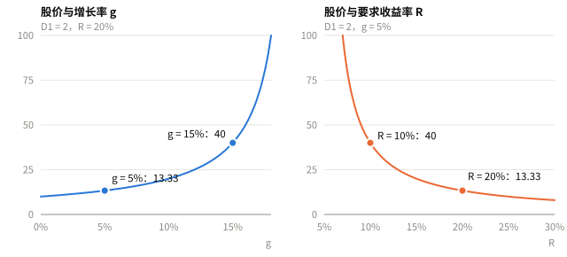
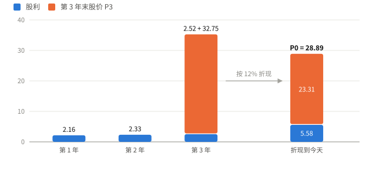
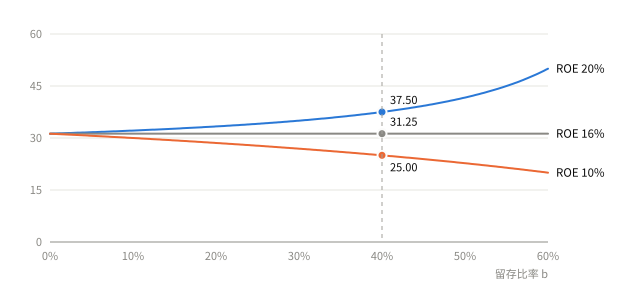

# 第 9 讲 股票估值

Stock Valuation

## 9.1 股票的现金流 Cash Flows for Stockholders { data-toc-label="9.1 股票的现金流" }

持有股票有两种现金流入：公司发放的股利，以及卖出股票的价款。股价等于这些预期现金流的现值。

!!! example "例 A · 持有期不影响股价"

    预计 1 年后发放股利 2.00，此后股利和股价每年增长 5%；要求收益率 20%。

    | 持有期 | 现金流 | 现值 |
    | --- | --- | ---: |
    | 1 年 | 第 1 年 2.00 + 卖价 14.00 | $\dfrac{16.00}{1.2} = 13.33$ |
    | 2 年 | 第 1 年 2.00；第 2 年 2.10 + 卖价 14.70 | $\dfrac{2.00}{1.2} + \dfrac{16.80}{1.2^2} = 13.33$ |
    | 3 年 | 第 1 年 2.00；第 2 年 2.10；第 3 年 2.205 + 卖价 15.435 | $\dfrac{2.00}{1.2} + \dfrac{2.10}{1.2^2} + \dfrac{17.64}{1.2^3} = 13.33$ |

    无论持有多久，价值都是 13.33。未来的卖价本身也是此后股利的现值。

把卖出时点不断往后推，卖价的现值趋于 0，股价就是全部未来股利的现值：

$$
P_0 = \frac{D_1}{1+R} + \frac{D_2}{(1+R)^2} + \frac{D_3}{(1+R)^3} + \cdots = \sum_{t=1}^{\infty} \frac{D_t}{(1+R)^t}
$$

无法逐年预测无穷多期股利，所以按股利的增长方式分三种情形处理：

| 情形 | 股利的变化 | 对应公式 |
| --- | --- | --- |
| 零增长 | 每期股利固定，类似优先股 | 永续年金 |
| 固定增长 | 每期按固定比例 $g$ 增长 | 增长永续年金 |
| 非固定增长 | 前几年增长率不规则，之后稳定增长 | 逐年折现 + 增长永续年金 |

## 9.2 零增长 Zero Growth { data-toc-label="9.2 零增长" }

$$
P_0 = \frac{D}{R}
$$

!!! example "例"

    - 每季度发放股利 0.50，要求收益率 10%，按季度复利：$P_0 = 0.50 / (10\% / 4) = 20.00$
    - 每年固定发放股利 1.25，要求收益率 15%：$P_0 = 1.25 / 0.15 = 8.33$

!!! warning "易错"

    股利和收益率的期间要一致：季度股利除以季度收益率，年股利除以年收益率。

## 9.3 固定增长 Constant Growth { data-toc-label="9.3 固定增长" }

股利增长模型
:   股利每年按固定比例 $g$ 永续增长时，股价是增长永续年金的现值（dividend growth model），又称戈登模型。

$$
P_0 = \frac{D_1}{R - g} = \frac{D_0(1+g)}{R - g}
$$

要求 $R > g$。$D_0$ 是刚刚发放的股利，$D_1$ 是下一期的股利。

!!! example "例 B"

    | 已知 | 计算 | 股价 |
    | --- | --- | ---: |
    | 刚发放 0.50，$g$ = 2%，$R$ = 15% | $0.50 \times 1.02 / (0.15 - 0.02)$ | 3.92 |
    | 1 年后发放 2.00，$g$ = 5%，$R$ = 20% | $2.00 / (0.20 - 0.05)$ | 13.33 |
    | 刚发放 1.45，$g$ = 2.8%，$R$ = 14% | $1.45 \times 1.028 / (0.14 - 0.028)$ | 13.31 |

    第二行就是例 A 的股票，与逐年折现的结果相同。

!!! warning "易错"

    题目说"刚刚发放"或"去年发放"的是 $D_0$，分子要乘 $(1+g)$；说"预计下一年发放"的是 $D_1$，直接用。

!!! example "例 C · 未来某年的股价"

    下一期股利 4.00，$g$ = 6%，$R$ = 16%。

    - 今天：$P_0 = 4.00 / (0.16 - 0.06) = 40.00$
    - 第 4 年末：$P_4 = D_5 / (R - g) = 4.00 \times 1.06^4 / 0.10 = 50.50$

    也可以直接算 $P_4 = P_0 \times 1.06^4 = 50.50$。固定增长模型下，股价与股利以同一速度 g 增长。

{ .cf-fig }

**图 1 股价对增长率和要求收益率的敏感性**。分母 $R - g$ 越小股价越高：$g$ 从 5% 升到 15%，或 $R$ 从 20% 降到 10%，股价都从 13.33 升到 40；$g$ 接近 $R$ 时股价急剧上升。
{ .cf-caption }

## 9.4 非固定增长 Differential Growth { data-toc-label="9.4 非固定增长" }

股利前 $N$ 年按 $g_1$ 增长，之后按 $g_2$ 永续增长。估值分三步：

1. 逐年算出前 $N$ 年的股利。
2. 用固定增长模型求第 $N$ 年末的股价：$P_N = D_{N+1} / (R - g_2)$。
3. 把前 $N$ 年的股利和 $P_N$ 一起折现到今天。

$$
P_0 = \frac{D_1}{R - g_1}\left[1 - \left(\frac{1+g_1}{1+R}\right)^N\right] + \frac{P_N}{(1+R)^N}
$$

第一项是前 $N$ 年股利构成的增长年金，第二项是第 $N$ 年末股价的现值。

!!! example "例 D"

    刚发放股利 2.00，未来 3 年每年增长 8%，之后每年增长 4%；要求收益率 12%。

    | 年 | 股利 | 计算 |
    | --- | ---: | --- |
    | 1 | 2.16 | $2 \times 1.08$ |
    | 2 | 2.33 | $2 \times 1.08^2$ |
    | 3 | 2.52 | $2 \times 1.08^3$ |
    | 4 | 2.62 | $2 \times 1.08^3 \times 1.04$ |

    - 第 3 年末股价：$P_3 = 2.62 / (0.12 - 0.04) = 32.75$
    - 逐年折现：$P_0 = \dfrac{2.16}{1.12} + \dfrac{2.33}{1.12^2} + \dfrac{2.52 + 32.75}{1.12^3} = 28.89$
    - 用公式：

    $$
    P_0 = \frac{2.16}{0.12 - 0.08}\left[1 - \left(\frac{1.08}{1.12}\right)^3\right] + \frac{32.75}{1.12^3} = 5.58 + 23.31 = 28.89
    $$

{ .cf-fig }

**图 2 非固定增长股票的价值构成**。前 3 年股利的现值只有 5.58，第 3 年末股价的现值 23.31 占股价的 81%。
{ .cf-caption }

!!! warning "易错"

    $P_N$ 的分子是 $D_{N+1}$，不是 $D_N$；$P_N$ 是第 $N$ 年末的价值，要折现 $N$ 年，不是 $N+1$ 年。

!!! example "例 E · 超常增长"

    刚发放股利 1.00，第 1 年增长 20%，第 2 年增长 15%，之后每年增长 5%；要求收益率 20%。

    - $D_1 = 1.20$，$D_2 = 1.38$，$D_3 = 1.449$
    - $P_2 = 1.449 / (0.20 - 0.05) = 9.66$
    - $P_0 = \dfrac{1.20}{1.2} + \dfrac{1.38}{1.2^2} + \dfrac{9.66}{1.2^2} = 1.0000 + 0.9583 + 6.7083 = 8.67$

!!! example "例 F · 股利先跳升再稳定增长"

    过去一直每年发放 2.40；明年起提高 10% 并维持 3 年，之后每年增长 2%；要求收益率 12%。

    - 第 1–3 年股利均为 $2.40 \times 1.10 = 2.64$
    - $P_3 = 2.64 \times 1.02 / (0.12 - 0.02) = 26.93$
    - $P_0 = 2.64 \times \dfrac{1 - 1.12^{-3}}{0.12} + \dfrac{26.93}{1.12^3} = 6.34 + 19.17 = 25.51$

## 9.5 参数估计 Estimating g and R { data-toc-label="9.5 参数估计" }

### 增长率 g

公司的增长来自把盈利留下再投资：

$$
\text{下一年盈利} = \text{今年盈利} + \text{今年留存收益} \times \text{留存收益回报率}
$$

两边同除以今年盈利：

$$
g = b \times ROE
$$

留存比率 $b$
:   留存收益占净利润的比例，等于 1 − 股利支付率（retention ratio）。

$ROE$
:   留存收益的回报率，通常用净资产收益率代替（return on retained earnings）。

!!! example "例 · 历史平均法"

    | 年份 | 股利 | 增长率 |
    | --- | ---: | ---: |
    | 2005 | 1.23 | |
    | 2006 | 1.30 | 5.7% |
    | 2007 | 1.36 | 4.6% |
    | 2008 | 1.43 | 5.1% |
    | 2009 | 1.50 | 4.9% |

    $g$ ≈ (5.7% + 4.6% + 5.1% + 4.9%) ÷ 4 = 5.1%

### 要求收益率 R

把股利增长模型变形，要求收益率分成两部分：

$$
R = \frac{D_1}{P_0} + g
$$

$D_1 / P_0$ 是股利收益率，$g$ 是资本利得收益率，因为股价也按 $g$ 增长。

!!! example "例"

    例 C 的股票价格 40.00，下一期股利 4.00，$g$ = 6%：$R = 4.00 / 40.00 + 6\% = 10\% + 6\% = 16\%$。

股利增长模型简单易用，但有明显局限：

- 只适用于正在发放股利的公司
- 股利增长率不稳定时不适用
- 对 $g$ 极其敏感：$g$ 高估 1 个百分点，$R$ 就高估 1 个百分点
- 没有直接考虑风险

## 9.6 增长机会 Growth Opportunities { data-toc-label="9.6 增长机会" }

增长机会
:   投资于 NPV 为正的项目的机会（growth opportunities）。

$$
P = \frac{EPS}{R} + NPVGO
$$

$EPS / R$ 是公司把盈利全部作为股利发放、不再增长时的价值，称为现金牛价值；$NPVGO$ 是增长机会的净现值。

!!! example "例 G"

    预计每股收益 5.00，要求收益率 16%，股价 75.00。

    - 现金牛价值 = 5.00 / 0.16 = 31.25
    - NPVGO = 75.00 − 31.25 = 43.75

    股价中超过一半来自市场对增长机会的预期。

提高留存比率有两个相反的作用：当期股利减少，增长率提高。只有 ROE > R 时，多留存才能提高股价。

!!! example "例 H · 留存多少合适"

    下一年每股收益 5.00，要求收益率 16%，留存比率 40%，即股利 3.00。

    | ROE | g = b × ROE | 股价 = 3.00 ÷ (R − g) | 与全部发放的 31.25 相比 |
    | --- | ---: | ---: | --- |
    | 20% | 8.0% | 37.50 | 更高 |
    | 16% | 6.4% | 31.25 | 相同 |
    | 10% | 4.0% | 25.00 | 更低 |

{ .cf-fig }

**图 3 留存比率对股价的影响**。ROE 高于要求收益率 16% 时，留存越多股价越高；ROE 等于 16% 时留存不影响股价；ROE 低于 16% 时，留存反而损害股东价值。
{ .cf-caption }

!!! example "例 I · 有期限的增长机会"

    公司每股收益 9.40，不增长，全部作为股利发放；要求收益率 12%。现有一个项目：1 年后每股投资 1.95，此后两年每股收益分别增加 2.75 和 3.05，然后结束。

    - 不投资：$P = 9.40 / 0.12 = 78.33$
    - $NPVGO = -\dfrac{1.95}{1.12} + \dfrac{2.75}{1.12^2} + \dfrac{3.05}{1.12^3} = 2.62$
    - 投资：$P = 78.33 + 2.62 = 80.95$
    - 第 4 年末项目已经结束，股价回到 78.33

## 9.7 市盈率 Price-Earnings Ratio { data-toc-label="9.7 市盈率" }

$$
P/E = \frac{\text{每股价格}}{EPS}
$$

把 $P = EPS/R + NPVGO$ 两边同除以 $EPS$：

$$
P/E = \frac{1}{R} + \frac{NPVGO}{EPS}
$$

市盈率与增长机会正相关，与风险 R 负相关。

!!! example "例 G 续"

    $P/E = 75.00 / 5.00 = 15$，其中 $1/0.16 = 6.25$ 来自现有盈利，$43.75 / 5.00 = 8.75$ 来自增长机会。

!!! warning "易错"

    市盈率高不一定说明股价被高估，可能是市场预期公司有大量 NPV 为正的投资机会，也可能是风险低、要求收益率低。

## 9.8 公式速查 Formulas { data-toc-label="9.8 公式速查" }

| 指标 | 公式 |
| --- | --- |
| 股价 | 全部未来股利的现值 $\sum D_t / (1+R)^t$ |
| 零增长 | $D / R$ |
| 固定增长 | $D_1 / (R - g)$，$D_1 = D_0(1+g)$ |
| 第 $N$ 年末股价 | $P_N = D_{N+1} / (R - g)$ |
| 非固定增长 | 前 $N$ 年股利现值 + $P_N / (1+R)^N$ |
| 增长率 | $g = b \times ROE$ |
| 要求收益率 | $R = D_1 / P_0 + g$ |
| 增长机会 | $P = EPS / R + NPVGO$ |
| 市盈率 | $P/E = 1/R + NPVGO / EPS$ |

## 9.9 自测 Quick Quiz { data-toc-label="9.9 自测" }

!!! question "1. 刚发放股利 3.00，股利每年增长 5%，要求收益率 12%，股价是多少？"

    ??? success "参考答案"

        $3.00 \times 1.05 / (0.12 - 0.05) = 45.00$。

!!! question "2. 股价 30.00，刚发放股利 1.50，预计股利每年增长 4%，要求收益率是多少？"

    ??? success "参考答案"

        $D_1 = 1.50 \times 1.04 = 1.56$；$R = 1.56 / 30.00 + 4\% = 5.2\% + 4\% = 9.2\%$。

!!! question "3. 刚发放股利 1.00，未来 2 年每年增长 25%，之后每年增长 6%，要求收益率 14%，股价是多少？"

    ??? success "参考答案"

        $D_1 = 1.25$，$D_2 = 1.5625$，$P_2 = 1.5625 \times 1.06 / 0.08 = 20.70$；$P_0 = 1.25/1.14 + (1.5625 + 20.70)/1.14^2 = 1.10 + 17.13 = 18.23$。

!!! question "4. 留存比率 60%，ROE 15%，可持续的股利增长率是多少？"

    ??? success "参考答案"

        $g = 60\% \times 15\% = 9\%$。

!!! question "5. 每股收益 4.00，要求收益率 12%，股价 50.00，NPVGO 是多少？"

    ??? success "参考答案"

        现金牛价值 = 4.00 / 0.12 = 33.33；NPVGO = 50.00 − 33.33 = 16.67。

!!! question "6. ROE 低于要求收益率时，公司应该多留存还是多发股利？"

    ??? success "参考答案"

        多发股利。留存收益的回报低于股东要求的收益率，多留存会降低股价。

!!! question "7. 为什么股利增长模型不适合估值高速成长、不发股利的公司？"

    ??? success "参考答案"

        模型要求公司正在发放股利，且股利以低于 R 的固定速度增长。不发股利时没有 $D_1$；增长率接近或超过 R 时公式失效。
