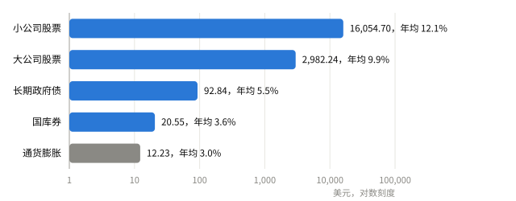
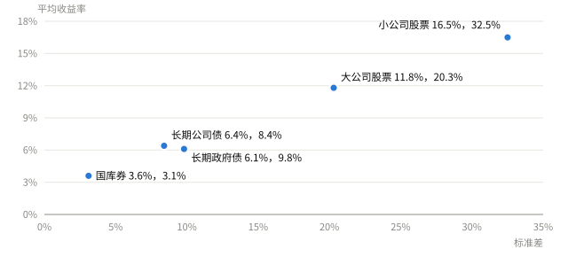
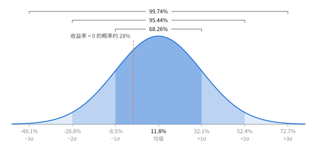

# 第 10 讲 风险与收益：历史的启示

Risk and Return: Lessons from Market History

## 10.1 收益 Returns { data-toc-label="10.1 收益" }

投资一项资产的收益由两部分组成：持有期间收到的现金，例如股利；以及资产价值的变化，即资本利得或损失。

金额收益
:   收到的现金 + 资产价值的变化（dollar return）。

百分比收益
:   金额收益 ÷ 期初投资额（percentage return）。

$$
R = \frac{D_1 + (P_1 - P_0)}{P_0} = \underbrace{\frac{D_1}{P_0}}_{\text{股利收益率}} + \underbrace{\frac{P_1 - P_0}{P_0}}_{\text{资本利得收益率}}
$$

!!! example "例 A"

    一年前以每股 45 元买入 100 股，期间每股收到股利 0.27 元，年末股价 48 元。

    - 期初投资：45 × 100 = 4,500
    - 金额收益：股利 27 + 资本利得 (4,800 − 4,500) = 327
    - 百分比收益：327 ÷ 4,500 = 7.27%，其中股利收益率 0.27 ÷ 45 = 0.60%，资本利得收益率 3 ÷ 45 = 6.67%

!!! warning "易错"

    没有卖出的股票，价格上涨也算收益。是否卖出不影响收益率的计算，只影响是否实现。

## 10.2 持有期收益率 Holding Period Return { data-toc-label="10.2 持有期收益率" }

持有期收益率
:   持有资产整个期间的总收益率，各期收益按复利累积（holding period return）。

$$
\text{持有期收益率} = (1 + R_1)(1 + R_2) \cdots (1 + R_T) - 1
$$

!!! example "例 B"

    某投资 4 年的年收益率依次为 10%、−5%、20%、15%。

    $$
    \text{持有期收益率} = 1.10 \times 0.95 \times 1.20 \times 1.15 - 1 = 44.21\%
    $$

!!! warning "易错"

    各年收益率不能直接相加。10% − 5% + 20% + 15% = 40%，少算了收益再投资带来的部分。

## 10.3 资本市场的历史收益 Historical Returns { data-toc-label="10.3 资本市场的历史收益" }

Ibbotson 和 Sinquefield 整理了美国自 1926 年起五类金融资产的逐年收益率：

| 资产 | 构成 |
| --- | --- |
| 大公司股票 Large-Company Stocks | 标普 500 指数成分股 |
| 小公司股票 Small-Company Stocks | 按市值排在纽交所后 20% 的公司 |
| 长期公司债 Long-Term Corporate Bonds | 高等级长期公司债 |
| 长期政府债 Long-Term Government Bonds | 剩余期限 20 年的美国国债 |
| 国库券 Treasury Bills | 期限 1 个月的美国国库券 |

{ .cf-fig }

**图 1 1925 年末投资 1 美元，到 2010 年末的价值**。横轴为对数刻度。85 年间小公司股票增长到 1.6 万美元，国库券只有 20.55 美元，仅略高于通货膨胀。年均为按 85 年复利折算的几何平均收益率。
{ .cf-caption }

| 1926–2011 | 平均年收益率 | 标准差 |
| --- | ---: | ---: |
| 大公司股票 | 11.8% | 20.3% |
| 小公司股票 | 16.5% | 32.5% |
| 长期公司债 | 6.4% | 8.4% |
| 长期政府债 | 6.1% | 9.8% |
| 国库券 | 3.6% | 3.1% |
| 通货膨胀 | 3.1% | 4.2% |

## 10.4 风险溢价 Risk Premiums { data-toc-label="10.4 风险溢价" }

无风险利率
:   没有任何风险的投资所能获得的收益率（risk-free rate）。通常用国库券收益率代表。

风险溢价
:   风险资产的收益率超过无风险利率的部分，是对承担风险的补偿（risk premium）。

$$
\text{风险溢价} = \text{风险资产的平均收益率} - \text{无风险利率}
$$

| 1926–2011 | 平均年收益率 | 风险溢价 |
| --- | ---: | ---: |
| 大公司股票 | 11.8% | 8.2% |
| 小公司股票 | 16.5% | 12.9% |
| 长期公司债 | 6.4% | 2.8% |
| 长期政府债 | 6.1% | 2.5% |
| 国库券 | 3.6% | 0 |

国库券的风险溢价按定义为 0。

{ .cf-fig }

**图 2 风险与收益**。1926–2011 年，标准差越大的资产平均收益率越高。承担更多风险，才可能获得更高的平均收益。
{ .cf-caption }

## 10.5 风险的度量 Risk Statistics { data-toc-label="10.5 风险的度量" }

风险没有公认的唯一定义。本讲用方差和标准差衡量收益率偏离平均值的程度。

$$
\bar{R} = \frac{R_1 + R_2 + \cdots + R_T}{T}
\qquad
\sigma^2 = \frac{\sum_{t=1}^{T} (R_t - \bar{R})^2}{T - 1}
\qquad
\sigma = \sqrt{\sigma^2}
$$

$T$ 为观测期数。用历史样本估计时，方差的分母是 $T - 1$。

!!! example "例 C"

    沿用例 B 的 4 年收益率 10%、−5%、20%、15%。

    | 年 | $R_t$ | $R_t - \bar{R}$ | $(R_t - \bar{R})^2$ |
    | --- | ---: | ---: | ---: |
    | 1 | 0.10 | 0.00 | 0.0000 |
    | 2 | −0.05 | −0.15 | 0.0225 |
    | 3 | 0.20 | 0.10 | 0.0100 |
    | 4 | 0.15 | 0.05 | 0.0025 |
    | 合计 | 0.40 | | 0.0350 |

    - 平均收益率：0.40 ÷ 4 = 10%
    - 方差：0.0350 ÷ 3 = 0.011667
    - 标准差：$\sqrt{0.011667} = 10.80\%$

!!! warning "易错"

    方差的单位是"百分比的平方"，不能直接与收益率比较；比较风险时用标准差。

## 10.6 正态分布 Normal Distribution { data-toc-label="10.6 正态分布" }

样本足够大时，正态分布的频率图呈对称的钟形，完全由均值和标准差决定。

| 范围 | 落入的概率 |
| --- | ---: |
| 均值 ± 1 个标准差 | 68.26% |
| 均值 ± 2 个标准差 | 95.44% |
| 均值 ± 3 个标准差 | 99.74% |

!!! example "例 D"

    大公司股票的平均年收益率 11.8%，标准差 20.3%。若年收益率近似服从正态分布：

    - 约 2/3 的年份，收益率落在 11.8% ± 20.3%，即 −8.5% 到 32.1% 之间
    - 约 95% 的年份，收益率落在 −28.8% 到 52.4% 之间
    - 收益率低于 −28.8% 的概率约为 (1 − 95.44%) ÷ 2 = 2.28%

{ .cf-fig }

**图 3 大公司股票年收益率的分布**。按均值 11.8%、标准差 20.3% 的正态分布近似，大约每 3.5 年就有 1 年亏损。
{ .cf-caption }

## 10.7 算术平均与几何平均 Arithmetic vs. Geometric Average { data-toc-label="10.7 算术平均与几何平均" }

算术平均收益率
:   各期收益率的简单平均，反映一个典型年份的收益（arithmetic average）。

几何平均收益率
:   多期复利下每期的平均收益率（geometric average）。

$$
\bar{R}_A = \frac{R_1 + R_2 + \cdots + R_T}{T}
$$

$$
\bar{R}_G = \left[(1 + R_1)(1 + R_2) \cdots (1 + R_T)\right]^{1/T} - 1
$$

!!! example "例 E"

    沿用例 B 的 4 年收益率。

    - 算术平均：(10% − 5% + 20% + 15%) ÷ 4 = 10%
    - 几何平均：$(1.10 \times 0.95 \times 1.20 \times 1.15)^{1/4} - 1 = 1.4421^{1/4} - 1 = 9.58\%$
    - 验证：$1.0958^4 = 1.4421$，与持有期收益率 44.21% 一致

除非各期收益率完全相同，几何平均总是小于算术平均；收益率波动越大，两者差距越大。

!!! tip "用哪种平均"

    - 描述过去多年的实际复利增长，用几何平均
    - 估计下一年的期望收益率，用算术平均

!!! example "例 F · 长期数据对比"

    | 资产 | 算术平均 1926–2011 | 几何平均 1926–2010 |
    | --- | ---: | ---: |
    | 小公司股票 | 16.5% | 12.1% |
    | 大公司股票 | 11.8% | 9.9% |
    | 长期政府债 | 6.1% | 5.5% |
    | 国库券 | 3.6% | 3.6% |

    几何平均由图 1 的期末价值折算。两组数据的期间相差一年，但规律清楚：小公司股票波动最大，两种平均差 4.4 个百分点；国库券几乎不波动，两者基本相同。

## 10.8 公式速查 Formulas { data-toc-label="10.8 公式速查" }

| 指标 | 公式 |
| --- | --- |
| 百分比收益 | $[D_1 + (P_1 - P_0)] / P_0$ |
| 股利收益率 | $D_1 / P_0$ |
| 资本利得收益率 | $(P_1 - P_0) / P_0$ |
| 持有期收益率 | $(1+R_1)(1+R_2)\cdots(1+R_T) - 1$ |
| 风险溢价 | 平均收益率 − 无风险利率 |
| 方差 | $\sum (R_t - \bar{R})^2 / (T - 1)$ |
| 标准差 | $\sqrt{\text{方差}}$ |
| 算术平均 | $\sum R_t / T$ |
| 几何平均 | $[\prod (1 + R_t)]^{1/T} - 1$ |

## 10.9 自测 Quick Quiz { data-toc-label="10.9 自测" }

!!! question "1. 年初以 50 元买入股票，年内收到股利 1.50 元，年末股价 52 元。总收益率、股利收益率和资本利得收益率各是多少？"

    ??? success "参考答案"

        总收益率 = (1.50 + 2) ÷ 50 = 7%；股利收益率 = 1.50 ÷ 50 = 3%；资本利得收益率 = 2 ÷ 50 = 4%。

!!! question "2. 1926–2011 年，哪类资产的平均收益率和风险溢价最高？哪类标准差最大？"

    ??? success "参考答案"

        都是小公司股票：平均收益率 16.5%，风险溢价 12.9%，标准差 32.5%。

!!! question "3. 3 年收益率依次为 12%、−8%、20%，求算术平均、几何平均和标准差。"

    ??? success "参考答案"

        算术平均 = 24% ÷ 3 = 8%；几何平均 = $(1.12 \times 0.92 \times 1.20)^{1/3} - 1 = 7.33\%$；方差 = (0.04² + 0.16² + 0.12²) ÷ 2 = 0.0208，标准差 = 14.42%。

!!! question "4. 某资产平均年收益率 10%，标准差 15%，收益率近似服从正态分布。约 95% 的年份收益率落在什么范围？"

    ??? success "参考答案"

        10% ± 2 × 15%，即 −20% 到 40%。

!!! question "5. 为什么几何平均不会大于算术平均？"

    ??? success "参考答案"

        亏损后需要更高的收益才能回本，波动会侵蚀复利增长。只有各期收益率完全相同时两者才相等，波动越大差距越大。
