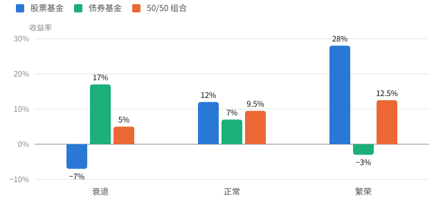
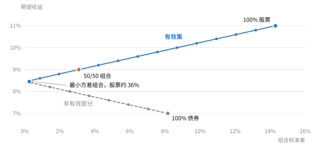
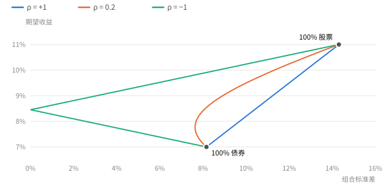
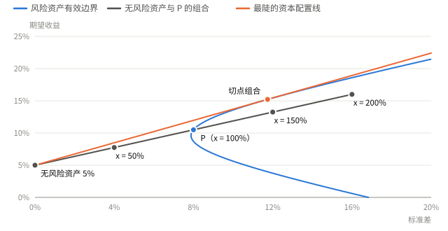
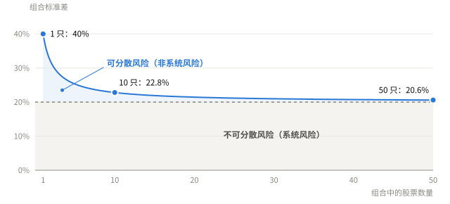
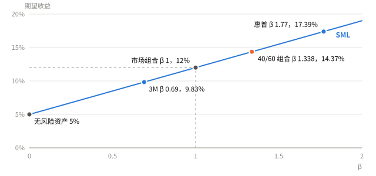

# 第 11 讲 收益与风险：资本资产定价模型

Return and Risk: The Capital Asset Pricing Model (CAPM)

## 11.1 期望收益与方差 Expected Return and Variance { data-toc-label="11.1 期望收益与方差" }

单个证券关注三类特征：期望收益，方差与标准差，与其他证券或市场指数的协方差和相关系数。第 10 讲用历史数据描述过去，本讲用各种经济状态的概率描述未来。

期望收益
:   各种状态下收益率的概率加权平均（expected return）。

$$
E(R) = \sum_{i=1}^{n} p_i R_i
$$

方差
:   收益率偏离期望收益的平方的概率加权平均（variance）。方差越大，可能的收益越分散。

$$
\sigma^2 = \sum_{i=1}^{n} p_i \left[R_i - E(R)\right]^2
\qquad
\sigma = \sqrt{\sigma^2}
$$

!!! example "例 A · 股票基金与债券基金"

    经济有衰退、正常、繁荣三种状态，概率各为 1/3。市场上只有股票基金和债券基金两种资产。

    | 状态 | 股票基金 | 偏差平方 | 债券基金 | 偏差平方 |
    | --- | ---: | ---: | ---: | ---: |
    | 衰退 | −7% | 0.0324 | 17% | 0.0100 |
    | 正常 | 12% | 0.0001 | 7% | 0.0000 |
    | 繁荣 | 28% | 0.0289 | −3% | 0.0100 |

    - 股票基金：期望收益 (−7% + 12% + 28%) ÷ 3 = 11%；方差 (0.0324 + 0.0001 + 0.0289) ÷ 3 = 0.0205；标准差 14.31%
    - 债券基金：期望收益 (17% + 7% − 3%) ÷ 3 = 7%；方差 0.0200 ÷ 3 = 0.0067；标准差 8.16%

    股票基金的期望收益和风险都高于债券基金。

!!! warning "易错"

    这里的方差按概率加权，分母不是 T − 1。T − 1 只用于由历史样本估计方差。

## 11.2 协方差与相关系数 Covariance and Correlation { data-toc-label="11.2 协方差与相关系数" }

协方差
:   两种证券收益率偏离各自期望值的乘积的期望（covariance）。为正说明两者倾向同向变动，为负说明倾向反向变动。

$$
\text{Cov}(R_i, R_j) = E\big[(R_i - E[R_i])(R_j - E[R_j])\big]
$$

用历史数据估计：

$$
\text{Cov}(R_i, R_j) = \frac{1}{T-1} \sum_{t=1}^{T} (R_{i,t} - \bar{R}_i)(R_{j,t} - \bar{R}_j)
$$

相关系数
:   协方差除以两者标准差的乘积（correlation），衡量共同风险且不受各自波动大小的影响，取值在 −1 到 +1 之间。

$$
\rho_{ij} = \text{Corr}(R_i, R_j) = \frac{\text{Cov}(R_i, R_j)}{\sigma_i \, \sigma_j}
$$

| 相关系数 | 含义 |
| --- | --- |
| −1 | 完全负相关，总是反向变动 |
| −1 到 0 | 倾向反向变动 |
| 0 | 不相关，没有固定倾向 |
| 0 到 +1 | 倾向同向变动 |
| +1 | 完全正相关，总是同向变动 |

!!! example "例 B · 两只基金的协方差"

    沿用例 A。三种状态下股票基金的偏差为 −18%、1%、17%，债券基金的偏差为 10%、0、−10%。

    - 协方差：[(−0.18)(0.10) + (0.01)(0) + (0.17)(−0.10)] ÷ 3 = −0.0117
    - 相关系数：−0.0117 ÷ (0.1431 × 0.0816) = −0.999

    两只基金几乎完全负相关：经济好时股票涨、债券跌，经济差时正好相反。

## 11.3 组合的收益与风险 Portfolio Return and Risk { data-toc-label="11.3 组合的收益与风险" }

组合收益率是各证券收益率的加权平均，权重 $w$ 是投资于该证券的资金比例。组合的期望收益同样是加权平均。

$$
R_P = w_S R_S + w_B R_B
\qquad
E(R_P) = w_S E(R_S) + w_B E(R_B)
$$

组合方差还取决于两种证券的协方差：

$$
\sigma_P^2 = w_1^2 \sigma_1^2 + w_2^2 \sigma_2^2 + 2 w_1 w_2 \, \text{Cov}(R_1, R_2)
$$

!!! example "例 C · 50/50 组合"

    沿用例 A，股票基金和债券基金各投资 50%。

    | 状态 | 股票基金 | 债券基金 | 组合 | 偏差平方 |
    | --- | ---: | ---: | ---: | ---: |
    | 衰退 | −7% | 17% | 5.0% | 0.001600 |
    | 正常 | 12% | 7% | 9.5% | 0.000025 |
    | 繁荣 | 28% | −3% | 12.5% | 0.001225 |

    - 衰退时组合收益率：50% × (−7%) + 50% × 17% = 5%
    - 期望收益：50% × 11% + 50% × 7% = 9%
    - 方差：(0.001600 + 0.000025 + 0.001225) ÷ 3 = 0.00095；标准差 3.08%
    - 用公式验证：0.5² × 0.0205 + 0.5² × 0.0067 + 2 × 0.5 × 0.5 × (−0.0117) = 0.00095

    组合的标准差 3.08%，既低于股票基金的 14.31%，也低于债券基金的 8.16%。

!!! warning "易错"

    期望收益可以加权平均，方差不行。直接对方差加权平均得到 0.5 × 0.0205 + 0.5 × 0.0067 = 0.0136，远高于实际的 0.00095。

{ .cf-fig }

**图 1 三种经济状态下的收益率**。股票基金在衰退时亏损 7%，债券基金同期上涨 17%，两者相互抵消，50/50 组合在每种状态下都赚 5% 到 12.5%。
{ .cf-caption }

分散化
:   把多种证券放入组合以降低风险（diversification）。能降低多少，取决于证券承受共同风险、价格同涨同跌的程度。

例如燃油是航空公司的主要成本，航空股表现好时石油股往往表现差，反之亦然，两者组合的风险低于单独持有任何一只。

- 两只股票完全负相关：一只的高收益正好抵消另一只的低收益，组合收益率可以稳定在平均值，风险完全消除
- 两只股票完全正相关：组合与单只股票同涨同跌，风险无法降低

## 11.4 两种资产的有效集 Efficient Set for Two Assets { data-toc-label="11.4 两种资产的有效集" }

改变股票基金和债券基金的权重，可以得到一系列不同的期望收益与标准差。

机会集
:   用给定资产构建的所有组合的期望收益与标准差的集合，也称可行集（opportunity set / feasible set）。

有效集
:   给定风险下期望收益最高、或给定期望收益下风险最低的组合，也称有效边界（efficient set / efficient frontier）。

最小方差组合
:   机会集中标准差最小的组合（minimum variance portfolio）。机会集中位于它上方的部分就是有效集。

| 股票权重 | 标准差 | 期望收益 |
| ---: | ---: | ---: |
| 0 | 8.2% | 7.0% |
| 25% | 2.6% | 8.0% |
| 35% | 0.4% | 8.4% |
| 50% | 3.1% | 9.0% |
| 75% | 8.7% | 10.0% |
| 100% | 14.3% | 11.0% |

{ .cf-fig }

**图 2 股票基金与债券基金组合的机会集**。股票权重每增加 5% 取一个点。最小方差组合下方的组合风险更高、收益更低，理性投资者不会选择。
{ .cf-caption }

两种资产的最小方差组合中，第一种资产的权重为：

$$
w_1^{*} = \frac{\sigma_2^2 - \text{Cov}(R_1, R_2)}{\sigma_1^2 + \sigma_2^2 - 2\,\text{Cov}(R_1, R_2)}
$$

本例股票基金的权重约为 36%，此时组合标准差只有约 0.26%，期望收益约 8.45%。

相关系数不影响组合的期望收益，只影响组合的风险。相关系数越低，同样权重下组合的标准差越低。

- ρ = +1：机会集是连接两种资产的直线，无法降低风险
- ρ = −1：机会集是两段折线，可以构建零风险组合
- −1 < ρ < +1：机会集是向左弯曲的曲线，相关系数越低弯得越厉害

{ .cf-fig }

**图 3 相关系数对机会集的影响**。两个端点仍是股票基金和债券基金，只改变两者的相关系数。例 B 中两只基金的相关系数约为 −0.999，所以图 2 的机会集几乎就是 ρ = −1 的折线。
{ .cf-caption }

## 11.5 卖空 Short Sales { data-toc-label="11.5 卖空" }

多头
:   对证券的正投资，权重为正（long position）。

空头
:   对证券的负投资，权重为负（short position）。卖空是先卖出自己并不拥有的股票，将来再买回，预期股价下跌时有利。

卖空一种资产得到的资金可以加投另一种资产，所以权重可以超过 100%，组合的期望收益和风险都可以超出两种资产本身的范围。

!!! example "例 D · 卖空可口可乐"

    英特尔期望收益 26%、标准差 50%；可口可乐期望收益 6%、标准差 25%；两者不相关。卖空价值相当于本金 50% 的可口可乐，连同本金一起买入价值相当于本金 150% 的英特尔。

    - 期望收益：1.5 × 26% + (−0.5) × 6% = 36%
    - 标准差：√(1.5² × 0.50² + 0.5² × 0.25²) = 76%

    反过来卖空 50% 英特尔、买入 150% 可口可乐，期望收益为 −4%，标准差为 45%，风险更高而收益为负，不在有效集上。

## 11.6 多种资产的有效集 Efficient Set for Many Securities { data-toc-label="11.6 多种资产的有效集" }

资产多于两种时，机会集不再是一条曲线，而是一个区域，单个资产都落在区域内部。区域左边界上最左的点是最小方差组合，它上方的边界就是有效集。

加入更多资产会使有效集向左上方扩展：同样的风险下可以获得更高的期望收益。

## 11.7 无风险借贷 Riskless Borrowing and Lending { data-toc-label="11.7 无风险借贷" }

把一部分资金投资于国库券等无风险资产，可以降低风险，但通常也会降低期望收益；追求高收益的投资者则可以借钱，加大对股票的投资。

比例 $x$ 投资于风险组合 P，其余 $1 - x$ 投资于无风险资产：

$$
E(R_{xP}) = r_f + x\left[E(R_P) - r_f\right]
\qquad
\sigma_{xP} = x \, \sigma_P
$$

无风险资产的标准差为 0，与 P 的协方差也为 0，所以组合标准差与 $x$ 成正比，所有组合都落在从 $r_f$ 出发、经过 P 的直线上。

- $0 < x < 1$：一部分资金借出，即买入国库券
- $x > 1$：按无风险利率借钱买入更多 P，即保证金买入（buying on margin）

!!! example "例 E · 无风险资产与风险组合 P"

    无风险利率 5%，风险组合 P 的期望收益 10.5%、标准差 8%。

    | 投资于 P 的比例 | 期望收益 | 标准差 |
    | ---: | ---: | ---: |
    | 0 | 5.00% | 0 |
    | 50% | 7.75% | 4% |
    | 100% | 10.50% | 8% |
    | 150% | 13.25% | 12% |
    | 200% | 16.00% | 16% |

    x = 150% 时：期望收益 5% + 1.5 × (10.5% − 5%) = 13.25%，标准差 1.5 × 8% = 12%。

这条直线的斜率是承担单位风险得到的超额收益，称为夏普比率（Sharpe ratio）：

$$
\text{斜率} = \frac{E(R_P) - r_f}{\sigma_P}
$$

从 $r_f$ 出发可以连向任何风险组合，得到许多条资本配置线。投资者应选择最陡的一条，即与风险资产有效集相切的直线，切点称为切点组合或有效组合（tangent / efficient portfolio）。

{ .cf-fig }

**图 4 无风险借贷与切点组合**。灰线是无风险资产与 P 的组合，橙线是与有效集相切的最陡直线。同样的风险下，橙线上的组合期望收益最高。风险资产有效边界为示意曲线。
{ .cf-caption }

## 11.8 市场均衡与资本市场线 Market Equilibrium and the CML { data-toc-label="11.8 市场均衡与资本市场线" }

CAPM 建立在三个假设上：

1. 投资者以竞争性市场价格买卖所有证券，没有税收和交易成本，并可以按无风险利率借贷
2. 投资者只持有有效组合，即给定波动率下期望收益最高的组合
3. 投资者对证券的波动率、相关系数和期望收益有相同的预期，即同质预期

在同质预期下，所有投资者算出同一个切点组合并持有它。所有投资者持有的风险证券加起来就是市场上的全部证券，需求必须等于供给，所以均衡时切点组合就是市场组合。

市场组合
:   按市值比例持有全部风险证券的组合（market portfolio）。

资本市场线
:   由无风险资产和市场组合构成的组合的期望收益与标准差之间的关系（capital market line, CML）。

$$
E(R_P) = R_f + \frac{E(R_M) - R_f}{\sigma_M} \, \sigma_P
$$

所有投资者面对同一条资本市场线，各自在线上的位置取决于风险承受能力：保守的投资者多持有无风险资产，激进的投资者借钱多买市场组合。

## 11.9 系统风险与非系统风险 Systematic and Unsystematic Risk { data-toc-label="11.9 系统风险与非系统风险" }

系统风险
:   影响大量资产的风险，各资产受影响的程度不同（systematic risk），也称市场风险、不可分散风险。例如 GNP、利率、通货膨胀等宏观经济的不确定性。

非系统风险
:   只影响单个资产或一小类资产的风险（unsystematic risk），也称公司特有风险、可分散风险。例如某家公司单独发布的消息。

$$
\text{总风险} = \text{系统风险} + \text{非系统风险}
$$

分散化能大幅降低收益率的波动，而期望收益并不随之同等下降：一种资产低于预期的收益会被另一种资产高于预期的收益抵消。但系统风险无法通过分散化消除。

N 只股票等权重组合，若每只股票方差都为 $\sigma^2$、任意两只之间的协方差都为 $\overline{\text{Cov}}$：

$$
\sigma_P^2 = \frac{1}{N}\,\sigma^2 + \left(1 - \frac{1}{N}\right)\overline{\text{Cov}}
$$

N 越大，第一项越接近 0，组合方差趋于协方差。大组合中方差项被分散掉，协方差项分散不掉。

{ .cf-fig }

**图 5 组合风险与股票数量**。假设每只股票标准差 40%、两两相关系数 0.25，组合标准差随股票数量增加而下降，但不会低于 20%，这部分就是系统风险。
{ .cf-caption }

## 11.10 贝塔系数 Beta { data-toc-label="11.10 贝塔系数" }

贝塔系数
:   市场组合的超额收益变动 1% 时，证券超额收益的预期变动百分比（beta, β），衡量证券的系统风险。

$$
\beta_i = \frac{\text{Cov}(R_i, R_M)}{\text{Var}(R_M)} = \rho_{iM} \, \frac{\sigma_i}{\sigma_M}
$$

| β | 含义 |
| --- | --- |
| β = 1 | 系统风险与市场整体相同 |
| β < 1 | 系统风险低于市场 |
| β > 1 | 系统风险高于市场 |

- 标准差衡量总风险，β 只衡量系统风险
- β 反映证券放在充分分散的组合中时的风险：非系统风险已被分散掉，只剩系统风险
- 证券的 β 取决于其收入和现金流对整体经济状况的敏感程度

!!! warning "易错"

    标准差高的股票 β 不一定高。如果一只股票的波动大多来自公司特有事件，它的标准差很大，β 却可能很小。

## 11.11 资本资产定价模型 Capital Asset Pricing Model { data-toc-label="11.11 资本资产定价模型" }

市场风险溢价
:   持有 β = 1 的组合，即市场组合，所期望获得的超额收益（market risk premium）。

$$
\text{市场风险溢价} = E(R_M) - r_f
$$

均衡时，所有资产和组合承担单位系统风险得到的报酬都相同，并等于市场组合的报酬：

$$
\frac{E(R_i) - R_f}{\beta_i} = \frac{E(R_M) - R_f}{1}
$$

整理得到资本资产定价模型：

$$
E(R_i) = R_f + \beta_i \left[E(R_M) - R_f\right]
$$

期望收益 = 无风险利率 + 风险溢价，其中风险溢价 = β × 市场风险溢价。知道资产的系统风险，就能用 CAPM 求出它的期望收益。

!!! example "例 F · 微软的期望收益"

    下一年市场收益率有 60% 的概率为 15%、40% 的概率为 5%。无风险利率 6%，微软的 β 为 1.18。

    - 市场期望收益：60% × 15% + 40% × 5% = 11%
    - 微软期望收益：6% + 1.18 × (11% − 6%) = 6% + 5.9% = 11.9%

## 11.12 证券市场线 Security Market Line { data-toc-label="11.12 证券市场线" }

证券市场线
:   反映期望收益与 β 之间关系的直线（security market line, SML），斜率为正。

SML 就是 CAPM 的图形：截距为 $R_f$，斜率为市场风险溢价 $E(R_M) - R_f$，市场组合位于 β = 1 处。

组合的 β 是各证券 β 的加权平均：

$$
\beta_P = \sum_i x_i \beta_i
$$

!!! example "例 G · 3M 与惠普的组合"

    3M 的 β 为 0.69，惠普的 β 为 1.77。无风险利率 5%，市场组合期望收益 12%。组合中 40% 投资 3M、60% 投资惠普。

    - 组合 β：0.40 × 0.69 + 0.60 × 1.77 = 1.338
    - 组合期望收益：5% + 1.338 × (12% − 5%) = 14.37%
    - 验证：3M 期望收益 5% + 0.69 × 7% = 9.83%，惠普 5% + 1.77 × 7% = 17.39%，加权平均 0.4 × 9.83% + 0.6 × 17.39% = 14.37%

{ .cf-fig }

**图 6 证券市场线**。按 CAPM，所有证券和组合都落在 SML 上，斜率为市场风险溢价 7%。
{ .cf-caption }

| 对比 | 资本市场线 CML | 证券市场线 SML |
| --- | --- | --- |
| 横轴 | 标准差 σ | β |
| 适用对象 | 有效组合 | 所有证券和组合 |
| 斜率 | $[E(R_M) - R_f] / \sigma_M$ | $E(R_M) - R_f$ |
| 单个证券 | 位于线下方，含可分散风险 | 位于线上 |

## 11.13 公式速查 Formulas { data-toc-label="11.13 公式速查" }

| 指标 | 公式 |
| --- | --- |
| 期望收益 | $\sum p_i R_i$ |
| 方差 | $\sum p_i [R_i - E(R)]^2$ |
| 协方差 | $E[(R_i - E[R_i])(R_j - E[R_j])]$ |
| 相关系数 | $\text{Cov}(R_i, R_j) / (\sigma_i \sigma_j)$ |
| 组合期望收益 | $\sum w_i E(R_i)$ |
| 两资产组合方差 | $w_1^2\sigma_1^2 + w_2^2\sigma_2^2 + 2w_1w_2\text{Cov}(R_1, R_2)$ |
| 无风险资产与 P 的组合 | $E = r_f + x[E(R_P) - r_f]$，$\sigma = x\sigma_P$ |
| 资本市场线 | $E(R_P) = R_f + \sigma_P [E(R_M) - R_f] / \sigma_M$ |
| 贝塔系数 | $\text{Cov}(R_i, R_M) / \text{Var}(R_M)$ |
| 组合 β | $\sum x_i \beta_i$ |
| CAPM | $E(R_i) = R_f + \beta_i [E(R_M) - R_f]$ |

## 11.14 自测 Quick Quiz { data-toc-label="11.14 自测" }

!!! question "1. 某股票在衰退、正常、繁荣三种状态下的收益率为 −10%、10%、30%，概率依次为 0.3、0.5、0.2。求期望收益和标准差。"

    ??? success "参考答案"

        期望收益 = 0.3 × (−10%) + 0.5 × 10% + 0.2 × 30% = 8%；方差 = 0.3 × 0.18² + 0.5 × 0.02² + 0.2 × 0.22² = 0.0196，标准差 = 14%。

!!! question "2. A 的标准差 20%，B 的标准差 30%，相关系数 0.5，各投资 50%。组合标准差是多少？为什么低于 25%？"

    ??? success "参考答案"

        协方差 = 0.5 × 0.20 × 0.30 = 0.03；方差 = 0.25 × 0.04 + 0.25 × 0.09 + 2 × 0.25 × 0.03 = 0.0475，标准差 = 21.79%。相关系数小于 1，两者的部分波动相互抵消，所以低于标准差的加权平均 25%。

!!! question "3. 无风险利率 4%，市场组合期望收益 10%。β = 1.5 的股票期望收益是多少？"

    ??? success "参考答案"

        4% + 1.5 × (10% − 4%) = 13%。

!!! question "4. 组合 30% 投资 β = 0.8 的股票、70% 投资 β = 1.2 的股票，无风险利率和市场期望收益同上题。求组合 β 和期望收益。"

    ??? success "参考答案"

        组合 β = 0.3 × 0.8 + 0.7 × 1.2 = 1.08；期望收益 = 4% + 1.08 × 6% = 10.48%。

!!! question "5. 持有充分分散的组合时，为什么衡量单只股票的风险要看 β 而不是标准差？"

    ??? success "参考答案"

        标准差包含非系统风险，它在充分分散的组合中会被抵消，承担它得不到补偿。只有系统风险无法分散，而 β 衡量的正是系统风险。

!!! question "6. 资本市场线与证券市场线有什么区别？"

    ??? success "参考答案"

        CML 的横轴是标准差，只描述由无风险资产和市场组合构成的有效组合；SML 的横轴是 β，适用于所有证券和组合。单个证券含有可分散风险，通常位于 CML 下方，但按 CAPM 都位于 SML 上。
