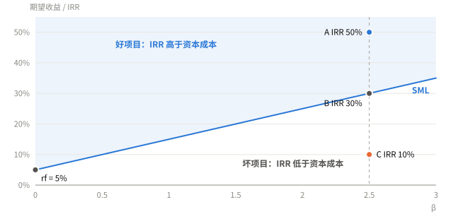
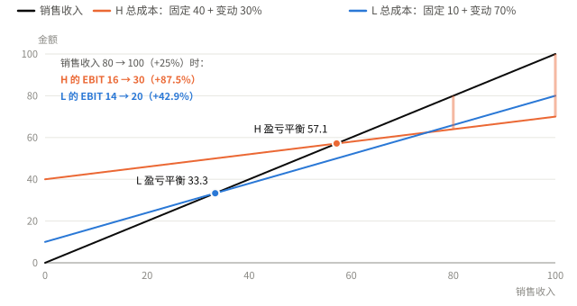
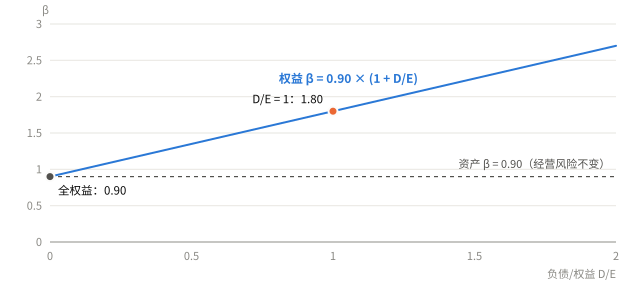
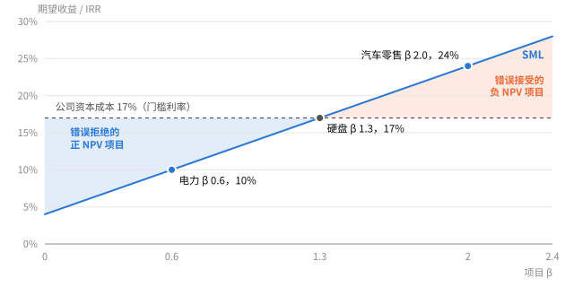
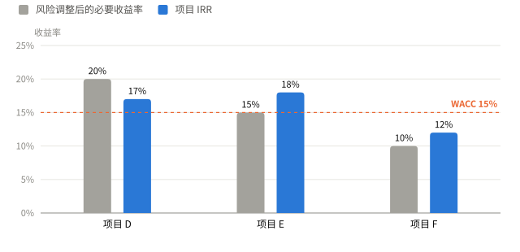

# 第 13 讲 风险、资本成本和资本预算

Risk, Cost of Capital, and Capital Budgeting

## 13.1 资本成本与折现率 Cost of Capital and the Discount Rate { data-toc-label="13.1 资本成本与折现率" }

第 5–6 讲讨论资本预算时，关注的是现金流的大小和时点；本讲讨论现金流有风险时，应该用什么折现率。

公司的资产由债务、优先股和普通股共同融资。项目的折现率就是投资者投资于同等风险资产所要求的收益率，即资本成本（cost of capital）。

- 全权益公司：资本成本就是权益资本成本
- 有债务的公司：资本成本是债务、优先股和普通股成本的加权平均，即 WACC（13.9）
- 项目风险与公司整体不同时：按项目自身的风险确定折现率（13.7、13.10）

## 13.2 用 CAPM 估计权益资本成本 Cost of Equity Capital: CAPM { data-toc-label="13.2 用 CAPM 估计权益资本成本" }

权益资本成本
:   股东投资于公司股票所要求的期望收益率（cost of equity capital）。站在公司角度，它就是 CAPM 给出的期望收益。

$$
R_S = R_F + \beta \left(R_M - R_F\right)
$$

用 CAPM 估计权益资本成本需要三个输入：

1. 无风险利率 $R_F$（13.3）
2. 市场风险溢价 $R_M - R_F$（13.3）
3. 公司的贝塔系数 $\beta = \text{Cov}(R_i, R_M) / \text{Var}(R_M)$（13.4）

!!! example "例 A · Stansfield 公司的折现率"

    Stansfield 公司 100% 权益融资，股票 β 为 2.5。无风险利率 5%，市场风险溢价 10%。

    - 权益资本成本：5% + 2.5 × 10% = 30%
    - 公司扩张项目若与公司现有业务风险相同，就应按 30% 折现

    公司正在评估三个相互独立的项目，每个投资 100 美元、期限一年，β 都是 2.5。

    | 项目 | 下一年现金流 | IRR | 按 30% 计算的 NPV |
    | --- | ---: | ---: | ---: |
    | A | 150 | 50% | 15.38 |
    | B | 130 | 30% | 0 |
    | C | 110 | 10% | −15.38 |

    - 项目 A：NPV = 150 ÷ 1.30 − 100 = 15.38，接受
    - 项目 B：NPV = 0，接受与否无差异
    - 项目 C：NPV = −15.38，拒绝

全权益公司应接受 IRR 高于权益资本成本的项目，拒绝 IRR 低于权益资本成本的项目。在 SML 图上，位于 SML 上方的是好项目，位于下方的是坏项目。

{ .cf-fig }

**图 1 用 SML 判断项目**。三个项目的 β 都是 2.5，对应的资本成本为 30%。A 位于 SML 上方，NPV 为正；C 位于 SML 下方，NPV 为负。
{ .cf-caption }

## 13.3 无风险利率与市场风险溢价 Risk-free Rate and Market Risk Premium { data-toc-label="13.3 无风险利率与市场风险溢价" }

### 无风险利率

国库券是无风险利率较好的近似。但 CAPM 是单期模型，而项目往往持续很多年，所以应使用各期的平均短期利率。

历史上 20 年期政府债券利率比短期利率平均高约 2%，因此 CAPM 中的无风险利率可以估计为：当前 20 年期国债利率减去 2%。

### 市场风险溢价

方法一：使用历史数据（第 10 讲），用过去市场组合收益率超过无风险利率的平均值估计。

方法二：使用股利折现模型。若股利以固定增长率 $g$ 增长（第 9 讲），股票的期望收益等于下一年的股息率加股利增长率：

$$
R = \frac{D_1}{P} + g
$$

这个公式也可以用于整个市场：用市场的平均股息率加上分析师预测的股利增长率，得到市场期望收益 $R_M$，再减去无风险利率即为市场风险溢价。例如《华尔街日报》曾报道标普 500 指数成分股的平均股息率约为 2.1%。

## 13.4 贝塔系数的估计 Estimation of Beta { data-toc-label="13.4 贝塔系数的估计" }

市场组合
:   经济中所有资产构成的组合。实务中用标普 500 等宽基股票指数代表。

贝塔系数
:   股票收益率对市场组合收益率的敏感程度。

$$
\beta_i = \frac{\text{Cov}(R_i, R_M)}{\text{Var}(R_M)}
$$

实务中把股票各期收益率对市场收益率做回归，回归直线的斜率就是 β。观测期的选择需要权衡：

- 观测值太少，β 的估计不准确
- 公司可能随时间改变所在行业，太久远的观测已经过时
- 通常使用最近五年的月度数据

讲义给出的几只股票相对标普 500 的 β：宝洁 0.52，雪佛龙 0.74，谷歌 1.20，美国银行 2.21。β 越大，散点图中回归线越陡。

### 贝塔、协方差与相关系数

$$
\beta_i = \frac{\text{Cov}(R_i, R_M)}{\sigma^2(R_M)} = \rho(R_i, R_M)\,\frac{\sigma(R_i)}{\sigma(R_M)}
$$

- 分母市场方差是常数，所以 β 与协方差在性质上相似
- β 与相关系数有关但不同：股票可能与市场高度相关，但如果自身波动 $\sigma(R_i)$ 较小，β 仍然较低

### 使用行业贝塔

单只股票的 β 估计误差远大于股票组合，所以可以用行业平均 β 代替公司自身的 β。

!!! example "例 B · ADP 公司的 β"

    Automatic Data Processing 公司所在行业波动较大，公司自身 β 的估计值为 0.70，财务主管对这个估计没有把握。行业平均 β 为 0.97，误差更小，因此可能更愿意用 0.97 作为本公司 β 的估计。

选择 β 没有固定公式，但有一条简单的准则：

- 公司经营与行业其他公司相似：用行业 β
- 公司经营与行业其他公司有根本不同：用公司自身的 β
- 无论哪种，都要对财务杠杆的差异进行调整（13.5）

## 13.5 贝塔的决定因素 Determinants of Beta { data-toc-label="13.5 贝塔的决定因素" }

| 类别 | 因素 | 作用 |
| --- | --- | --- |
| 经营风险 | 收入的周期性 | 收入随经济周期波动越大，β 越高 |
| 经营风险 | 经营杠杆 | 放大收入周期性对 β 的影响 |
| 财务风险 | 财务杠杆 | 提高权益 β |

### 收入的周期性

有些公司的收入有明显的周期性：经济扩张时表现好，收缩时表现差。β 衡量股票收益对市场收益的反应程度，所以周期性强的股票 β 高。

- 零售商和汽车公司随经济周期波动
- 运输公司和公用事业公司对经济周期依赖较小

!!! warning "易错"

    周期性不等于波动性。电影公司的收入取决于影片是卖座还是失败，波动很大，但与经济周期关系不大，β 不一定高。标准差高的股票 β 不一定高。

### 经营杠杆

经营杠杆
:   公司或项目对其固定生产成本的敏感程度（operating leverage）。固定成本越高、变动成本越低，经营杠杆越高。

$$
\text{DOL} = \frac{\Delta \text{EBIT}}{\text{EBIT}} \times \frac{\text{Sales}}{\Delta \text{Sales}}
$$

经营杠杆度 DOL 是销售收入变动 1% 时 EBIT 变动的百分比。销售收入周期性相同的公司，如果在生产中用固定成本替代变动成本，β 会上升。

!!! example "例 C · 两种成本结构（假设数据）"

    公司 H 固定成本 40、变动成本占收入 30%；公司 L 固定成本 10、变动成本占收入 70%。销售收入从 80 增加到 100（+25%）。

    | 公司 | 收入 80 时 EBIT | 收入 100 时 EBIT | EBIT 变动 | DOL |
    | --- | ---: | ---: | ---: | ---: |
    | H | 80 − 40 − 24 = 16 | 100 − 40 − 30 = 30 | +87.5% | 3.5 |
    | L | 80 − 10 − 56 = 14 | 100 − 10 − 70 = 20 | +42.9% | 1.71 |

    同样 25% 的收入增长，H 的 EBIT 增长是 L 的两倍多。收入下降时 H 的 EBIT 也下降得更快，所以 H 的 β 更高。

{ .cf-fig }

**图 2 经营杠杆**。H 的总成本线截距高、斜率低，盈亏平衡点更高，但越过盈亏平衡点后利润随收入增长得更快。数据为说明用的假设值。
{ .cf-caption }

### 财务杠杆

经营杠杆是对固定生产成本的敏感程度，财务杠杆是对固定融资成本（利息）的敏感程度。资产 β 是债务 β 和权益 β 按市值加权的平均：

$$
\beta_{\text{Asset}} = \frac{D}{D+E}\,\beta_{\text{Debt}} + \frac{E}{D+E}\,\beta_{\text{Equity}}
$$

债务 β 通常很低，可以假设为 0，于是：

$$
\beta_{\text{Equity}} = \beta_{\text{Asset}} \left(1 + \frac{D}{E}\right)
$$

财务杠杆总是使权益 β 高于资产 β。

!!! example "例 D · Grand Sport 公司加杠杆"

    Grand Sport 公司目前全权益融资，β 为 0.90。公司决定把资本结构调整为债务与权益各占一半（D/E = 1）。

    - 公司仍在同一行业，资产 β 保持 0.90
    - 假设债务 β 为 0：0.90 = 1/(1 + 1) × β 权益
    - 权益 β = 2 × 0.90 = 1.80

{ .cf-fig }

**图 3 财务杠杆与权益 β**。经营风险不变时资产 β 不变，负债越多，股东承担的风险越集中，权益 β 越高。
{ .cf-caption }

!!! warning "易错"

    借用行业 β 或其他公司的 β 时，要先把它们的权益 β 换算为资产 β（去杠杆），再按本公司的资本结构换算回权益 β（加杠杆）。直接套用杠杆不同的公司的权益 β 会高估或低估风险。

## 13.6 股利折现模型法与两种方法的比较 Dividend Discount Model { data-toc-label="13.6 股利折现模型法" }

股利折现模型（DDM）是估计权益资本成本的另一种方法：

$$
R_S = \frac{D_1}{P_0} + g
$$

DDM 与 CAPM 在理论上一致。学术界普遍更倾向于 CAPM，公司实务中也更多使用 CAPM，原因之一是估计公司增长率 $g$ 的误差较大。

| 方法 | 优点 | 缺点 |
| --- | --- | --- |
| CAPM（SML 法） | 明确对系统风险进行调整；只要有 β，适用于所有公司 | 需要估计市场风险溢价和 β，两者都随时间变化；用过去预测未来，不一定可靠 |
| 股利增长模型 | 容易理解和使用 | 只适用于目前支付股利的公司；股利增长率不稳定时不适用；对 $g$ 极其敏感，$g$ 增加 1%，权益成本也增加 1%；没有明确考虑风险 |

## 13.7 部门和项目的资本成本 Cost of Capital for Divisions and Projects { data-toc-label="13.7 部门和项目的资本成本" }

项目风险与公司整体风险不同时，每个项目都应按与自身风险相称的折现率折现。除非公司所有项目风险相同，否则对所有项目使用同一个折现率是错误的。

用公司整体资本成本 $R_F + \beta_{\text{FIRM}}(R_M - R_F)$ 作为所有项目的门槛利率，会犯两类错误：

- 风险低于公司整体的项目：IRR 高于 SML 但低于门槛利率，正 NPV 项目被错误拒绝
- 风险高于公司整体的项目：IRR 高于门槛利率但低于 SML，负 NPV 项目被错误接受

!!! example "例 E · 多元化公司投资电力项目"

    Conglomerate 公司按 CAPM 计算的资本成本为 17%：无风险利率 4%，市场风险溢价 10%，公司 β 为 1.3，即 4% + 1.3 × 10% = 17%。公司的业务各占三分之一：

    | 业务 | β | 按 CAPM 计算的资本成本 |
    | --- | ---: | ---: |
    | 汽车零售 | 2.0 | 4% + 2.0 × 10% = 24% |
    | 电脑硬盘制造 | 1.3 | 4% + 1.3 × 10% = 17% |
    | 电力 | 0.6 | 4% + 0.6 × 10% = 10% |

    资产的平均 β 为 (2.0 + 1.3 + 0.6) ÷ 3 = 1.3。

    评估新的发电项目时应使用 10%，而不是 17%：10% 反映的是投资于电力这类风险资产的机会成本。投资于硬盘或汽车零售的项目则应使用更高的折现率。

{ .cf-fig }

**图 4 用公司资本成本评价所有项目**。虚线是 17% 的门槛利率，斜线是 SML。左侧蓝色区域的项目 NPV 为正却被拒绝，右侧橙色区域的项目 NPV 为负却被接受。
{ .cf-caption }

## 13.8 债务与优先股的资本成本 Cost of Debt and Preferred Stock { data-toc-label="13.8 债务与优先股的资本成本" }

### 债务资本成本

债务资本成本 $R_B$（cost of debt）的两种估计方法：

1. 计算公司现有债务的到期收益率 YTM（第 8 讲）
2. 根据新发债务预期的债券评级，参考当前同评级债券的利率

利息可以在税前扣除，所以计算 WACC 时要使用税后债务成本 $R_B(1 - T_C)$。

!!! warning "易错"

    - 债务成本是到期收益率，不是票面利率。票面利率反映的是发行时的利率水平
    - 债务成本要做税收调整，权益成本不做：利息可以在税前扣除，股利不能

### 优先股资本成本

优先股是一种永续年金（第 4 讲），其价格等于每期股利除以要求的收益率，整理得到：

$$
R_P = \frac{C}{PV}
$$

其中 $C$ 为每期优先股股利，$PV$ 为优先股当前价格。

## 13.9 加权平均资本成本 Weighted Average Cost of Capital { data-toc-label="13.9 加权平均资本成本" }

加权平均资本成本
:   各类资本成本按其在资本结构中所占的市值比例加权的平均（weighted average cost of capital, WACC）。

$$
R_{\text{WACC}} = \frac{E}{V} R_E + \frac{P}{V} R_P + \frac{D}{V} R_D (1 - T_C)
\qquad
V = E + P + D
$$

| 符号 | 含义 |
| --- | --- |
| $E/V$、$P/V$、$D/V$ | 普通股、优先股、债务在资本结构中的比例 |
| $R_E$、$R_P$、$R_D$ | 普通股、优先股、债务的成本 |
| $T_C$ | 公司所得税税率 |

只有股票和债券时，用 $S$ 表示权益、$B$ 表示债务：

$$
R_{\text{WACC}} = \frac{S}{S+B} R_S + \frac{B}{S+B} R_B (1 - T_C)
$$

计算 WACC 分两步：先估计权益成本（用 β 和 CAPM）和债务成本（观察公司债务的 YTM），再按资本结构加权。

!!! example "例 F · International Paper 公司"

    行业平均 β 为 0.82，无风险利率 3%，市场风险溢价 8.4%。公司债务收益率 8%，边际税率 37%，负债率 32%。

    - 权益成本：3% + 0.82 × 8.4% = 9.89%
    - WACC：0.68 × 9.89% + 0.32 × 8% × (1 − 0.37) = 6.73% + 1.61% = 8.34%

    8.34% 可以用于折现这样的项目：项目风险与公司整体风险相同，项目的财务杠杆也与公司整体相同。

!!! example "例 G · General Store 公司"

    权益成本 15.8%，税前债务成本 7.7%，税率 32%，负债权益比 D/E = 0.40。

    - 权重：E/V = 1 ÷ 1.4 = 71.43%，D/V = 0.4 ÷ 1.4 = 28.57%
    - WACC：0.7143 × 15.8% + 0.2857 × 7.7% × (1 − 0.32) = 11.29% + 1.50% = 12.78%

!!! warning "易错"

    题目给出负债权益比 D/E 时，先换算为 D/V = (D/E) ÷ (1 + D/E) 和 E/V = 1 ÷ (1 + D/E)，不能把 0.40 直接当作债务权重。

## 13.10 风险调整的 WACC Risk-Adjusted WACC { data-toc-label="13.10 风险调整的 WACC" }

WACC 反映的是公司平均项目的风险，即公司现有业务的风险。不同部门或项目的风险可能不同，其折现率应根据各自的风险和资本结构进行调整。

!!! example "例 H · 统一用 WACC 与按风险调整"

    公司 WACC 为 15%。三个项目的 IRR 和按风险调整后的必要收益率如下：

    | 项目 | 风险调整后的必要收益率 | IRR | 按 WACC 15% 决策 | 按风险调整决策 |
    | --- | ---: | ---: | --- | --- |
    | D | 20% | 17% | 接受 | 拒绝 |
    | E | 15% | 18% | 接受 | 接受 |
    | F | 10% | 12% | 拒绝 | 接受 |

    按风险调整后，D 和 F 的决策都发生了变化：高风险的 D 被错误接受，低风险的 F 被错误拒绝。

{ .cf-fig }

**图 5 统一用 WACC 与按风险调整**。灰色柱是按项目风险确定的必要收益率，蓝色柱是项目 IRR，橙色虚线是公司 WACC。只有 IRR 高于自己的灰色柱时项目才值得投资。
{ .cf-caption }

### 纯业务法

纯业务法
:   用专门从事所考虑业务的公司的 β 确定项目折现率（pure play approach）。

1. 找到一家或几家专门从事该产品或服务的公司
2. 计算每家公司的 β
3. 取平均值
4. 用这个 β 和 CAPM 求出该风险项目的必要收益率

缺点是纯业务公司往往很难找到。

### 主观法

比较项目风险与公司整体风险：项目风险高于公司整体时使用高于 WACC 的折现率，低于公司整体时使用低于 WACC 的折现率。

| 风险等级 | 折现率（WACC = 15%） |
| --- | --- |
| 风险很低 | WACC − 8% = 7% |
| 风险较低 | WACC − 3% = 12% |
| 与公司风险相同 | WACC = 15% |
| 风险较高 | WACC + 5% = 20% |
| 风险很高 | WACC + 10% = 25% |

## 13.11 发行成本 Flotation Costs { data-toc-label="13.11 发行成本" }

发行成本
:   发行新债券或新股票时发生的费用（flotation costs）。

发行成本是项目的增量现金流，它增加了项目的初始投资 $CF_0$，通常会降低 NPV。为得到项目所需的资金，需要筹集的金额为：

$$
\text{筹资总额} = \frac{\text{所需资金}}{1 - f_A}
$$

加权平均发行成本 $f_A$ 按各融资来源的平均发行成本和公司的目标资本结构加权：

$$
f_A = \frac{E}{V} f_E + \frac{D}{V} f_D
$$

!!! example "例 I · Spatt 公司：基本方法"

    Spatt 公司全权益融资，权益成本 20%，所以 WACC 也是 20%。公司计划投资 1 亿美元扩张现有业务，全部通过发行新股筹资，发行成本为发行金额的 10%，即公司只能得到发行金额的 90%。

    - 需要发行：1 亿 ÷ (1 − 10%) = 1.111 亿美元
    - 发行成本：1.111 亿 − 1 亿 = 0.111 亿美元，扩张的实际成本为 1.111 亿美元

!!! example "例 J · Weinstein 公司：加权平均发行成本"

    目标资本结构为 80% 权益、20% 债务。股票发行成本为筹资额的 20%，债券发行成本为 6%。新工厂需要 6,500 万美元。

    - 加权平均发行成本：80% × 20% + 20% × 6% = 17.2%
    - 真实成本：6,500 万 ÷ (1 − 17.2%) = 7,850 万美元

    发行成本可能是一笔相当大的费用。

!!! example "例 K · Photochronograph 公司：发行成本与 NPV"

    公司目标负债权益比为 0.55，计划投资 5,000 万美元建设新厂，预计每年产生税后现金流 670 万美元，永续。权益全部来自外部融资，税率 35%。三种融资方式：

    | 来源 | 发行成本 | 资本成本 |
    | --- | ---: | --- |
    | 新发普通股 | 8% | 14% |
    | 新发 20 年期债券 | 4% | 票面利率 8%，平价发行，税前成本 8% |
    | 应付账款 | 0 | 等于公司 WACC，税前税后相同 |

    应付账款与长期债务的目标比例为 0.20，所以全部债务中应付账款占 0.20/1.2，债券占 1/1.2。

    第一步，求 WACC（应付账款的成本就是 WACC，所以 WACC 出现在等式两边）：

    $$
    R_{\text{WACC}} = \frac{1}{1.55}(14\%) + \frac{0.55}{1.55}\left[\frac{0.20}{1.2} R_{\text{WACC}} + \frac{1}{1.2}(8\%)(1 - 35\%)\right]
    $$

    解得 $R_{\text{WACC}} = 11.23\%$。

    第二步，求加权平均发行成本：

    $$
    f_A = \frac{1}{1.55}(8\%) + \frac{0.55}{1.55}\left[\frac{0.20}{1.2}(0) + \frac{1}{1.2}(4\%)\right] = 6.34\%
    $$

    第三步，计算 NPV：

    - 筹资总额：5,000 万 ÷ (1 − 6.34%) = 5,338.69 万美元
    - NPV = −5,338.69 万 + 670 万 ÷ 11.23% = 625.19 万美元

    NPV 为正，应建设新厂。

!!! warning "易错"

    - 发行成本应加到初始投资中，不要用来提高折现率
    - 例 K 的 NPV 625.19 万是用未四舍五入的 WACC（11.2343%）算出的；直接用 11.23% 计算约为 627 万，差异来自舍入

## 13.12 公式速查 Formulas { data-toc-label="13.12 公式速查" }

| 指标 | 公式 |
| --- | --- |
| 权益成本（CAPM） | $R_S = R_F + \beta(R_M - R_F)$ |
| 权益成本（DDM） | $R_S = D_1 / P_0 + g$ |
| 贝塔系数 | $\text{Cov}(R_i, R_M) / \text{Var}(R_M) = \rho_{iM}\,\sigma_i / \sigma_M$ |
| 经营杠杆度 | $\text{DOL} = (\Delta\text{EBIT}/\text{EBIT}) \div (\Delta\text{Sales}/\text{Sales})$ |
| 资产 β | $\beta_A = \frac{D}{D+E}\beta_D + \frac{E}{D+E}\beta_E$ |
| 权益 β（债务 β = 0） | $\beta_E = \beta_A (1 + D/E)$ |
| 优先股成本 | $R_P = C / PV$ |
| 税后债务成本 | $R_B (1 - T_C)$ |
| WACC | $\frac{E}{V}R_E + \frac{P}{V}R_P + \frac{D}{V}R_D(1 - T_C)$ |
| 加权平均发行成本 | $f_A = \frac{E}{V}f_E + \frac{D}{V}f_D$ |
| 含发行成本的筹资额 | $\text{所需资金} / (1 - f_A)$ |

## 13.13 自测 Quick Quiz { data-toc-label="13.13 自测" }

!!! question "1. 某全权益公司 β 为 1.2，无风险利率 4%，市场风险溢价 7%。与公司风险相同的项目应使用什么折现率？"

    ??? success "参考答案"

        4% + 1.2 × 7% = 12.4%。全权益公司的资本成本就是权益资本成本。

!!! question "2. 某公司股票下一年股利 2 美元，现价 40 美元，股利预计每年增长 6%。用 DDM 估计权益成本。"

    ??? success "参考答案"

        2 ÷ 40 + 6% = 11%。

!!! question "3. 某公司全权益融资时 β 为 1.0。若调整为 D/E = 0.5，债务 β 为 0，权益 β 变为多少？"

    ??? success "参考答案"

        资产 β 不变，仍为 1.0；权益 β = 1.0 × (1 + 0.5) = 1.5。

!!! question "4. 权益成本 14%，税前债务成本 8%，税率 25%，D/E = 1。求 WACC。"

    ??? success "参考答案"

        E/V = D/V = 50%；WACC = 0.5 × 14% + 0.5 × 8% × (1 − 25%) = 7% + 3% = 10%。

!!! question "5. 公司 WACC 为 12%，一个新项目的风险远低于公司现有业务。如果仍用 12% 折现，可能犯什么错误？"

    ??? success "参考答案"

        低风险项目的合理折现率低于 12%。用 12% 折现会低估其 NPV，可能把 NPV 为正的项目错误拒绝。

!!! question "6. 目标资本结构为 60% 权益、40% 债务，股票发行成本 10%，债券发行成本 5%。项目需要 1,000 万美元，实际需要筹集多少？"

    ??? success "参考答案"

        f_A = 60% × 10% + 40% × 5% = 8%；筹资额 = 1,000 万 ÷ (1 − 8%) = 1,086.96 万美元。

!!! question "7. 为什么债务成本要做税收调整，而权益成本不做？"

    ??? success "参考答案"

        公司支付的利息可以在计算所得税前扣除，实际负担的成本是 R_B(1 − T_C)；股利从税后利润中支付，不能抵税。
