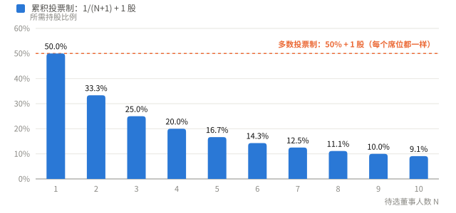
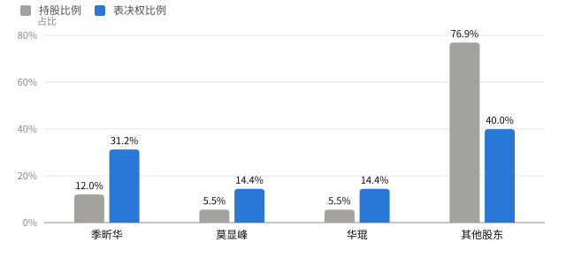
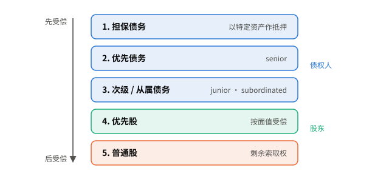
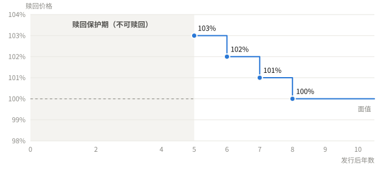

# 第 15 讲 长期融资：简介

Long-Term Financing: An Introduction

## 15.1 长期融资工具概览 Overview { data-toc-label="15.1 长期融资工具概览" }

第 13 讲用 WACC 把债务、优先股和普通股的成本合在一起。本讲回到这三种证券本身，看它们各自给投资者什么权利、给公司带来什么约束。

- 普通股：公司的所有者，享有投票权和剩余索取权（15.2–15.5）
- 优先股：介于债务和普通股之间（15.6）
- 长期债务：债券、银团贷款和国际债券（15.8–15.12）
- 公司实际怎样组合使用这些工具：美国企业的融资模式与资本结构（15.13）

## 15.2 普通股的特征与投票制度 Features of Common Stock { data-toc-label="15.2 普通股的特征与投票制度" }

股东通过选举董事会控制公司。选举董事有两种基本规则。

累积投票制
:   所有董事一次性同时选出（cumulative voting）。每位股东的总票数 = 持股数 × 待选董事人数 N，可以把全部票数集中投给一位候选人。持股超过 1/(N+1)，即 1/(N+1) 加 1 股，就能保证当选一个席位。这种制度让小股东也有机会进入董事会。

多数投票制
:   董事逐个选举（straight voting）。每个席位都要 50% 加 1 股才能保证当选，持股过半的股东可以拿下全部席位，小股东一席也得不到（all or nothing）。

!!! example "例 A · 累积投票制下需要多少股（假设数据）"

    公司共 1,000 股，一次选出 4 名董事。小股东想保证自己的候选人当选。

    - 累积投票制：需要 1,000 ÷ (4 + 1) + 1 = 201 股
    - 验证：小股东共有 201 × 4 = 804 票，全部投给自己的候选人；其余股东共有 799 × 4 = 3,196 票，平分给 4 名候选人每人只有 799 票，少于 804 票，所以小股东的候选人一定能进入前 4 名
    - 多数投票制：每个席位都需要 501 股，持有 201 股的小股东一个席位也拿不到

{ .cf-fig }

**图 1 保证一个董事席位所需的持股比例**。累积投票制下门槛为 1/(N+1)，待选董事越多门槛越低；多数投票制下每个席位都需要 50% 加 1 股。
{ .cf-caption }

### 代理投票与股票类别

代理投票
:   股东授权他人代为投票（proxy voting）。股东分散时，管理层和外部股东都会争取代理权，形成代理权之争。

股票类别
:   公司可以发行投票权不同的多类股票（classes of stock）。例如 Google 的 A 类股每股 1 票，由公众持有；B 类股每股 10 票，由内部人持有。这样内部人只用较少的现金流权就能控制公司。

### 股东的其他权利

1. 按持股比例分享公司发放的股利
2. 公司清算时，在偿还债务后按比例分享剩余资产
3. 优先认股权（preemptive right）：公司增发新股时，现有股东有权按持股比例优先认购，以免持股比例被稀释

!!! warning "易错"

    累积投票制的门槛是 1/(N+1) **加 1 股**，不是 1/N。N = 1 时累积投票制和多数投票制一样，都要 50% 加 1 股。

## 15.3 双重股权结构 Dual-Class Share Structure { data-toc-label="15.3 双重股权结构" }

双重股权结构（dual-class shares）指公司发行两类或多类投票权不同的普通股，也叫同股不同权。纳斯达克和纽交所都允许这种结构。

公司采用双重股权的主要理由：

- IPO 后创始人和管理层仍能保持控制权
- 避免短视（short-termism）：在维权投资者的压力下，公司可能为了短期业绩削减研发等长期投资；控制权稳定的管理层可以坚持长期战略

### Google 创始人的公开信

Google 2004 年 IPO 时的创始人信解释了双重股权的目的：让公司专注于长期发展，不受短期市场压力影响。外部投资者因此是在押注创始团队，而不能通过投票改变公司方向。

2012 年 Google 又发行了没有投票权的 C 类股：

- 效果相当于一次 2 拆 1 的拆股：每持有一股 A 或 B 类股，都会获得一股 C 类股
- 公司可以用 C 类股做股权激励和收购对价，而不稀释创始人的投票权
- Drummond 在信的附言中说明，创始人之间对股份转让还有一项"捆绑"（stapling）限制，防止创始人通过出售股票套现的同时保留不成比例的投票权

## 15.4 中国内地与香港的同股不同权制度 Weighted Voting Rights in China and Hong Kong { data-toc-label="15.4 中国内地与香港的同股不同权制度" }

### 内地：从同股同权到科创板

《公司法》第 103、126、131 条体现的是同股同权原则：同一类别的每一股份具有同等权利。

政策演变：

- 2018 年 9 月 18 日，国务院《关于推动创新创业高质量发展打造"双创"升级版的意见》提出，允许科技企业实行同股不同权的治理结构
- 2018 年 6 月 15 日，上交所发布存在差异化表决权安排的红筹企业相关规则

上交所对特别表决权的主要要求：

| 要求 | 内容 |
| --- | --- |
| 持有人资格 | 对公司发展做出重大贡献，并且在公司持续担任董事 |
| 持股下限 | 特别表决权股东合计持有的有表决权股份不低于 10% |
| 表决权上限 | 每份特别表决权股份的表决权数量不超过普通股份的 20 倍 |
| 普通股权利 | 每份普通股份的表决权数量大于 0 |

### 香港：第 8A 章不同投票权架构

港交所 2018 年 4 月新增《上市规则》第 8A 章，允许不同投票权（weighted voting rights, WVR）架构的公司上市：

- 只适用于新申请上市的公司，已上市公司不能改为 WVR 架构
- 市值门槛：至少 400 亿港元；或至少 100 亿港元且最近一年收入至少 10 亿港元
- 非 WVR 股东必须持有至少 10% 的投票权
- WVR 受益人必须是公司董事，并且合计持有至少 10% 的经济利益
- WVR 股份一经转让即失去不同投票权

### 案例：优刻得（UCloud）

优刻得是科创板首家同股不同权上市公司，2019 年 3 月 17 日通过特别表决权安排：

- 季昕华、莫显峰、华琨持有的 A 类股每股 5 票，其他股份每股 1 票
- 公司共有 422,805,164 股，对应 813,558,144 票

| 股东 | 持股比例 | 表决权比例 |
| --- | ---: | ---: |
| 季昕华 | 12.0224% | 31.2400% |
| 莫显峰 | 5.5412% | 14.3988% |
| 华琨 | 5.5412% | 14.3988% |
| 其他股东 | 76.8952% | 39.9623% |

三位创始人合计持股约 23.1%，却拥有约 60% 的表决权。

{ .cf-fig }

**图 2 优刻得的持股比例与表决权比例**。A 类股每股 5 票，三位创始人用约 23% 的股份获得约 60% 的表决权。
{ .cf-caption }

为保护普通股东，以下事项每股只有 1 票（A 类股也按 1 票计算），并且须经出席股东大会的股东所持表决权的三分之二以上通过：

1. 修改公司章程
2. 改变 A 类股享有的表决权数量
3. 聘请或解聘独立董事
4. 聘请或解聘会计师事务所
5. 公司合并、分立、解散或变更公司形式

### 案例：小米

小米是港交所第一家以 WVR 架构上市的公司：

- A 类股每股 10 票，B 类股每股 1 票
- A 类股由创始人雷军和林斌持有

!!! warning "易错"

    同股不同权改变的是**投票权**，不是现金流权。优刻得的 A 类股和普通股分红相同，只是表决权不同。

## 15.5 双重股权结构有害吗 Are Dual-Class Firms Harmful? { data-toc-label="15.5 双重股权结构有害吗" }

| 观点 | 依据 |
| --- | --- |
| 有害 | Gompers 等（2010，RFS）：公司价值随内部人现金流权上升而上升，随内部人投票权上升而下降。投票权与现金流权分离越大，代理问题越严重 |
| 应设限 | 美国机构投资者委员会（CII）主张加入日落条款（sunset provision），让双重股权在一定年限后自动转为同股同权 |
| 未必有害 | MSCI（2018）：2007 年 11 月至 2017 年 8 月，投票权不平等的股票表现好于市场 |
| 有争议 | 哥伦比亚大学的讨论：创始人独特的愿景（idiosyncratic vision）可能为公司创造价值，也可能让公司偏离股东利益 |

双重股权的核心权衡是：控制权稳定带来长期视角，同时外部股东失去了通过投票约束管理层的能力。

## 15.6 优先股 Preferred Stock { data-toc-label="15.6 优先股" }

优先股
:   在股利分配和清算顺序上优先于普通股的股票（preferred stock）。

优先股的主要特征：

- 有约定的股利，必须先付优先股股利，才能向普通股发放股利
- 股利不是公司的负债，董事会可以推迟发放，公司不会因此违约
- 大多数优先股是累积的（cumulative）：未付的股利会累积下来，必须先全部补付，普通股才能分红
- 清算时按面值受偿，排在债权人之后、普通股之前
- 一般没有投票权

## 15.7 股利的特征 Features of Dividends { data-toc-label="15.7 股利的特征" }

- 董事会宣告发放之前，股利不是公司的负债；公司不付股利，股东不能起诉或要求公司破产
- 股利从税后现金流中支付，不能在计算公司所得税时扣除
- 个人股东收到的股利通常要缴税

## 15.8 债务与权益的比较 Debt versus Equity { data-toc-label="15.8 债务与权益的比较" }

| 维度 | 债务 | 权益 |
| --- | --- | --- |
| 所有权 | 不代表所有权 | 代表所有权 |
| 投票权 | 债权人通常没有投票权 | 普通股股东选举董事会 |
| 税收 | 利息可以在税前扣除 | 股利不能在税前扣除 |
| 违约后果 | 债权人可以依法追索，未偿债务可能使公司陷入财务困境 | 股东没有法律追索权；全权益公司不会破产 |

!!! warning "易错"

    利息抵税是债务的好处，财务困境成本是债务的代价。第 16–17 讲的资本结构理论就是在这两者之间权衡。

## 15.9 债券契约 The Bond Indenture { data-toc-label="15.9 债券契约" }

债券契约
:   公司（借款人）与债权人之间的书面协议（indenture），通常由受托人代表债权人监督执行。

契约的主要内容：

- 债券的基本条款：面值、票面利率、到期日等
- 发行总额
- 担保：以什么资产作为抵押
- 偿债基金（sinking fund）安排
- 赎回条款
- 保护性条款

### 偿付顺序

优先级（seniority）说明公司破产时各类债权人的受偿顺序：优先债务 > 次级债务 > 从属债务。有担保的债务以特定资产作抵押，对该资产有优先受偿权。

{ .cf-fig }

**图 3 公司破产时的受偿顺序**。债权人排在优先股和普通股之前；债务内部按担保和优先级排序，普通股只有剩余索取权。
{ .cf-caption }

### 赎回条款

赎回条款
:   允许公司在到期前按约定价格买回债券（call provision）。

- 赎回价格一般高于面值，高出的部分叫赎回溢价（call premium）
- 很多债券规定发行后若干年内不能赎回，叫延期赎回（deferred call），这段时间内债券处于赎回保护期（call protected）

### 保护性条款

保护性条款
:   契约中限制公司某些行为、保护债权人的条款（protective covenants）。

| 类型 | 含义 | 例子 |
| --- | --- | --- |
| 消极条款 | 规定公司不能做什么 | 限制股利发放；不能把资产抵押给其他债权人；不能与其他公司合并；不能出售或租出主要资产；限制增发长期债务 |
| 积极条款 | 规定公司必须做什么 | 营运资本保持在最低水平以上；定期向债权人提供经审计的财务报表 |

## 15.10 可赎回债券 Callable Bonds { data-toc-label="15.10 可赎回债券" }

!!! example "例 B · 可赎回债券的赎回价格"

    某公司 2006 年 9 月 15 日发行 1 亿美元 10 年期债券，票面利率 8%，每年付息一次。发行 5 年后，公司可以提前 30 天通知赎回，赎回价格如下：

    | 赎回时点 | 赎回价格（占面值） |
    | --- | ---: |
    | 发行后第 5 年 | 103% |
    | 第 6 年 | 102% |
    | 第 7 年 | 101% |
    | 第 8、9 年 | 100% |

    - 前 5 年处于赎回保护期，不能赎回
    - 之后赎回溢价每年下降 1 个百分点，第 8 年起降到面值
    - 如果市场利率下降，公司会赎回这批 8% 的债券，再以较低利率发行新债，即再融资

{ .cf-fig }

**图 4 可赎回债券的赎回价格**。前 5 年不可赎回；之后赎回价格从 103% 逐年降到面值。
{ .cf-caption }

可赎回债券可以看作：

$$
\text{可赎回债券} = \text{普通债券} - \text{公司持有的赎回期权}
$$

赎回权属于公司，利率下降时公司行权，债券持有人的收益因此受限。为了补偿这一点，可赎回债券的要求收益率高于同等条件的不可赎回债券。

!!! warning "易错"

    赎回期权在**公司**手里，对债券持有人不利，所以可赎回债券价格更低、收益率更高。回售债券（15.11）正好相反：期权在**投资者**手里，收益率更低。

## 15.11 债券分类与要求收益率 Bond Types and Required Yields { data-toc-label="15.11 债券分类与要求收益率" }

### 记名债券与不记名债券

- 记名债券（registered）：公司登记持有人，直接向持有人付息
- 不记名债券（bearer）：谁持有债券凭证谁就有权受偿，利息凭息票领取；凭证丢失难以追回，公司也不知道持有人是谁

### 哪种债券要求收益率更高

其他条件相同时，投资者承担的风险越大或放弃的权利越多，要求的收益率越高。

| 比较 | 要求收益率更高的一方 | 原因 |
| --- | --- | --- |
| 有担保 vs 无担保 | 无担保 | 违约时没有特定资产作保障 |
| 次级 vs 优先 | 次级 | 破产时受偿顺序靠后 |
| 可赎回 vs 不可赎回 | 可赎回 | 公司持有赎回期权，利率下降时投资者被迫按赎回价交出债券 |

### 其他债券类型

| 类型 | 特征 |
| --- | --- |
| 收益债券（income bond） | 只有公司收益足够时才支付利息，不付息不构成违约 |
| 可转换债券（convertible bond） | 持有人可以在到期前按约定比例把债券转换成股票 |
| 回售债券（put bond） | 持有人可以要求公司按约定价格提前偿还本金 |

## 15.12 银团贷款与国际债券 Syndicated Loans and International Bonds { data-toc-label="15.12 银团贷款与国际债券" }

### 长期银团贷款

银团贷款
:   由货币中心银行牵头发放贷款，再把贷款份额卖给其他银行组成的银团（syndicated bank loan）。

- 银团贷款可以公开交易
- 课件指出这类贷款总是投资级

### 国际债券

| 类型 | 含义 |
| --- | --- |
| 欧洲债券（Eurobond） | 以某种货币计价，但在该货币发行国以外的市场发行，例如在伦敦发行的美元债券 |
| 外国债券（foreign bond） | 外国借款人在某国市场发行、以该国货币计价的债券，例如外国公司在美国发行的美元债券 |

投资国际债券面临的风险：

1. 信用风险
2. 利率风险
3. 汇率风险
4. 流动性风险

### 中国企业境外发债

- 2016 年中资企业共发行 258 只美元债，总额 1,271.4 亿美元，比 2015 年的 1,075 亿美元增长 18.3%，仅次于 2014 年 1,400.6 亿美元的高峰
- 2015 年"8·11"汇改后人民币汇率弹性增大，境外发债的汇率风险上升

路透社报道的几个背景：

- 2016 年人民币贬值约 7%，中资企业的境外美元债发行额仍创下 1,110 亿美元的纪录
- 一个原因是资本管制收紧，企业通过境外发债获得外汇资金
- 在境内融资受限的房地产企业是重要发行人
- 2017 年到期的开发商贷款约 79 亿美元，再融资需求大

!!! warning "易错"

    以美元借债、以人民币取得收入的企业，人民币贬值会加重偿债负担。境外发债的成本不能只看票面利率，还要考虑汇率风险。

## 15.13 美国企业的融资模式与资本结构 Patterns of Financing and Capital Structure { data-toc-label="15.13 美国企业的融资模式与资本结构" }

### 融资模式（1995–2010）

- 内部融资（留存收益和折旧）是最主要的资金来源，占比还在上升
- 2002–2007 年企业净回购股票的规模加速扩大，即净股权融资为负；2008 年后回购下降
- 外部融资中，债务比股权更重要

### 资本结构：账面价值与市场价值

经济学家更看重市场价值，公司财务主管更常用账面价值。

| 指标 | 课件图中的大致范围 |
| --- | --- |
| 债务占账面权益的比例 | 约 61%–76% |
| 债务占市场权益的比例 | 约 40%–54% |

两种口径都表明，美国非金融企业的债务比率低于 50%，即企业主要靠权益融资。按市场价值计算的比例更低，因为股票市值通常高于账面值。

## 15.14 小结 Summary { data-toc-label="15.14 小结" }

1. 普通股股东拥有公司，通过投票选举董事；累积投票制有利于小股东，多数投票制使大股东拿下全部席位
2. 双重股权结构让创始人用较少的现金流权保持控制权，利弊仍有争议；内地科创板和港交所都已在限制条件下允许
3. 优先股股利优先于普通股，但不是负债，可以推迟发放
4. 债务与权益的根本区别在于所有权、投票权、税收待遇和违约后果
5. 债券契约规定基本条款、担保、优先级、赎回条款和保护性条款；条款越不利于投资者，要求收益率越高
6. 美国企业主要依靠内部融资，债务比率低于 50%

## 15.15 公式速查 Formulas { data-toc-label="15.15 公式速查" }

| 指标 | 公式 |
| --- | --- |
| 累积投票制下保证一个席位的持股数 | $\dfrac{\text{总股数}}{N + 1} + 1$ |
| 累积投票制下股东的总票数 | 持股数 × 待选董事人数 $N$ |
| 多数投票制下保证一个席位的持股数 | 总股数 × 50% + 1 |
| 可赎回债券 | 普通债券价值 − 赎回期权价值 |
| 赎回溢价 | 赎回价格 − 面值 |

## 15.16 自测 Quick Quiz { data-toc-label="15.16 自测" }

!!! question "1. 公司共 600 股，一次选出 5 名董事。累积投票制下，至少需要多少股才能保证一个席位？多数投票制下呢？"

    ??? success "参考答案"

        累积投票制：600 ÷ (5 + 1) + 1 = 101 股。多数投票制：每个席位都需要 301 股。

!!! question "2. 普通股和优先股有哪些区别？"

    ??? success "参考答案"

        优先股有约定股利，分红和清算顺序都在普通股之前；但优先股一般没有投票权，清算时最多按面值受偿，不享有剩余索取权。普通股有投票权和剩余索取权，股利不固定。

!!! question "3. 优先股股利和债券利息都是固定支付，为什么优先股被视为权益而不是债务？"

    ??? success "参考答案"

        优先股股利在宣告前不是负债，公司可以推迟发放而不违约，股东不能因此要求公司破产；股利也不能在税前扣除。债券利息是法定义务，不付即违约。

!!! question "4. 优刻得三位创始人合计持股约 23.1%，A 类股每股 5 票。为什么他们拥有约 60% 的表决权？修改公司章程时他们还有这么多票吗？"

    ??? success "参考答案"

        A 类股的表决权是普通股的 5 倍：23.1% × 5 ÷ (23.1% × 5 + 76.9%) ≈ 60%。修改章程属于每股 1 票的事项，A 类股也只按 1 票计算，他们的表决权回到约 23.1%，而且须三分之二以上通过。

!!! question "5. 股东和债权人分别有哪些权利？"

    ??? success "参考答案"

        股东：选举董事、按比例分享股利和清算剩余资产、优先认股权。债权人：按契约收取利息和本金，公司违约时可以依法追索，受保护性条款保护，破产时先于股东受偿；通常没有投票权。

!!! question "6. 赎回条款如何影响债券的收益率？为什么？"

    ??? success "参考答案"

        可赎回债券的收益率高于同等条件的不可赎回债券。赎回权属于公司，利率下降时公司会赎回债券，投资者只能按赎回价收回本金并以更低利率再投资，所以要求更高的收益率作为补偿。

!!! question "7. 一家公司从未举债，能否破产？为什么？"

    ??? success "参考答案"

        全权益公司不会因为无法偿债而破产：股利不是法定义务，股东没有法律追索权。破产是债务违约的结果。
