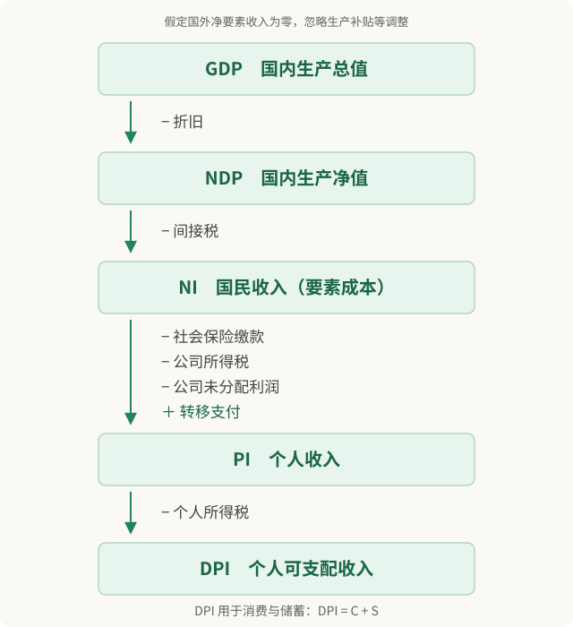

# 第 1 章 总产出的核算

Measuring Total Output

## 1.1 GDP 的含义与核算边界

国内生产总值（Gross Domestic Product，GDP）是一个国家或地区在一定时期内，在其经济领土内生产的全部最终产品和服务的市场价值。它是**流量**，衡量一段时期的生产成果。

理解定义要抓住四点：按市场价值汇总；避免重复计算；只计当期生产；按生产所在地划分。最终产品与中间产品按**用途**区分，同一种面粉卖给家庭食用是最终产品，卖给面包厂加工则是中间投入。

| 情形 | 是否计入当期 GDP | 理由 |
| --- | --- | --- |
| 当期生产并由居民购买的新衣服 | 计入 | 当期最终消费品 |
| 服装厂购买用于制衣的布料 | 不单独累加 | 价值已包含在衣服中；生产法只加各阶段增加值 |
| 转售旧房、旧车 | 旧物价值不计入，当期中介服务计入 | 区分过去的生产与当期服务 |
| 企业购置新机器、居民购买新建住房 | 计入投资 | 增加固定资产 |
| 当期生产但尚未售出的产品 | 计入存货投资 | 生产已发生，销售可以在以后发生 |
| 买卖股票、债券 | 金融资产交易额不计入，当期交易服务计入 | 资产所有权转移与新增生产不同 |
| 政府购买教学设备、提供公共服务 | 计入 | 政府购买当期产品和服务 |
| 政府发放养老金、失业救济 | 支付本身不计入 | 属于转移支付，没有对应的当期生产 |
| 外资企业在境内生产 | 计入本国 GDP | 按生产所在地划分，企业所有者的国籍不决定归属 |

!!! warning "易错：市场价值不等于只统计有现金交易的活动"

    无偿家务劳动通常不计入，但自有住房提供的居住服务、部分自产自用产品会按估算价值纳入。政府的非市场服务也纳入核算，通常按成本计价。核算边界参见国家统计局的[说明](https://www.stats.gov.cn/zs/tjws/zytjzbqs/gnsczz/202409/t20240909_1956324.html)。

## 1.2 GDP 的三种核算方法

### 生产法：计算增加值

$$
\text{增加值}=\text{总产出价值}-\text{中间投入价值},\qquad
GDP=\sum\text{各生产单位增加值}
$$

中间投入是生产中消耗的原材料、能源及服务等。购置机器属于固定资产投资，机器磨损形成的折旧也不作为中间投入扣除，因此这里得到的是包含折旧的**总增加值**。

??? example "例 1：服装生产链与增加值"

    假设一件衣服依次经过以下生产阶段，除表中列出的投入外，无其他中间投入。

    | 生产阶段 | 产品价值／元 | 中间投入／元 | 增加值／元 |
    | --- | ---: | ---: | ---: |
    | 种棉：棉花 | 80 | 0 | 80 |
    | 纺纱：棉纱 | 120 | 80 | 40 |
    | 织布：棉布 | 200 | 120 | 80 |
    | 制衣：衣服 | 350 | 200 | 150 |
    | 合计 | 750 | 400 | **350** |

    各阶段增加值之和为 $80+40+80+150=350$ 元，等于最终衣服的价值。直接把销售额相加得到 750 元，会重复计算中间产品。

### 收入法：计算生产形成的收入

从收入分配角度看，增加值形成劳动报酬、经营收益等收入，还包含折旧和生产税净额。我国收入法核算的构成为：

$$
GDP=\text{劳动者报酬}+\text{生产税净额}+\text{固定资产折旧}+\text{营业盈余}
$$

生产税净额是生产税减生产补贴，区别于个人所得税、公司所得税。从工资、租金、利息、利润等要素收入出发核算时，还需加回折旧，并调整生产税与补贴。我国核算项目的定义见[国家统计局](https://www.stats.gov.cn/zs/tjws/tjzb/202301/t20230101_1903699.html)。

### 支出法：计算最终用途

$$
Y=GDP=C+I+G+NX,\qquad NX=X-M
$$

| 项目 | 含义 | 核算要点 |
| --- | --- | --- |
| 消费 $C$ | 居民购买产品和服务的支出 | 新建住房归入投资 |
| 投资 $I$ | 国内私人总投资，包括固定投资与存货投资 | 包括重置投资；购买股票、债券不属于这里的投资 |
| 政府购买 $G$ | 政府购买产品和服务的支出，包括政府投资 | 转移支付不直接计入 |
| 净出口 $NX$ | 出口 $X$ 减进口 $M$ | 进口可能已包含在 $C、I、G$ 中，需要剔除 |

$$
\text{总投资}=\text{净投资}+\text{折旧}
$$

在 $C+I+G+NX$ 分类中，政府投资归入 $G$。我国统计资料通常列为“最终消费支出＋资本形成总额＋净出口”。

**为什么减进口？**例如居民购买 100 元进口食品，消费增加 100 元，进口也增加 100 元，两项抵消，国内 GDP 不因这笔进口产品购买而增加。

**为什么转移支付不直接计入？**养老金发放只是购买力转移；领取者用它购买当期最终产品时，再按相应消费计入。

### 三种方法为什么一致

同一笔生产活动创造产品，其价值形成收入，最终产品又对应消费、投资等用途。未售出的当期产品计入存货投资，因此理论上有：

$$
\text{总产出}=\text{总收入}=\text{总支出}
$$

| 方法 | 观察角度 | 计算依据 |
| --- | --- | --- |
| 生产法 | 在哪里创造价值 | 增加值之和 |
| 收入法 | 生产价值怎样分配 | 生产形成的收入及相关调整 |
| 支出法 | 最终产品用于何处 | 消费、投资、政府购买、净出口 |

实际统计使用不同数据来源，可能存在统计误差，但这不改变三种方法在核算原理上的一致性。

## 1.3 从 GDP 到个人可支配收入

### 五个指标及其换算

以下 $NI$ 指按要素成本计量的国民收入。假定国外净要素收入为零，不考虑生产补贴等其他调整，可得下列换算关系。

**GDP：国内生产总值**，衡量境内当期生产的最终成果。按支出法：

$$
GDP=C+I+G+NX
$$

**NDP：国内生产净值**，即扣除固定资本消耗后的产出。

$$
NDP=GDP-\text{折旧}
$$

**NI：国民收入**，即生产要素取得的收入。

$$
NI=NDP-\text{间接税}
$$

**PI：个人收入**，即个人实际取得的收入，包含转移收入。

$$
\begin{aligned}
PI={}&NI-\text{社会保险缴款}-\text{公司所得税}\\
&-\text{公司未分配利润}+\text{转移支付}
\end{aligned}
$$

**DPI：个人可支配收入**，即个人缴纳所得税后可用于消费和储蓄的收入。

$$
DPI=PI-\text{个人所得税}=C+S
$$

{ .cf-fig }

**图 1 收入指标换算**。扣除折旧、调整税收与收入分配项目，依次得到净产出、要素收入、个人收入与个人可支配收入。
{ .cf-caption }

从 NI 到 PI，要扣除个人尚未取得的公司留存收入、用于缴税缴费的部分，再加上个人取得的转移收入。DPI 才是个人可用于消费与储蓄的收入。

!!! warning "易错：先看口径，再做加减"

    - $NI=NDP-\text{间接税}$ 依赖本节的简化假设，不能直接套用于所有统计资料。
    - 生产形成的收入与个人取得的收入不同；转移支付不直接增加 GDP，却可以增加 PI。
    - 税收总额可能包含多种税。只有题目明确忽略其他税种时，才能把“税收总额－间接税”全部视为个人所得税。

??? example "例 2：从支出核算 GDP，再求各项收入指标"

    某国最终消费为 8000 亿美元，国内私人总投资为 5000 亿美元，其中折旧 1000 亿美元；政府税收 3000 亿美元，其中间接税 2000 亿美元；政府支出 3000 亿美元，其中政府购买 2500 亿美元、转移支付 500 亿美元；出口 2000 亿美元，进口 1500 亿美元。求 GDP、NDP、NI、PI 与 DPI。

    假定国外净要素收入、公司所得税、公司未分配利润、社会保险缴款及其他调整均为零，除间接税外的税收均为个人所得税。

    | 指标 | 计算 | 结果／亿美元 |
    | --- | --- | ---: |
    | GDP | $8000+5000+2500+(2000-1500)$ | **16000** |
    | NDP | $16000-1000$ | **15000** |
    | NI | $15000-2000$ | **13000** |
    | PI | $13000+500$ | **13500** |
    | DPI | $13500-(3000-2000)$ | **12500** |

    GDP 使用总投资 5000，而非净投资 4000；政府购买取 2500，而非政府支出总额 3000。折旧在求 NDP 时扣除，转移支付在求 PI 时加回。

### GDP 与 GNP／GNI：国内与国民

GDP 按**生产所在地**划分；GNP（国民生产总值）及现行核算中的 GNI（国民总收入）按**常住单位归属**区分，居民身份不等同于国籍。

$$
GNI=GDP+\text{来自国外的初次收入}-\text{支付给国外的初次收入}
$$

后两项之差为来自国外的初次收入净额，亦称国外净要素收入。它为零时，国内与国民口径的总量相等；不为零时，需要先调整口径再换算国民收入。

## 1.4 储蓄与投资的核算恒等式

在简化部门模型中，忽略折旧、国外净要素收入等调整，将私人税后收入分为消费与储蓄。记 $Y$ 为收入，$S$ 为私人储蓄，$T$ 为**净税收＝税收－转移支付**，$G$ 为政府购买。

收入用途与支出构成分别为：

$$
Y=C+S+T,\qquad Y=C+I+G+NX
$$

两式相等并消去 $C$，得：

$$
I=S+(T-G)-NX
$$

| 模型 | 核算恒等式 | 含义 |
| --- | --- | --- |
| 两部门：居民、企业 | $I=S$ | 投资等于私人储蓄 |
| 三部门：加入政府 | $I=S+(T-G)$ | 投资等于私人储蓄与政府储蓄之和 |
| 四部门：加入国外 | $I=S+(T-G)-NX$ | 国内投资还与净出口相联系 |

其中，政府储蓄为 $T-G$，国民储蓄为 $S_N=S+(T-G)$，因此 $S_N=I+NX$。净出口为负时，在本节简化条件下，国内投资可以超过国民储蓄。

**这里是事后核算关系，投资包含实际存货变动；下一章讨论计划投资与计划储蓄相等时，才是在讨论均衡条件。**

## 1.5 名义 GDP、实际 GDP 与平减指数

名义 GDP 的变动同时受到产量和价格影响。要比较实际产出，需固定价格，排除涨价的影响。

设 $p_{it}$、$q_{it}$ 为第 $i$ 种最终产品在 $t$ 期的价格和产量，$0$ 表示基期。本章采用固定基期价格计算：

$$
\begin{aligned}
\text{名义 GDP}_t&=\sum_i p_{it}q_{it}\\
\text{实际 GDP}_t&=\sum_i p_{i0}q_{it}\\
\text{GDP 平减指数}_t&=\frac{\text{名义 GDP}_t}{\text{实际 GDP}_t}\times100
\end{aligned}
$$

计算时抓住价格与数量的配对：**名义 GDP 用当期价、当期量；实际 GDP 用基期价、当期量。**基期自身的名义 GDP 与实际 GDP 相等，平减指数为 100。

??? example "例 3：两期 GDP 与价格水平"

    某经济体只生产以下五种最终产品，以 2020 年为基期，价格单位为美元。

    | 产品 | 2020 年产量 | 2020 年价格 | 2023 年产量 | 2023 年价格 |
    | --- | ---: | ---: | ---: | ---: |
    | A | 25 | 1.5 | 30 | 1.6 |
    | B | 50 | 7.5 | 60 | 8 |
    | C | 40 | 6 | 50 | 7 |
    | D | 30 | 5 | 35 | 5.5 |
    | E | 60 | 2 | 70 | 2.5 |

    **① 两期名义 GDP：各用当期价格与产量。**

    $$
    \begin{aligned}
    GDP^{\text{名义}}_{2020}
    &=1.5\times25+7.5\times50+6\times40+5\times30+2\times60\\
    &=922.5\text{（美元）}\\[4pt]
    GDP^{\text{名义}}_{2023}
    &=1.6\times30+8\times60+7\times50+5.5\times35+2.5\times70\\
    &=1245.5\text{（美元）}
    \end{aligned}
    $$

    **② 2023 年实际 GDP：用 2020 年价格与 2023 年产量。**

    $$
    \begin{aligned}
    GDP^{\text{实际}}_{2023}
    &=1.5\times30+7.5\times60+6\times50+5\times35+2\times70\\
    &=1110\text{（美元）}
    \end{aligned}
    $$

    **③ 2023 年平减指数与相对基期的价格涨幅。**

    $$
    D_{2023}=\frac{1245.5}{1110}\times100\approx112.2
    $$

    2020 年指数为 100，因此 2023 年价格水平比 2020 年高约 $12.2\%$。

!!! warning "易错：指数、涨幅与比较期间"

    平减指数 112.2 对应相对基期价格水平高约 12.2%，不是上涨 112.2%。本题比较的是 2020—2023 年的累计变化，不能把它直接写成 2023 年同比涨幅。比较任意相邻两期，应计算 $(D_t/D_{t-1}-1)\times100\%$。

## 1.6 GDP 的局限与补充指标

GDP 衡量生产活动，福利还取决于收入分配、闲暇、健康与环境等因素。修复被破坏的设施会形成当期产出，但原有财富的损失不能仅凭这笔支出抵消。

| 问题 | 补充指标或分析角度 | 能补充什么 |
| --- | --- | --- |
| 总量受人口规模影响 | 人均 GDP＝GDP／人口 | 观察平均产出水平；比较实际变化时采用实际 GDP，仍需另看收入分配 |
| 名义增长混合了数量与价格变化 | 实际 GDP、GDP 平减指数 | 区分实际产出变化与价格变化 |
| 汇率折算影响跨国比较 | 购买力平价（PPP） | 按可比商品和服务的购买力折算；结果受样本与权重影响 |
| 部分非市场活动未计入，地下经济可能漏计 | 补充调查与估算 | 识别统计覆盖不足；地下经济是否漏计还取决于核算方法与资料 |
| 常规 GDP 未充分扣除资源耗减与环境损失 | 绿色 GDP、环境经济核算 | 补充资源与环境代价 |
| 实际产出没有直接说明产能利用程度 | 潜在 GDP 与产出缺口 | 潜在 GDP 衡量劳动、资本在可持续利用状态下的产出能力，后续章节再展开 |

这些指标分别补充平均水平、购买力、环境代价或产能信息，不能用同一种调整解决所有问题。GDP 也不能单独反映福利和分配状况。

## 1.7 公式速查与自测

### 公式速查

| 用途 | 公式 | 条件或口径 |
| --- | --- | --- |
| 生产法 | $GDP=\sum\text{增加值}$ | 增加值＝总产出－中间投入 |
| 支出法 | $GDP=C+I+G+NX$ | $I$ 为私人总投资，$G$ 含政府投资，$NX=X-M$ |
| 从总值到净值 | $NDP=GDP-\text{折旧}$ | 总投资＝净投资＋折旧 |
| 从产出到可支配收入 | 见 1.3 的换算关系 | 先明确税收、国外净要素收入及其他调整 |
| 储蓄与投资 | $I=S+(T-G)-NX$ | 简化部门模型；$T$ 为净税收，$S$ 为私人储蓄 |
| 实际 GDP | $\sum_i p_{i0}q_{it}$ | 固定基期价、当期量 |
| GDP 平减指数 | $D_t=(\text{名义 GDP}_t/\text{实际 GDP}_t)\times100$ | 基期指数为 100 |

### 自测

!!! question "1. 为什么不能把生产链各阶段的销售额直接相加？"

    ??? success "参考答案"

        后续产品价值已经包含中间投入。直接累加会重复计算；应加总各阶段增加值，或计算最终产品价值。

!!! question "2. 政府发放救济金与购买教学设备，在 GDP 核算中有什么区别？"

    ??? success "参考答案"

        救济金属于转移支付，支付本身不计入 GDP；购买当期生产的教学设备属于政府购买，计入 $G$。救济金用于购买当期最终产品时，再按相应消费核算。

!!! question "3. 两部门经济事后总有 I＝S，是否说明计划支出始终等于产出？"

    ??? success "参考答案"

        否。实际投资包含非计划存货变动。产品卖不出去也会增加存货，使事后核算关系成立；计划支出与产出相等才是收入决定模型的均衡条件。

!!! question "4. 名义 GDP 增长，能否直接说明实际产出增长？"

    ??? success "参考答案"

        不能。增长可能来自价格上涨，需用实际 GDP 判断产出变化。例 3 中，2023 年实际 GDP 要用 2020 年价格乘 2023 年产量。

