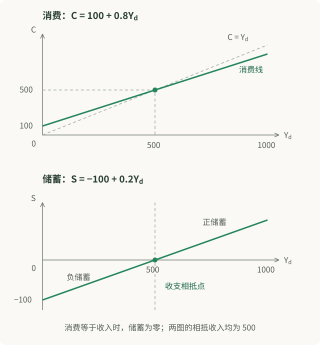

# 第 2 章 简单国民收入决定原理

Income Determination and the Multiplier

## 2.1 分析前提与经济循环

简单国民收入决定模型研究：**价格水平给定时，计划支出怎样决定短期产出与收入。**假定存在闲置资源，企业能按既定价格调整生产；忽略折旧、公司未分配利润等收入调整，暂不分析利率的内生变动。

长期产出主要受劳动、资本和技术等供给条件约束；短期资源未充分利用时，需求不足可以使实际产出低于充分就业水平。这里先分析后者。

记 $Y$ 为实际产出与收入，$C$ 为消费，$I$ 为计划投资，$G$ 为政府购买，$X$、$M$ 分别为出口与进口。税收 $T$ 与转移支付 $TR$ 分开列示：

$$
T_N=T-TR,\qquad Y_d=Y-T+TR=Y-T_N
$$

$T_N$ 为净税收，$Y_d$ 为可支配收入，私人储蓄 $S=Y_d-C$。

消费支出成为企业收入，企业支付的报酬又成为居民收入。储蓄、净税收和进口使部分收入退出国内支出循环，称为**漏出**；投资、政府购买和出口向循环增加支出，称为**注入**。

| 部门范围 | 计划总支出 $E$ | 均衡时的注入与漏出 |
| --- | --- | --- |
| 两部门：居民、企业 | $C+I$ | $I=S$ |
| 三部门：加入政府 | $C+I+G$ | $I+G=S+T_N$ |
| 四部门：加入国外 | $C+I+G+X-M$ | $I+G+X=S+T_N+M$ |

表中的 $I$ 是计划投资，因此等式表示均衡条件。实际核算中的投资还包含非计划存货变动。

## 2.2 消费与储蓄

### 消费函数

消费取决于可支配收入，也受财富、预期、收入分配和信贷条件等影响。最简单的线性形式为：

$$
C=a+bY_d,\qquad a>0,\quad 0<b<1
$$

$a$ 是自发消费，不随当期收入变化；$bY_d$ 是引致消费。$b$ 表示每增加一单位可支配收入，用于增加消费的部分。

**平均消费倾向**衡量消费占可支配收入的比例：

$$
APC=\frac{C}{Y_d}=\frac{a}{Y_d}+b
$$

**边际消费倾向**衡量新增可支配收入带来的消费增量：

$$
MPC=\frac{\Delta C}{\Delta Y_d}=b
$$

在线性函数中，MPC 固定；当 $Y_d>0$ 时，APC 随收入增加而下降。两部门没有税收和转移支付，故 $Y_d=Y$。

### 储蓄函数

可支配收入扣除消费后即为储蓄：

$$
S=Y_d-C=-a+(1-b)Y_d
$$

**平均储蓄倾向**为：

$$
APS=\frac{S}{Y_d}=-\frac{a}{Y_d}+1-b
$$

**边际储蓄倾向**为：

$$
MPS=\frac{\Delta S}{\Delta Y_d}=1-b
$$

因此：

$$
APC+APS=1,\qquad MPC+MPS=1
$$

收支相抵时 $C=Y_d$、$S=0$，相应收入为：

$$
Y_d^{\text{相抵}}=\frac{a}{1-b}
$$

低于该收入时消费超过收入，储蓄为负，需要动用财富或借款；高于该收入时储蓄为正。

{ .cf-fig }

**图 1 消费与储蓄**。消费线与收支相抵线 $C=Y_d$ 的交点，对应储蓄线与横轴的交点。图中取 $a=100$、$b=0.8$，收支相抵收入为 500。
{ .cf-caption }

!!! warning "易错：平均倾向、边际倾向与收入口径"

    APC 是消费与收入之比，MPC 是消费增量与收入增量之比。线性消费函数中，APC 下降而 MPC 不变；低收入时 APC 可以超过 1。存在税收时，倾向指标的分母采用可支配收入；若 $T=T_0+tY$、转移支付固定，则消费对总收入的斜率为 $b(1-t)$，区别于 MPC＝$b$。

### 其他消费理论

| 理论 | 消费决策的依据 | 主要含义 |
| --- | --- | --- |
| 相对收入理论 | 与他人的收入比较及过去达到的消费水平 | 存在示范效应；收入下降时，消费习惯使消费不易同比例下降，即棘轮效应 |
| 恒久收入理论 | 可持续的长期预期收入 | 持久的收入增加通常比暂时增加更能提高消费 |
| 生命周期理论 | 一生的收入与已有财富 | 工作期储蓄、退休期动用储蓄，以平滑各期消费 |

收入分配、社会保障、年龄结构、财富与预期变化，都可能改变消费水平，不能只用当期收入解释全部消费行为。生命周期中的消费平滑机制可参见[圣路易斯联储的说明](https://www.stlouisfed.org/publications/page-one-economics/2014/11/01/smoothing-the-path-balancing-debt-income-and-saving-for-the-future)。

## 2.3 投资需求的决定

### 投资、资本与计划存货

投资是一定时期资本形成的**流量**，资本是某一时点的**存量**。总投资包括重置投资和净投资；忽略资产重估等变化时，净投资等于资本存量的增加。

计划投资包括固定资产投资与计划存货投资。产品卖不出去造成的意外积压属于非计划存货增加，应与企业主动安排的库存区分。政府投资归入 $G$，股票、债券交易额不属于这里的实际投资。

### 预期收益、资本边际效率与利率

投资是否值得，取决于未来净收益的现值与购置成本。设初始成本为 $K_0$，第 $j$ 年末预期净收益为 $R_j$，第 $n$ 年末残值为 $J$，贴现率为 $r$：

$$
PV=\sum_{j=1}^{n}\frac{R_j}{(1+r)^j}+\frac{J}{(1+r)^n}
$$

资本边际效率（MEC）是使上述现值等于资本品供给价格 $K_0$ 的贴现率 $\rho$：

$$
K_0=\sum_{j=1}^{n}\frac{R_j}{(1+\rho)^j}+\frac{J}{(1+\rho)^n}
$$

对先投入、以后取得正净收益的项目，在风险等条件相同时，$\rho>r$ 有利于投资，$\rho=r$ 时处于投资边界。利率下降使更多项目达到投资条件，故投资需求通常与利率反向变化。

??? example "例 1：机器投资的预期收益与资本边际效率"

    一台机器售价 30000 元，使用三年，无残值。三年末的预期净收益依次为 11000、12100、13310 元。求资本边际效率，并判断利率变化的影响。

    取 $\rho=10\%$：

    $$
    \begin{aligned}
    PV&=\frac{11000}{1.1}+\frac{12100}{1.1^2}+\frac{13310}{1.1^3}\\
    &=10000+10000+10000=30000
    \end{aligned}
    $$

    现值等于机器价格，故资本边际效率为 10%。若贴现率降至 10% 以下，现值超过成本；若升至 10% 以上，现值低于成本。比较时应保持收益预期与风险条件不变。

### 投资函数与曲线移动

线性投资函数可写为：

$$
I=I_0-dr,\qquad d>0
$$

$I_0$ 表示与利率无关的投资部分，$d$ 衡量投资对利率的敏感程度。利率下降引起**沿投资曲线移动**；预期收益、技术、税收优惠与融资条件改善，使同一利率下投资增加，表现为**曲线右移**。

若纵轴为 $r$、横轴为 $I$，曲线斜率为 $-1/d$；$d$ 越大，曲线越平缓。利率按小数还是百分数代入，必须与参数的单位一致。

资本边际效率侧重给定资本品价格下的预期收益率。若投资扩张推高资本品价格，新增投资的收益率会下降；考虑这类变化的投资边际效率（MEI）更接近实际投资需求。

托宾 q 理论从资产估值解释投资：

$$
q=\frac{\text{现有资本的市场价值}}{\text{资本的重置成本}}
$$

$q>1$ 时，新建资本相对便宜，增加投资更有吸引力；$q<1$ 时，购买已有资本可能更合算。它反映投资激励，实际投资仍受预期、融资和调整成本影响。

## 2.4 净出口的决定

出口主要受国外收入、相对价格和汇率等影响；进口随本国收入增加而增加。保持其他条件不变，可写为：

$$
X=X_0
$$

$$
M=M_0+mY,\qquad m>0
$$

$$
NX=X-M=NX_0-mY,\qquad NX_0=X_0-M_0
$$

$m$ 是边际进口倾向，表示每增加一单位国内收入，进口增加多少。本国收入增加，引起沿净出口曲线向右下方移动；国外收入增加等因素可使净出口曲线上移。

在进出口数量能够充分调整等条件下，本币贬值可通过提高出口竞争力、抑制进口来改善净出口；其效果还取决于贸易弹性与调整时间。汇率若未说明标价方式，不能仅凭数值升降判断升贬值。

## 2.5 均衡收入与两部门乘数

### 计划支出与产出调整

记计划总支出为 $E$。两部门模型中，投资先视为给定的 $I_0$：

$$
E=C+I_0=a+bY+I_0
$$

均衡条件为：

$$
Y=E
$$

- $E>Y$：购买超过当期产出，存货意外减少，企业倾向于增产。
- $E<Y$：产品意外积压，企业倾向于减产。
- $E=Y$：没有非计划存货变动，产出与计划支出一致。

两部门中由 $Y=C+S$ 可知，$Y=C+I_0$ 等价于 $S=I_0$。**均衡收入由计划支出决定，未必等于充分就业收入。**

### 均衡收入与乘数的推导

把消费函数代入均衡条件：

$$
Y=a+bY+I_0
$$

整理得到：

$$
Y^*=\frac{a+I_0}{1-b}
$$

若自发支出 $A=a+I_0$ 增加 $\Delta A$，边际消费倾向不变，则：

$$
\Delta Y=\frac{\Delta A}{1-b},\qquad k=\frac{\Delta Y}{\Delta A}=\frac{1}{1-b}
$$

初始支出成为他人收入，其中比例 $b$ 再用于消费，又形成下一轮收入。各轮增量相加：

$$
\Delta Y=\Delta A+b\Delta A+b^2\Delta A+\cdots=\frac{\Delta A}{1-b}
$$

这是收入与支出连续传递的结果。由于 $0<b<1$，每轮增量逐渐缩小。

<picture id="keynesian-cross">
  <source media="(max-width: 640px)" srcset="../figures/ch02-keynesian-cross-mobile.svg">
  
</picture>

自发支出增加 100，均衡收入增加 500，支出乘数为 5。
{ .cf-caption }

??? example "例 2：均衡收入与自发消费变化"

    已知 $C=1000+0.8Y$、$I_0=600$，金额单位为亿元。求均衡收入；若自发消费增加至 1100，收入如何变化？

    初始均衡收入：

    $$
    Y_0=\frac{1000+600}{1-0.8}=8000
    $$

    此时 $C=7400$、$S=600=I_0$。自发消费增加 100，乘数为 $1/(1-0.8)=5$，故：

    $$
    \Delta Y=5\times100=500,\qquad Y_1=8500
    $$

    新均衡下 $C=7900$、$S=600$。消费增加量为 500，其中 100 来自自发消费增加，400 来自收入提高引起的引致消费。

??? note "拓展：消费调整存在一期滞后"

    若 $C_t=a+bY_{t-1}$、投资固定为 $I_0$，并假定各期按计划支出安排生产，则 $Y_t=a+bY_{t-1}+I_0$。当 $0<b<1$ 时，偏离均衡的部分逐期缩小，收入趋于 $(a+I_0)/(1-b)$。静态乘数给出最终变化，不表示全部变化在同一期完成。

## 2.6 税收、转移支付与财政乘数

### 三部门均衡收入

令税收含定额部分和比例部分：

$$
T=T_0+tY,\qquad 0\le t<1
$$

因而：

$$
Y_d=(1-t)Y-T_0+TR
$$

将 $C=a+bY_d$ 代入 $Y=C+I_0+G$：

$$
Y=a+b[(1-t)Y-T_0+TR]+I_0+G
$$

整理得到：

$$
Y^*=\frac{a+I_0+G-bT_0+bTR}{1-b(1-t)}
$$

比例税使新增收入的一部分用于纳税，减少下一轮消费，因此 $t$ 越高，乘数越小。收入下降时税收也自动下降，可缓冲可支配收入与消费的收缩，这是自动稳定作用。

### 各类财政乘数

以下均保持 $b、t$ 等参数不变。

**政府购买乘数**：政府购买直接增加计划支出。

$$
k_G=\frac{1}{1-b(1-t)}
$$

**定额税乘数**：增加定额税先减少可支配收入，再按比例 $b$ 减少消费。

$$
k_{T_0}=\frac{-b}{1-b(1-t)}
$$

**转移支付乘数**：转移收入先增加可支配收入，只有其中用于消费的部分进入第一轮支出。

$$
k_{TR}=\frac{b}{1-b(1-t)}
$$

投资与自发消费的乘数为 $k_{I_0}=k_a=k_G$。在此模型中，等额增加政府购买比等额增加转移支付或减少定额税带来的初始支出增量更大。

**平衡预算乘数**：政府购买与定额税等额增加，即 $\Delta G=\Delta T_0$：

$$
k_B=k_G+k_{T_0}=\frac{1-b}{1-b(1-t)}
$$

无比例税（$t=0$）时 $k_B=1$；有比例税时，该值通常小于 1。这里的等额指政府购买与定额税的自主增量，不包含收入变化引起的税收变动。

!!! warning "易错：减税额与税率变化不同"

    $k_{T_0}$ 描述定额税变化，不适用于直接改变税率 $t$。税率变化会同时改变支出线斜率和乘数，应重新求均衡收入。用乘数反求政策变动时，先算收入缺口，再用 $\Delta G=\Delta Y/k_G$ 或 $\Delta T_0=\Delta Y/k_{T_0}$；减税对应 $\Delta T_0<0$。

??? example "例 3：比例税、转移支付与充分就业缺口"

    已知 $C=100+0.8Y_d$、$I_0=50$、$G=200$、$TR=62.5$、$T=0.25Y$。求均衡收入和相关乘数。若充分就业收入为 1200，分别用增加政府购买、减少定额税、等额增加政府购买与定额税弥补缺口，各需多少？各方案单独实施，单位均为亿元。

    **① 均衡收入。**

    $$
    Y=100+0.8(0.75Y+62.5)+50+200
    $$

    得 $0.4Y=400$，故 $Y^*=1000$。

    **② 乘数。**

    $$
    k_G=k_{I_0}=2.5,\qquad k_{T_0}=-2,\qquad k_{TR}=2
    $$

    **③ 弥补收入缺口。**所需 $\Delta Y=1200-1000=200$。

    - 增加政府购买：$\Delta G=200/2.5=80$。
    - 减少定额税：$\Delta T_0=200/(-2)=-100$，即新增 100 的定额减税，比例税率仍为 0.25。
    - 等额增加政府购买与定额税：$k_B=2.5-2=0.5$，故 $\Delta G=\Delta T_0=200/0.5=400$。

    最后一种方案中，收入上升还引起比例税增加 $0.25\times200=50$；政策规定的等额变动不等于事后总税收增量与购买增量相等。

## 2.7 开放经济与引致投资

### 进口漏出

加入净出口 $NX=NX_0-mY$，投资仍固定时：

$$
Y^*=\frac{a+I_0+G+NX_0-bT_0+bTR}{1-b(1-t)+m}
$$

收入增加引起进口增加，部分新增支出购买国外产品，国内支出循环的反馈减弱。故边际进口倾向 $m$ 越大，国内收入乘数越小。

### 投资随收入变化

若投资还受收入影响，写为：

$$
I=I_0+vY,\qquad v\ge0
$$

$I_0$ 为自发投资，$vY$ 为随收入变化的引致投资。它与投资对利率的反应是不同机制；这里保持利率给定，把其影响并入 $I_0$。

将消费、投资、税收与净出口函数一起代入，可得：

$$
\begin{aligned}
Y={}&a+b[(1-t)Y-T_0+TR]\\
&+I_0+vY+G+NX_0-mY
\end{aligned}
$$

记 $D=1-b(1-t)-v+m$，则：

$$
Y^*=\frac{a+I_0+G+NX_0-bT_0+bTR}{D}
$$

自发支出乘数为 $1/D$，定额税乘数为 $-b/D$，转移支付乘数为 $b/D$。比例税与进口使分母增大，削弱反馈；引致投资使分母减小，强化反馈。通常假定计划支出对收入的斜率满足 $0\le b(1-t)+v-m<1$，使逐轮调整收敛。

??? example "例 4：同时存在比例税与引致投资"

    已知 $C=160+0.75Y_d$、$Y_d=Y-T$、$T=-100+0.2Y$、$I=100+0.1Y$、$G=400$，无净出口。求均衡收入、消费、投资、净税负及乘数；若收入增加 100，分别需增加多少政府购买或减少多少定额税？

    **① 将各支出写成总收入的函数。**

    $$
    Y_d=100+0.8Y,\qquad C=235+0.6Y
    $$

    **② 代入均衡条件。**

    $$
    Y=(235+0.6Y)+(100+0.1Y)+400
    $$

    得 $Y=2450$，此时 $C=1705$、$I=345$、$T=390$，且 $1705+345+400=2450$。

    **③ 乘数与政策变化。**

    $$
    D=1-0.75(1-0.2)-0.1=0.3
    $$

    $$
    k_G=k_{I_0}=k_a=\frac{10}{3},\qquad k_{T_0}=-2.5
    $$

    增加政府购买需 $\Delta G=100/(10/3)=30$；定额税变化需 $\Delta T_0=100/(-2.5)=-40$，即减税 40。这里的负税收截距也可等价写为固定转移支付 100，两种写法不能重复计入。

??? example "例 5：开放经济中的投资乘数与净出口"

    已知 $C=30+0.8Y_d$、$Y_d=Y-T_N$、$T_N=50$、$I=60$、$G=50$、$NX=50-0.05Y$。比较定额净税收与 $T_N=50+0.0625Y$ 两种情形下的均衡收入、净出口，以及投资由 60 增至 70 的影响。单位均为亿元。

    **① 定额净税收。**$C=-10+0.8Y$，故：

    $$
    Y=(-10+0.8Y)+60+50+(50-0.05Y)
    $$

    得 $Y=600$、$NX=20$。投资乘数为 $1/(1-0.8+0.05)=4$。投资增加 10 后，$Y$ 增至 640，$NX$ 降至 18。

    **② 含比例净税收。**$C=30+0.8(0.9375Y-50)=-10+0.75Y$，故：

    $$
    Y=(-10+0.75Y)+60+50+(50-0.05Y)
    $$

    得 $Y=500$、$NX=25$。投资乘数为 $1/[1-0.8(1-0.0625)+0.05]=10/3$。投资增加 10 后，$Y=1600/3\approx533.33$，$NX\approx23.33$。

    比例税削弱收入反馈，故同样的投资增加带来较小的收入增量。收入上升增加进口，因此净出口下降。

## 2.8 乘数的条件与两个辨析

### 乘数何时适用

简单乘数把价格、利率和行为参数视为给定，并要求存在闲置资源、供给能够随需求调整。接近产能约束时，新增需求可能更多体现为价格上涨；若财政扩张推高利率，部分私人支出可能被挤出。

乘数既放大扩张，也放大收缩。自发消费、投资、政府购买、出口的乘数在同一模型中可以相同，但支出构成、受益群体、时滞与长期供给效果仍有差别。现实中的乘数还受进口、融资与货币政策等影响，参见 [IMF 对财政乘数的分析](https://www.elibrary.imf.org/view/journals/004/2009/011/article-A001-en.xml)。

### 节约悖论

短期投资固定、资源闲置时，居民同时减少自发消费，会经乘数降低收入。在两部门模型中：

$$
S=-a+(1-b)Y,\qquad Y^*=\frac{a+I_0}{1-b}
$$

代入可得均衡储蓄仍为 $S^*=I_0$。人们希望增加储蓄，结果却是收入下降、总储蓄未增加；若投资也随需求转弱，总储蓄还可能减少。

长期储蓄可为资本积累提供资金，是否形成更多有效投资取决于投资机会与资金配置。短期需求效应与长期资本形成应分别分析。

### 破窗与财富损失

修窗支出能够形成收入，也可能产生乘数效应，但破坏同时损失原有财富，并占用本可用于其他用途的资金和资源。**新增支出、GDP 与社会福利是不同概念**；不能仅从修复活动形成的产出推断破坏使社会更富裕。

## 2.9 公式速查与自测

### 公式速查

**消费与储蓄：**

$$
C=a+bY_d,\qquad S=-a+(1-b)Y_d
$$

$$
APC+APS=1,\qquad MPC=b,\qquad MPS=1-b
$$

**两部门均衡与乘数：**

$$
Y^*=\frac{a+I_0}{1-b},\qquad k=\frac{1}{1-b}
$$

**含比例税、进口与引致投资的一般形式：**

$$
D=1-b(1-t)-v+m
$$

$$
Y^*=\frac{a+I_0+G+NX_0-bT_0+bTR}{D}
$$

$$
k_a=k_{I_0}=k_G=k_{NX_0}=\frac{1}{D}
$$

$$
k_{T_0}=-\frac{b}{D},\qquad k_{TR}=\frac{b}{D}
$$

$$
\Delta G=\Delta T_0\ \text{时},\qquad k_B=\frac{1-b}{D}
$$

没有比例税、引致投资或进口漏出时，分别令 $t=0$、$v=0$、$m=0$。乘数描述其他参数固定时的自主变动，不能直接套用于税率或倾向参数的变化。

### 自测

!!! question "1. 企业出现非计划存货增加，说明计划支出与产出是什么关系？"

    ??? success "参考答案"

        计划支出小于产出，即 $E<Y$。企业倾向于减产。实际核算把积压计入存货投资，不能据此认定计划支出已经均衡。

!!! question "2. C＝100＋0.8Yd，Yd＝1000，求消费、储蓄及四种倾向。"

    ??? success "参考答案"

        $C=900$、$S=100$；$APC=0.9$、$APS=0.1$；$MPC=0.8$、$MPS=0.2$。平均倾向取决于收入水平，线性函数的边际倾向保持不变。

!!! question "3. 为什么政府购买乘数大于转移支付乘数的绝对值？"

    ??? success "参考答案"

        政府购买直接进入第一轮支出；转移支付先增加收入，其中只有比例 $b$ 用于消费。在参数相同的模型中，$k_{TR}=b\,k_G$，且 $0<b<1$。

!!! question "4. 有比例税时，政府购买与定额税等额增加，平衡预算乘数还等于 1 吗？"

    ??? success "参考答案"

        在无进口和引致投资的三部门模型中，$k_B=(1-b)/[1-b(1-t)]$；若 $t>0$，其值小于 1。等于 1 是 $t=0$ 时的结果。

!!! question "5. 税率由 0.2 改为 0.25，可以直接把 0.05 乘以定额税乘数吗？"

    ??? success "参考答案"

        不能。税率变化改变税收对收入的反应及乘数分母，应把新税率代入均衡收入公式，比较新旧结果。
