# 第 3 章 产品市场与货币市场均衡

IS 曲线、LM 曲线与共同均衡

## 3.1 前提与符号

IS 表示**产品市场均衡**时利率与收入的组合，LM 表示**货币市场均衡**时利率与收入的组合。本章令价格水平 $P=1$，货币供给 $M=m$；先求两部门经济的 IS，再讨论政府支出变化。

| 符号 | 含义 |
| --- | --- |
| $Y,r$ | 国民收入（总产出）、利率；例题金额单位为亿元，利率按方程中的数值代入 |
| $I,S$ | 投资、储蓄 |
| $\alpha,\beta$ | 消费函数中的常数项、边际消费倾向；$0<\beta<1$ |
| $e,d$ | 投资函数中的常数项、投资利率系数；$d>0$ |
| $L_1,L_2,L$ | 交易性货币需求、投机性货币需求、货币总需求 |
| $k,h,m$ | 交易性货币需求系数、投机性货币需求系数、货币供给；$0<k<1,h>0$ |

## 3.2 IS：产品市场均衡

**均衡条件与推导**：两部门经济中，$I=S$，投资函数 $I=e-dr$，储蓄函数 $S=-\alpha+(1-\beta)Y$。

$$
\begin{aligned}
e-dr&=-\alpha+(1-\beta)Y\\
r&=\frac{\alpha+e}{d}-\frac{1-\beta}{d}Y
\end{aligned}
$$

等价形式：$Y=(\alpha+e-dr)/(1-\beta)$。IS 上任一点满足 $I=S$；曲线外不满足产品市场均衡。

| 检索项 | 规律（其他条件不变） |
| --- | --- |
| 倾斜方向 | 向右下方；利率较低，对应的均衡产出较高 |
| 斜率 | $-(1-\beta)/d$；$\beta↑$、$d↑$ 均使 IS 更平缓 |
| 投资变化 | 同一利率下投资增加 → IS 右移；减少 → 左移 |
| 储蓄变化 | 同一收入下储蓄增加 → IS 左移；减少 → 右移 |
| 政府支出 | 政府支出增加 → IS 右移；减少 → 左移 |
| 曲线上方／下方 | 上方 $I<S$，产出有下降趋势；下方 $I>S$，产出有上升趋势 |

**区分**：利率改变引起投资、储蓄和收入调整，是沿 IS 移动；投资函数、储蓄函数改变，才使 IS 移动。利率与产出呈反向关系，联系通过投资、储蓄实现，不是二者直接的因果关系。

??? note "三部门、四部门的均衡条件"

    三部门：$Y=C+I+G$；四部门：$Y=C+I+G+NX$。$G$ 为政府购买，$NX$ 为净出口。

## 3.3 货币市场与 LM

货币需求也称**流动性偏好**。货币需求分为交易、预防、投机三种动机：

| 动机 | 持币目的与决定因素 |
| --- | --- |
| 交易 | 个人、企业进行正常交易；取决于收入、交易习惯和商业制度 |
| 预防 | 应付事故、失业、疾病等意外支出；取决于人们对意外事件的态度 |
| 投机 | 为在金融市场买卖有价证券获利而持币；利率上升、债券价格下降 → 买债券、持币减少，反之相反 |

债券收益一定时，债券价格与利率反向变化。

**货币需求函数**：交易与预防动机合为交易性货币需求 $L_1=kY$；投机性货币需求用 $L_2=-hr$ 表示其随利率下降而增加的关系。总需求：

$$
L=L_1+L_2=kY-hr
$$

$-hr$ 表示利率上升时需求减少，不表示实际持币数量为负。

**LM 推导**：均衡条件 $L=M$，货币供给 $M=m$，故：

$$
kY-hr=m
\quad\Rightarrow\quad
r=-\frac{m}{h}+\frac{k}{h}Y
$$

等价形式：$Y=m/k+(h/k)r$。LM 上任一点满足 $L=M$；曲线外不满足货币市场均衡。

<picture id="ch03-mechanisms">
  <source media="(max-width: 640px)" srcset="../figures/ch03-mechanisms-mobile.svg">
  
</picture>

| 检索项 | 规律（其他条件不变） |
| --- | --- |
| 倾斜方向 | 向右上方；利率较高，对应的均衡产出较高 |
| 斜率 | $k/h$；$k↑$ → LM 更陡，$h↑$ → LM 更平缓 |
| 交易性需求变化 | 给定收入下，交易性货币需求增加 → LM 左移；减少 → 右移 |
| 投机性需求变化 | 给定利率下，投机性货币需求增加 → LM 左移；减少 → 右移 |
| 货币供给变化 | 货币供给增加 → LM 右移；减少 → 左移 |
| 曲线上方／下方 | 上方 $L<M$，利率有下降趋势；下方 $L>M$，利率有上升趋势 |

**区分**：收入增加引起交易性货币需求增加，是沿 LM 移动；同一收入或同一利率下，货币需求函数改变，才使 LM 移动。利率与产出呈同向关系，二者通过交易性、投机性货币需求联系。

**货币市场与三个区域**：货币供给由中央银行给定，与利率无关，供给曲线垂直。收入给定时，货币需求曲线向下；货币供给增加，均衡利率下降。下图左固定 $Y=2000$；右为 LM 三个区域的形状示意。

<picture id="ch03-money-and-regions">
  <source media="(max-width: 640px)" srcset="../figures/ch03-money-and-regions-mobile.svg">
  
</picture>

| LM 区域 | 特征 |
| --- | --- |
| 凯恩斯区域 | 利率低、债券价格高，买卖债券的获利空间小，流动性偏好趋于无限大，即流动性陷阱；LM 近乎水平 |
| 中间区域 | 交易性、投机性货币需求共同调整；LM 向右上倾斜 |
| 古典区域 | 投机性货币需求很少；LM 近乎垂直 |

## 3.4 共同均衡与四区域判别

IS 与 LM 的交点使 **$I=S$、$L=M$ 同时成立**，由此确定均衡产出与利率。

**贯穿模型**：$C=200+0.8Y$，$I=300-5r$，$L=0.2Y-5r$，$M=300$。

$$
\mathrm{IS}:r=100-0.04Y,\qquad
\mathrm{LM}:r=-60+0.04Y
$$

联立 $100-0.04Y=-60+0.04Y$ → **$Y=2000,r=20$**。

<picture id="ch03-equilibrium-regions">
  <source media="(max-width: 640px)" srcset="../figures/ch03-equilibrium-regions-mobile.svg">
  
</picture>

图中 $I,S$ 的比较采用两部门条件。调整方向：A：$Y↓,r↓$；B：$Y↑,r↓$；C：$Y↑,r↑$；D：$Y↓,r↑$。
{ .cf-caption }

## 3.5 均衡变动与政策配合

财政政策可通过政府购买、转移支付、税收改变 IS；货币政策可通过货币供给改变 LM。

| 变化 | 曲线移动 | 共同均衡的变化 |
| --- | --- | --- |
| 自发支出增加 | IS 右移，LM 不变 | $Y↑,r↑$ |
| 货币供给增加 | LM 右移，IS 不变 | $Y↑,r↓$ |
| 两者配合增加 | IS、LM 均右移 | 可以使 $Y↑$ 而 $r$ 不变，所需数量由方程确定 |

**贯穿例题的目标**：充分就业的有效需求为 2020 亿元，基准均衡收入只有 2000 亿元。三种方案分别实施，结果如下；图中虚线为原曲线，实线为新曲线或未变曲线。

<picture id="ch03-policy-comparison">
  <source media="(max-width: 640px)" srcset="../figures/ch03-policy-comparison-mobile.svg">
  
</picture>

| 方案 | 政府追加投资 $G$ | 追加货币供给 $\Delta M$ | 新均衡利率 |
| --- | ---: | ---: | ---: |
| 财政政策 | 8 | 0 | 20.8 |
| 货币政策 | 0 | 8 | 19.2 |
| 政策配合 | 4 | 4 | 20 |

??? example "贯穿例题：求曲线、均衡与政策追加量"

    沿用 3.4 的条件。

    **IS**：$S=Y-C=-200+0.2Y$。令 $S=I$：$-200+0.2Y=300-5r$ → $r=100-0.04Y$。

    **LM**：$0.2Y-5r=300$ → $r=-60+0.04Y$。

    **共同均衡**：联立两式 → $Y=2000,r=20$。

    **单独增加政府投资**：$-200+0.2Y=300+G-5r$，新 IS 为 $r=100+0.2G-0.04Y$。与原 LM 联立：

    $$
    Y=2000+2.5G
    \quad\Rightarrow\quad
    G=\frac{2020-2000}{2.5}=8
    $$

    **单独增加货币供给**：$0.2Y-5r=300+\Delta M$，新 LM 为 $r=-60-0.2\Delta M+0.04Y$。与原 IS 联立：

    $$
    Y=2000+2.5\Delta M
    \quad\Rightarrow\quad
    \Delta M=8
    $$

    **保持利率为 20**：令 $Y=2020,r=20$，分别代入两个市场的方程：

    $$
    \begin{aligned}
    -200+0.2\times2020&=300+G-5\times20 &&\Rightarrow G=4\\
    0.2\times2020-5\times20&=300+\Delta M &&\Rightarrow \Delta M=4
    \end{aligned}
    $$

    三个方案的新曲线：财政方案 IS 为 $r=101.6-0.04Y$；货币方案 LM 为 $r=-61.6+0.04Y$；配合方案 IS 为 $r=100.8-0.04Y$、LM 为 $r=-60.8+0.04Y$。未移动的曲线仍用原方程。

## 3.6 银行

| 概念 | 定义 |
| --- | --- |
| 中央银行 | 发行货币、作为商业银行的银行、执行宏观货币政策 |
| 商业银行 | 以利润最大化为目标的企业 |
| 货币供给 | 现金货币＋存款货币；现金货币由中央银行发行，存款货币由商业银行经营活动创造 |
| 法定准备金 | 商业银行吸收的存款中，按规定必须保留、不得用于放贷的最低准备金 |
| 法定准备金率 $rr$ | 法定准备金／存款；为避免与利率 $r$ 混淆，记为 $rr$ |
| 超额准备金 | 超过法定准备金的部分；超额准备金率＝超额准备金／存款 |

**货币乘数与供给**：简化条件下，$M=R/rr$，$1/rr$ 为货币乘数（货币供给乘数）；此处 $R$ 为用于说明存款创造的初始现金。超额准备金率、现金提取率会使实际货币乘数低于 $1/rr$。准备金或准备金率变化，会使存款规模相应扩张或收缩。

??? example "存款创造：初始存款 1000 的逐级扩张"

    初始存款 1000，法定准备金率 10%；不提取现金、不保留超额准备金，可贷资金全部贷出，支付所得全部重新存入银行。

    | 银行 | 存款 | 准备金 | 贷款 |
    | --- | ---: | ---: | ---: |
    | 初始银行 | 1000 | 100 | 900 |
    | 第二级 | 900 | 90 | 810 |
    | 第三级 | 810 | 81 | 729 |
    | …… | …… | …… | …… |
    | 银行体系合计 | 10000 | 1000 | 9000 |

    $$
    1000+1000(1-10\%)+1000(1-10\%)^2+\cdots
    =\frac{1000}{10\%}=10000
    $$

??? note "货币层次：按流动性划分"

    流动性即变现能力，不同国家的具体划分不同。一般关系为：

    | 层次 | 构成 |
    | --- | --- |
    | M1 | 通货＋商业银行活期存款 |
    | M2 | M1＋商业银行定期存款 |
    | M3 | M2＋商业银行以外金融机构的金融债券 |
    | M4 | M3＋银行与金融机构以外的所有短期金融工具 |

    M0 为流通中现金；$M2-M1$ 为准货币。M1 反映现实购买力，M2 还反映潜在购买力。

## 3.7 公式速查与自测

| 用途 | 公式 | 条件 |
| --- | --- | --- |
| 储蓄函数 | $S=-\alpha+(1-\beta)Y$ | 两部门经济 |
| 投资函数 | $I=e-dr$ | $d>0$ |
| IS | $r=(\alpha+e)/d-(1-\beta)Y/d$ | $I=S$ |
| 货币需求 | $L=L_1+L_2=kY-hr$ | $0<k<1,h>0$ |
| LM | $r=-m/h+kY/h$ | $L=M=m$，$P=1$ |
| 货币供给 | $M=R/rr$ | 简化存款创造条件，见 3.6 |

1. IS、LM 的斜率分别取决于什么？参数怎样改变曲线陡缓？
2. IS、LM 曲线上方和下方，各属于什么不均衡状态？
3. 交易性、投机性货币需求增加，分别怎样移动 LM？
4. 流动性陷阱对应哪个区域？LM 三个区域的形状如何？
5. 怎样通过财政、货币政策提高收入，同时保持利率不变？
6. 超额准备金率、现金提取率为什么会降低货币乘数？

??? question "自测答案"

    1. IS 斜率为 $-(1-\beta)/d$，$\beta↑$ 或 $d↑$ 使其更平；LM 斜率为 $k/h$，$k↑$ 更陡，$h↑$ 更平。
    2. IS 上方 $I<S$、下方 $I>S$；LM 上方 $L<M$、下方 $L>M$。
    3. 给定收入下交易性需求增加，或给定利率下投机性需求增加，均使 LM 左移；收入增加引起的交易性需求增加属于沿 LM 移动。
    4. 凯恩斯区域对应流动性陷阱，LM 近乎水平；中间区域向右上倾斜；古典区域近乎垂直。
    5. 同时增加政府支出和货币供给，分别代入两市场方程确定数量；本例各追加 4。
    6. 超额准备金减少可贷资金，提取现金减少再次存入的资金，存款创造规模下降。
